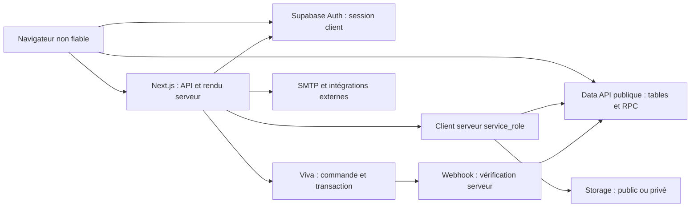

# Audit de sécurité — 10 novembre 2026

> État initial, conservé pour traçabilité. Les constats ci-dessous décrivent le code avant correction. S01–S14 ont été corrigés et déployés le 11 novembre ; les permissions de production ont été vérifiées et l'utilisateur a confirmé la reconnexion administrateur. Voir [SECURITY_FIXES.md](SECURITY_FIXES.md) et le [complément D01–D03 et exploitation](docs/security-closure-2026-11-11.md) pour les preuves et les limites actuelles. Les mentions « non vérifié » du corps historique ne remplacent pas ces contrôles datés.

## Périmètre et conclusion

Audit du dépôt `C:\lesiteinternetquitue`, branche `master`, HEAD `21eaf6e7f632b4df5421a12eb7db6c63ecb9eedd`, **avec les modifications locales présentes**. Les instructions d'AGENTS.md et les guides Next.js installés sur les données serveur et Route Handlers ont été lus. Mission limitée à l'audit : seuls ce rapport, deux annexes et des tests isolés ont été ajoutés. Aucun correctif applicatif, changement de dépendance/configuration, déploiement, paiement, remboursement, email ou mutation distante n'a été réalisé.

**Priorité immédiate : fermer les anciennes RPC de récompenses, supprimer la création automatique de sessions administrateur dans les routes client et corriger les comparaisons d'email des commandes historiques.** Une création arbitraire d'avantages commerciaux est reproduite avec les permissions SQL par défaut des migrations ; une session client autorisée suffit à contourner le mot de passe administrateur et le TOTP ; un email contenant un joker peut lire ou anonymiser des commandes historiques d'un autre client.

Ces résultats concernent le code et les reproductions locales décrites ci-dessous. **Les ACL, migrations, versions et configurations effectivement déployées sur Supabase/Vercel/Viva ne sont pas vérifiées.** L'audit ne conclut donc ni à une exploitation passée, ni à la sécurité de la production.

### État observé

| Élément | Preuve locale |
|---|---|
| Application | Next.js App Router **16.4.1**, React/React DOM **19.2.3** ; package.json, lockfile et packages installés concordants |
| Données/authentification | Supabase JS **2.95.3**, SSR **0.8.0** ; PostgreSQL **17 demandé par la configuration locale**, version distante inconnue |
| Paiement | **Viva Smart Checkout**, intégration REST dans `src/lib/viva-payment.ts` ; pas de SDK Stripe présumé |
| Hébergement | Configuration Vercel et deux routes cron ; formule Vercel et Supabase Pro annoncées, non vérifiées dans les consoles |
| Autres services | SMTP/Nodemailer **10.2.1**, Printful pour le catalogue, Mondial Relay, Sentry **10.76.2**, fournisseurs de cotations pour le jeu |
| Fichiers / images | Supabase Storage ; sharp **0.35.5**, pdfjs-dist **5.5.207**, pdf-lib **1.17.1**, pdfkit **0.17.2**, FFmpeg |
| Tests | Node local **25.3.0** ; CI déclarée Node **24** ; Vitest installé **4.1.11**, lockfile **4.1.12** ; PGlite **0.5.8** |
| Taille inventoriée | 197 fichiers Route Handler dont 190 API ; 277 méthodes HTTP API repérées ; 371 migrations ; inventaire SQL détaillé dans l'annexe DB |

L'état Git initial comportait **17 fichiers modifiés et 7 non suivis**, principalement le chantier de production du personnel du jeu, package.json et sa nouvelle migration `20261110000100_kq_staff_production.sql`. Le checkpoint `docs/bete-de-concours/ux-progress.json` est également devenu modifié pendant l'audit par une activité extérieure à celui-ci. Aucun de ces travaux n'a été modifié ou réinitialisé par l'audit. Le périmètre n'est pas un commit propre ni une image du déploiement.

Les fichiers `.env.local` et `.env.development.local` existent : seule leur liste de noms de variables a été inventoriée, sans reproduire leurs valeurs ni les utiliser pour tester les services. `.env.example` est le seul fichier d'environnement suivi trouvé. Le dépôt n'a pas été transmis à un scanner externe.

## Cartographie et frontières de confiance



- **Identité client :** `getCurrentSupabaseSessionCustomer/Identity` appelle `auth.getUser()` (`src/lib/supabase/customer-backend.ts:493-547`). La simple présence d'un cookie dans middleware.ts ne constitue qu'un premier filtre ; les routes privées utilisent ensuite la vérification serveur.
- **Identité administrateur :** cookie HMAC distinct, HttpOnly/SameSite Strict, durée quatre heures. Les gardes des routes et pages admin le valident, mais les chemins d'émission et la révocation sont défectueux (S02, S05).
- **Données sensibles :** profils/adresses, commandes et factures, preuves de missions, historiques de mailing, logs d'audit, identifiants de session, prix/remises/points et récompenses. Les opérations Data API applicatives passent majoritairement par `service_role`, qui contourne la RLS : chaque contrôle serveur et chaque ACL de RPC est essentiel.
- **Paiement :** panier → prix, variantes, livraison, TVA et avantages recalculés → commande/identifiant de tentative persistants → Viva → transaction relue côté serveur → RPC de finalisation/verrous/stock → facturation, tickets et avantages. La page de retour ne suffit pas à valider un paiement. Remboursements, contestations bancaires et expédition réelle ne disposent pas d'une chaîne de rapprochement démontrée dans ce périmètre.
- **Accès directs :** le navigateur connaît légitimement la clé publique Supabase. Il peut contourner Next.js et appeler les RPC exposées ; masquer un bouton ou protéger uniquement une route Next.js ne protège pas une RPC publique.

## Tous les constats

« Confirmé » signifie démontré dans le code et, lorsque précisé, dans un environnement local isolé. Cela ne signifie pas « observé en production ». Les efforts sont indicatifs, hors déploiement et reprise de données : petit ≤ 1 jour, moyen 1–3 jours.

| ID | Gravité / preuve | Impact et emplacement principal | Correction minimale / effort |
|---|---|---|---|
| **S01** | **Critique — confirmé localement**, ACL déployées inconnues | RPC privilégiées publiques : fabrication de remises/cadeaux et actions sur une collection tierce. `20260302001300_lottery_all_burn_10.sql:3-119`, `20260302000300_tcg_collection_album_rewards.sql:89-199` | Révoquer les exécutions client sur toutes les signatures ; n'autoriser que le serveur utile ; protéger le barème. Petit + revue historique |
| **S02** | **Élevée — confirmé localement** | Contournement du mot de passe admin et du TOTP via `account/login/route.ts:129-136` et `account/me/route.ts:50-57` | Émission du cookie admin uniquement après la vérification renforcée ; retirer les deux créations automatiques. Petit |
| **S03** | **Élevée — confirmé localement**, présence de commandes historiques nécessaire | Email interprété comme motif : lecture de commandes d'autrui, fidélité indue, anonymisation destructive. `supabase/order-backend.ts:306-312`, `customer-account-deletion.ts:58-67` | Égalité sur email normalisé, ou RPC avec comparaison exacte ; rattachement historique contrôlé. Petit |
| **S04** | **Élevée — suspicion de configuration à vérifier** ; politique permissive reproduite avec GRANT explicite | Un utilisateur peut augmenter ses points si `authenticated` conserve UPDATE sur profiles. `20260215_0001_init.sql:199,287-290` | Vérifier puis retirer les écritures directes inutiles ; permissions par colonne si indispensables. Petit |
| **S05** | **Moyenne — confirmé localement** | Cookie admin copié encore valide après logout ; garde indépendant du compte et de sa révocation. `admin-auth.ts:100-155`, `admin-guard.ts:13-24`, `admin/logout/route.ts:5-14` | Session admin persistante liée au compte, révocable ; invalider à logout/changement des facteurs/retrait d'accès. Moyen |
| **S06** | **Moyenne — confirmé localement** | Notes de modération et email du modérateur publiés aux visiteurs. `supabase/blog-interactions-backend.ts:36-98`, `api/blog/comments/route.ts:23-32` | DTO public distinct, projection SQL minimale, suppression des métadonnées internes. Petit |
| **S07** | **Moyenne — confirmé localement**, dépend du catalogue | Omission de variante : disponibilité contournée et stock de variante non débité. `checkout/viva/route.ts:170-187,240-241`, `20260224000100_fix_inventory_rpc.sql:94-107,152-168` | Variante obligatoire pour ces produits ; persister ID/prix canonique ; rejeter l'absence côté stock. Petit à moyen |
| **S08** | **Moyenne — confirmé localement** | Correction admin « payé » validée avant le stock ; échec laissant payé/sans revue et avantages potentiellement attribués. `supabase/order-backend.ts:578-603` | Transaction verrouillée intégrant paiement, stock et décision de revue ; transitions administratives explicites. Moyen |
| **S09** | **Moyenne — confirmé dans le code et test de route** | Archivage admin d'une commande encore payable ; capture ultérieure non rapprochable normalement. `admin/orders/[orderId]/route.ts:150-161`, `20261108000800_viva_payment_monotonicity.sql:99-105` | Annuler/vérifier chez Viva avant archivage, conserver un traitement de capture tardive. Moyen |
| **S10** | **Moyenne — réponse confirmée**, perte finale à vérifier | Webhook occupé acquitté 200 avant traitement durable. `checkout/viva/webhook/route.ts:240-244`, `20260811000100_checkout_payment_security_hardening.sql:391-393` | 503/Retry-After pour « busy », ou file durable avec reprise indépendante. Petit à moyen |
| **S11** | **Moyenne — confirmé localement** | Newsletter : activation/réactivation d'une adresse tierce et envoi sans preuve de possession ; budget multiplié en changeant l'adresse. `newsletter/subscribe/route.ts:29-30,57-63`, `supabase/newsletter-backend.ts:80-88` | Confirmation signée avant activation ; plafonds séparés IP/destinataire/global ; préserver les désinscriptions. Moyen |
| **S12** | **Moyenne — confirmé localement**, format d'IP distant à vérifier | IPv6 compressées regroupées sous `unknown`, permettant d'épuiser le quota d'autres visiteurs/admins. `security-rate-limit.ts:36,47-66,102-113` | Parseur IP standard et normalisation ; tester IPv4, IPv6 compressée et mappée. Petit |
| **S13** | **Moyenne — confirmé localement sous panne de schéma** | RPC anti-abus manquante : repli mémoire par instance, quotas renouvelables entre workers ; réponse RPC vide acceptée. `security-rate-limit.ts:132-158` | Échec fermé sur les opérations sensibles ; stockage distribué obligatoire, réponse RPC strictement validée. Petit |
| **S14** | **Faible — échec de test reproduit** | Test SQL des droits arrêté avant les assertions par des fixtures obsolètes. `scripts/test-supabase-data-api-grants.mjs:13,62` | Aligner fixtures/sources ; couvrir ACL effectives, signatures et rôles. Petit à moyen |

Les références non préfixées de la colonne emplacement sont sous `src/lib`, `src/app/api` ou `supabase/migrations` selon le fichier ; les sections ci-dessous et annexes donnent les chemins complets. Les points D01–D03 plus bas sont du durcissement, séparés des failles.

## Preuves et corrections détaillées

### S01 — Avantages commerciaux créés par des RPC publiques

La dernière fonction à sept arguments `rpc_burn_duplicate_cards` est SECURITY DEFINER, reçoit `p_user_id` et les paramètres de récompense, et ne vérifie ni l'identité appelante ni son rôle. Aucune révocation de PUBLIC EXECUTE de ce nom, ni de `rpc_claim_collection_page_reward`, n'a été trouvée dans les 371 migrations. PostgreSQL accorde EXECUTE à PUBLIC par défaut ; une RLS active sur les tables ne bloque pas ce chemin privilégié. Voir les [privilèges PostgreSQL](https://www.postgresql.org/docs/current/ddl-priv.html) et la [documentation Supabase des fonctions](https://supabase.com/docs/guides/database/functions).

**Attaque/prérequis :** connaître ses propres cartes obtenues dans le jeu, disposer des doublons nécessaires, appeler directement la RPC avec un avantage hors barème ; ou connaître les UUID pertinents d'une autre collection. L'attaque contre autrui requiert ces identifiants, dont l'énumération n'est pas démontrée. L'exposition distante dépend des ACL et du schéma public réellement exposés.

**Preuve :** le script isolé utilise les corps exacts des fonctions, les rôles anon/authenticated, une RLS active et aucune permission de table client. Le SELECT direct anonyme échoue, mais les RPC consomment des cartes d'un utilisateur fictif et créent un cadeau de 1 000 000 g, puis une remise de 80 %, et sélectionnent une récompense de collection. Des révocations nommées dans la fixture bloquent ensuite les appels. Il ne s'agit pas d'un test exécuté avec service_role pour « prouver » l'isolation.

**Impact monétaire :** `src/lib/supabase/lottery-backend.ts:2404-2421` accepte le bon disponible du propriétaire ; `:553-560` transmet son pourcentage ; `src/app/api/checkout/viva/route.ts:746-810,972-981` le déduit du montant envoyé à Viva. Le prestataire peut donc confirmer correctement un prix commercialement frauduleux. Les cadeaux deviennent aussi des lignes gratuites (`:857-867`). Aucun achat réel n'a été réalisé.

**Correction :** migration ciblée révoquant PUBLIC/anon/authenticated sur toutes les signatures, puis droits minimaux à service_role pour les signatures utilisées. Inventorier et retirer les anciennes surcharges ; ne pas accorder globalement tous les droits de public. Renforcer le calcul du barème dans la frontière serveur/SQL. Examiner ensuite les bons hors barème et les historiques de burn avant utilisation, sans les supprimer aveuglément.

**Test reproductible :** `node scripts/security-audit-2026-11-10-database.mjs`. Après correction, les rôles clients doivent échouer avant mutation ; le serveur doit encore créer uniquement le bon prévu. L'ancienne surcharge à quatre paramètres existe mais son exploitation actuelle n'est **pas** démontrée. [Détails SQL et limites](docs/security-audit-2026-11-10-database.md).

### S02 et S05 — Élévation automatique et sessions administrateur non révocables

`POST /api/admin/login` demande une identité Supabase autorisée, un mot de passe admin scrypt et, si configuré, un TOTP (`src/app/api/admin/login/route.ts:48-78`). Mais **POST /api/account/login et GET /api/account/me créent le même cookie administrateur avec la seule adresse autorisée**. GET me ne demande même pas de mot de passe. Les gardes vérifient uniquement la signature/expiration du cookie (`src/lib/admin-guard.ts:13-24`, `middleware.ts:isAdminAuthorized`).

**Prérequis :** mot de passe client compromis, ou session client valide du compte autorisé. Un client ordinaire ne peut pas choisir un email admin dans son profil : ce contrôle positif a été conservé dans le test. La faiblesse ne permet pas de devenir admin avec une adresse arbitraire non authentifiée, mais neutralise les facteurs supplémentaires censés protéger ce compte.

**Preuve :** `src/test/security-audit/auth.test.ts` exécute les vraies routes, le vrai signataire et le vrai garde, avec une réponse d'identité fictive à la place de Supabase. Malgré un hash admin délibérément invalide et un TOTP configuré, login puis me émettent chacun un jeton accepté. Ce test de logique ne prétend pas valider un JWT Supabase distant.

**Révocation distincte :** le payload HMAC ne contient que version, expiration et nonce. Logout vide le cookie du navigateur sans invalider une copie ; le test rejoue cette copie avec succès. Ni changement de mot de passe/TOTP ni révocation du compte ne sont consultés par le garde pendant les quatre heures de validité. Une rotation du secret nécessite aussi le renouvellement des processus qui ont mis la clé en cache (`src/lib/admin-auth.ts:80-97`).

**Corrections/tests :** retirer les deux créations automatiques ; vérifier qu'une session client autorisée échoue sur l'API admin avant le passage par login admin avec les facteurs requis. Ajouter une session persistante liée à l'utilisateur et un mécanisme de révocation. Tester déconnexion, suppression/retrait du compte, changement des facteurs, expiration et signature falsifiée. Les deux derniers contrôles passent déjà localement.

### S03 — Confusion entre email exact et motif SQL

`listCustomerOrdersForLoyaltyInSupabase` utilise `.ilike("customer_email", safeCustomerEmail)` pour les lignes `customer_id IS NULL` (`src/lib/supabase/order-backend.ts:306-312`). Cette requête alimente l'export (`src/lib/customer-data-export.ts:119-135`) et la fidélité du checkout. La suppression de compte réemploie la même comparaison (`src/lib/customer-account-deletion.ts:58-67`) avant d'effacer les coordonnées.

**Attaque/prérequis :** un utilisateur possède et valide une adresse contenant `_` ou un autre caractère interprété comme motif. Avec `a_b@example.invalid`, SQL ILIKE correspond aussi à `axb@example.invalid`. Les commandes tierces doivent être historiques/non rattachées (`customer_id IS NULL`). Les commandes liées à l'UUID d'un autre utilisateur restent exclues.

**Preuve :** `src/test/security-audit/legacy-email.test.ts` exécute les deux vrais backends avec un adaptateur SQL en mémoire. Deux identités et commandes fictives sont utilisées : la commande historique B est retournée pour A, puis anonymisée par la suppression de A ; la commande B liée reste intacte. Cela démontre la logique et la sémantique PostgreSQL, pas un appel PostgREST avec deux JWT réels. L'export expose les champs effectivement présents dans ce modèle de commande, sans prétendre que ce test couvre toutes les pièces jointes.

**Correction :** comparaison exacte sur email normalisé, idéalement via colonne normalisée/indexée ou RPC serveur utilisant `lower(email) = lower(p_email)`. Le dépôt applique déjà cette approche pour l'éligibilité concours (`supabase/migrations/20261004000100_contest_data_api_hardening.sql:90-105`). Couvrir `_`, `%`, `*`, la casse, les commandes rattachées/non rattachées, l'export, l'anonymisation et la fidélité.

### S04 — Permissions de profil potentiellement trop larges

La RLS de `profiles` vérifie le propriétaire mais ne distingue pas les colonnes personnelles des points. Un GRANT UPDATE historique sur toute la table autoriserait un client à modifier ses valeurs de fidélité. Le rattrapage des permissions de septembre préserve les ACL client existantes ; leur état distant n'est pas connu. Le script DB démontre la modification sous rôle authenticated avec `request.jwt.claim.sub`, **après ajout explicite du GRANT comme prérequis**. Il ne prouve pas que ce GRANT existe en production.

Les PATCH de profil Next.js filtrent correctement les champs via `src/lib/account-profile.ts:parseCustomerProfilePatch` ; ils ne ferment pas un accès Data API direct. Puisque l'application écrit avec service_role, retirer les écritures client inutiles est la correction la plus simple. Tester les colonnes de points et de dépenses sur son propre profil, ainsi que toute écriture sur le profil B. [Preuve et emplacement des politiques](docs/security-audit-2026-11-10-database.md).

### S06 — Métadonnées de modération dans l'API publique

`GET /api/blog/comments?postId=...` retourne sans authentification le résultat de `getApprovedBlogCommentsByPostId`. Ce backend réutilise le DTO de modération : `adminNote`, `reviewedBy`, UUID client et identité du commentateur. `reviewedBy` provient de `context.email` lors de la modération (`src/app/api/admin/blog/comments/route.ts:51-52`). Le filtrage `status=approved` est présent, mais ne filtre pas les colonnes.

Le test `public-data.test.ts` montre les notes et l'email fictifs dans la réponse anonyme réelle. Gravité moyenne : confidentialité des notes si elles sont renseignées et exposition d'identifiants internes ; aucune fuite massive de profils complets n'est déduite. Utiliser une projection/structure publique explicite ; vérifier que les champs internes sont absents du JSON, même si l'interface ne les affiche pas.

### S07–S10 — Paiements, stock et reprise

Les reproductions et chemins complets figurent dans [l'annexe paiements](docs/security-audit-2026-11-10-payments.md). Aucun de ces constats ne signifie qu'un statut envoyé par le navigateur suffit à fabriquer un paiement Viva.

- **S07 :** dans la fixture, la variante explicitement désactivée reçoit 400 ; le même produit envoyé sans variante reçoit 200 au prix de base. La vraie RPC de stock retourne `applied=true`, `processed_items=0` et laisse le stock de variante inchangé lorsque le suivi de stock du produit de base est désactivé. Vérifier aussi les packs contenant des produits à variantes. Test : `payments-variant-omission.test.ts`.
- **S08 :** une correction admin écrit payé, puis appelle séparément le stock. L'échec du second appel ne restaure pas le premier ; certains triggers de récompense peuvent déjà avoir vu payé/sans revue. Les changements admin ne bénéficient pas des garanties de monotonie de la finalisation Viva. Exiger une transition transactionnelle et vérifier paiement/revue avant expédition. Test local du backend avec commit simulé : `payments-admin-boundaries.test.ts` ; un test intégral des triggers reste requis.
- **S09 :** l'archivage admin ne passe pas par l'annulation Viva, contrairement à l'annulation client. Une session de paiement encore ouverte ou une notification retardée peut aboutir à une capture exclue du finaliseur par `archived_at`. Tester annulation/capture concurrentes et rapprocher les captures tardives ; ne pas se contenter de masquer la commande. Test de route dans `payments-admin-boundaries.test.ts`.
- **S10 :** un événement déjà en cours obtient 200 pendant son bail de dix minutes. Si le premier worker s'arrête et que Viva cesse ses retries après ce 200, l'opération peut rester incomplète. Le 200 prématuré est reproduit ; la politique de retry distante et la perte finale sont non vérifiées. Test : `payments-webhook-busy.test.ts`. Une file durable ou un 503 avec reprise est nécessaire.

### S11–S13 — Abus et disponibilité

**Newsletter (S11).** L'adresse libre est immédiatement upsertée `active`, même si elle était désinscrite, puis un email est envoyé. Aucun token de confirmation de possession n'est exigé. Le quota porte sur le couple IP/adresse ; changer d'adresse donne un budget neuf. Le service de mailing utilise ensuite les statuts active/unsubscribed (`src/lib/mailing-backend.ts:100-110`, `src/lib/mailing-policy.ts:22`). `public-data.test.ts` reproduit activation et demande d'envoi avec SMTP simulé ; aucun email n'a été envoyé. Ajouter double confirmation, séparation des budgets, délai par destinataire et réponse neutre plutôt que révéler `alreadySubscribed`. L'inscription de compte présente aussi un quota IP/email uniquement (`src/app/api/account/register/route.ts:35-38`), mais les limites propres à Supabase Auth peuvent réduire l'abus et restent à vérifier.

**IPv6 (S12).** Le regex actuel refuse les adresses compressées telles que `2001:db8::1`, validées pourtant par `node:net.isIP`. Elles deviennent `unknown` même lorsque x-real-ip fournit la même adresse correcte. Des requêtes anonymes peuvent alors consommer le quota IP de login admin avant l'authentification (`src/app/api/admin/login/route.ts:20-25`) et affecter d'autres clients dans ce groupe. Le test vérifie la collision ; le format délivré en production n'a pas été observé. Ne pas confondre ce défaut avec une usurpation de X-Forwarded-For : la [documentation Vercel](https://vercel.com/docs/headers/request-headers) précise que la plateforme le réécrit par défaut. Aucun contournement par simple en-tête forgé n'est affirmé sur Vercel.

**Repli distribué (S13).** Quand la RPC de limitation manque, chaque processus utilise sa Map locale ; la limite n'est donc plus commune aux workers Vercel. `rate-limit.test.ts` démontre qu'une seconde instance accorde un budget neuf après épuisement de la première. Une réponse RPC vide autorise également la requête. Le fonctionnement normal utilise bien PostgreSQL ; le défaut est conditionnel à une migration absente/dégradée, pas une affirmation que les quotas de production sont actuellement locaux. Retourner une erreur contrôlée et alerter dans ce cas ; tester panne/absence, réponse vide, concurrence et partage du quota.

## Matrice d'accès

Matrice attendue et vérifiée au niveau des chemins de code ; **aucune campagne HTTP avec les JWT A/B d'un Supabase déployé n'a été effectuée**. Les tests de rôle SQL sont explicités pour S01/S04.

| Ressource / opération | Visiteur | Client A | Client B visant A | Administrateur | Preuve / exception |
|---|---|---|---|---|---|
| Profil / adresse via API privée | Refus | Lire/modifier champs personnels A | Pas de propriétaire arbitraire dans PATCH | CRUD contrôlé | auth.getUser, parseCustomerProfilePatch ; S04 pour API DB directe |
| Commandes liées / reprise / annulation / facture | Refus | Propriétaire + conditions paiement | Refus par customerId | Accès admin | Routes account/orders et invoice ; tests facture ; S08/S09 transitions admin |
| Commandes historiques dans export/fidélité | Refus | Email A attendu | **Fuite/anonymisation possible avec motif** | Accès admin | S03 |
| Export / suppression de compte | Refus | Identité de session, confirmation email à la suppression | ID cible non fourni par client | Pas de droit implicite sur route client | Tests export/delete ; pas de réauthentification récente exigée |
| Cartes / avantages via Next.js | Refus | Propriétaire vérifié | Contrôles d'appartenance | Gestion autorisée | Ces contrôles sont contournables par les RPC S01 |
| Anciennes RPC de récompense | **Exécution possible dans fixture** | Montant et propriétaire déclarés | Identifiants tiers exploitables s'ils connus | service_role légitime | S01, ACL distantes à établir |
| Preuves de missions | Pas de lien arbitraire | Upload sous UUID A | Préfixe utilisateur vérifié | Lecture par liens signés courts | Bucket privé ; admin/missions ; annexe DB |
| Média de catalogue / PDF d'analyse publié | Lecture publique voulue | Idem | Idem | Upload/gestion protégés | Buckets publics ; absence de documents privés historiques à vérifier |
| Commentaires approuvés | Lecture publique | Idem, ajout après login | Pas d'édition d'autrui démontrée | Modération | S06 métadonnées internes renvoyées |
| Mailing / exports logistiques / administration | Refus | Refus sauf compte autorisé élevé automatiquement | Refus | Garde admin | S02 et S05 fragilisent cette frontière |

## Contrôles positifs et couverture ASVS adaptée

Grille thématique inspirée d'OWASP ASVS, sans certification ni affirmation de couverture exhaustive de tous ses contrôles. « Vérifié » reste limité aux preuves locales indiquées.

| Domaine | Couverture | Preuves ou limites |
|---|---|---|
| Prix, quantité, devise, frais, taxes, remises | Partiellement vérifié | Recalcul serveur, bornes et tests checkout/TVA existants ; défauts S01/S03/S07 ; pas de catalogue/tarification déployés |
| Confirmation et liaison transaction/commande | Vérifié dans code/tests | Transaction récupérée chez Viva, comparaison identifiants/source/devise EUR/montant/statut ; pas d'autorité du retour navigateur |
| Authenticité webhook / test-production | Partiellement vérifié | Relecture indépendante chez le prestataire avant mutation ; ne pas exiger artificiellement une signature de corps propre à un autre prestataire. Valeurs réelles des clés/source/marchand et configuration webhook inconnues |
| Rejeu, idempotence, concurrence, stock | Partiellement vérifié | Tentatives/webhooks persistants, verrous SQL, stock idempotent, monotonie des callbacks testée ; S07–S10 ; pas de test multi-connexion sur PostgreSQL réel |
| Livraison, remboursements, chargebacks | Non vérifié pour le cycle complet | Aucun rapprochement exhaustif/remboursement prestataire ou réversion des avantages démontré ; procédures et outils externes inconnus |
| Récompenses et fidélité monétisables | Partiellement vérifié | S01/S03/S04 ; verrous et reçus des voies récentes examinés. Pas de simulation exhaustive de toute l'économie du jeu |
| Sessions/JWT, récupération, email | Partiellement vérifié | getUser côté serveur, PKCE callback, verifyOtp recovery/setSession puis updateUser ; redirections bornées ; logout Supabase. Durée/révocation effectives, email confirmé, modification sécurisée et MFA Auth distants inconnus |
| Authentification/autorisation admin | Vérifié dans code/tests | Gardes serveur présents, hash scrypt, signature/expiration ; S02/S05 et TOTP optionnel selon configuration |
| Entrées HTTP, pages, crons | Partiellement vérifié | Inventaire des 190 routes API/277 méthodes, examen des gardes directs et helpers ; deux crons exigent CRON_SECRET avec comparaison constante. Pas de fuzzing exhaustif de chaque méthode |
| Actions serveur | Non applicable aux sources trouvées | Pas de directive `use server` dans les sources applicatives recherchées ; ne pas extrapoler aux mécanismes internes Next.js |
| Isolation clients / mass assignment | Partiellement vérifié | PATCH en liste blanche, identité serveur, factures propriétaires ; S03/S04 ; absence de test JWT A/B PostgREST complet |
| Tables, grants, RLS, vues, RPC | Partiellement vérifié | Inventaire des dernières définitions et conventions, 232 noms de tables avec RLS, six vues invoker, search_path des definer ; S01/S04/S14 ; pas de rejeu complet ni de catalogue distant |
| Storage / uploads | Partiellement vérifié | Preuves privées, images réencodées, MIME/poids/pixels, UUID, signature dix minutes après garde admin ; autres buckets volontairement publics. Contenu existant et ACL distantes non vus |
| Realtime / Edge Functions Supabase | Non applicable aux usages trouvés ; configuration distante non vérifiée | Pas d'abonnement client ni fonction Edge Supabase applicative trouvés ; Realtime activé dans le fichier local uniquement |
| SQL/commandes/chemins/SSRF | Partiellement vérifié | Requêtes SDK paramétrées ; S03 est une confusion de motif, pas une injection SQL arbitraire. FFmpeg via spawn avec arguments, endpoints fournisseurs issus de configuration, chemins upload contrôlés. Pas de fuzzing des parseurs PDF/vidéo |
| XSS / contenu | Partiellement vérifié | React échappe le texte ; JSON-LD échappe `<`, `>` et séparateurs ; script inline de debug seulement hors production ; pas de chemin XSS exploitable confirmé |
| CSRF / CORS / cookies / HTTPS | Partiellement vérifié | Origin exigé sur mutations account/admin/checkout/jeu, contrôles supplémentaires sur plusieurs routes ; SameSite, Secure en production pour cookie admin ; pas de CORS privé permissif identifié. Les routes blog mutatives reposent notamment sur SameSite, sans contrôle Origin équivalent |
| Cache/CDN/SSR | Partiellement vérifié | GET Route Handlers non cachés par défaut selon guide installé, appels cookies dynamiques ; caches explicites centrés sur données publiques, export/factures no-store. Pas de trace CDN réelle ; ajouter no-store explicite aux réponses privées qui l'omettent |
| Secrets / bundles / logs | Partiellement vérifié | Scan local ciblé de 2 637 fichiers texte suivis sans résultat sur motifs de clés privées/JWT/secrets fournisseurs ; historique ciblé des .env sensible sans commit trouvé. Pas de scan exhaustif Git/bundles/logs ; clé anon publique normale |
| Confidentialité des réponses | Partiellement vérifié | Catalogue public distinct sans commandes, blog publié filtré ; S03/S06 ; erreurs SQL brutes sur certaines routes à réduire sans fuite de secret démontrée |
| Dépendances / CI/CD | Partiellement vérifié | Versions réelles/lock inspectées, CI lint/types/tests/grants/audit déclarée ; avis officiels précis consultés. D01 et écart Vitest ; aucun scan distant du lockfile |
| Abus / ressources facturées | Partiellement vérifié | Limites PostgreSQL et quotas de plusieurs opérations, contrôles corps sur missions/banque/social ; S11–S13, D02 ; limites fournisseur/WAF distantes inconnues |
| Journalisation, alertes, restauration | Partiellement / non vérifié | Audit logs et Sentry sans PII par défaut/replay configurés ; D03 ; aucune preuve d'alerte opérationnelle ou restauration testée |
| Suppression / conservation / sauvegardes | Partiellement vérifié | Parcours de suppression nettoie preuves, mailing et identité, anonymise commandes ; S03 ; pas de revue juridique, pas de preuve de purge des backups/logs ni d'échéance de conservation |
| Isolation preview/production et consoles | Non vérifié | Pas d'accès aux scopes d'environnement, rôles, MFA consoles, protection preview, branch protections ou réglages dashboard |

### D01–D03 — Durcissement et configurations à confirmer

- **D01 — Dépendances.** Next **16.4.1** est dans les plages d'avis du 3 novembre 2026 corrigés en **16.4.5**, notamment [SVG optimizer](https://github.com/vercel/next.js/security/advisories/GHSA-7qx7-33qx-rqx2), [cookies HttpOnly sur routes Edge](https://github.com/vercel/next.js/security/advisories/GHSA-f3mh-rxg3-f5g2), [réponses proxy auto-hébergées](https://github.com/vercel/next.js/security/advisories/GHSA-pc58-hwjq-p385), [cache binaire](https://github.com/vercel/next.js/security/advisories/GHSA-rhh4-g77r-r9qj) et [fallback Cache Components](https://github.com/vercel/next.js/security/advisories/GHSA-vvgp-ww4w-46vf). Aucun chemin exploitable correspondant n'est établi ici : hébergement Vercel annoncé, pas de Route Handler Edge explicite ni de Cache Components/use cache trouvé. `unstable_cache` seul n'établit pas le prérequis Cache Components. Prévoir une montée testée vers une version corrigée au minimum pour ces avis. Les [corrections Next du 14 octobre](https://nextjs.org/blog/nextjs-security-update-october-14-2026) sont présentes dans la version locale ; sharp 0.35.5 est installé. Ne pas attribuer automatiquement une faille RSC à `react:19.2.3` : l'[avis React](https://react.dev/blog/2025/12/11/denial-of-service-and-source-code-exposure-in-react-server-components) vise les paquets react-server-dom concernés, et Next embarque son implémentation. Vérifier l'artefact exact déployé. Pas d'avis CVE inventé ni de conclusion « toutes dépendances saines ».
- **D02 — Limites de corps.** `src/lib/body-size-guard.ts:7-25` ne lit que Content-Length et accepte son absence. Plusieurs routes font ensuite request.json/formData. Réutiliser les lecteurs réellement bornés déjà présents dans missions/mailing/banque/social. L'impact est limité par les protections de plateforme à vérifier et, pour les uploads admin, par l'authentification ; aucun test de charge ni déni de service de production.
- **D03 — Traces durables.** `src/lib/audit-log.ts:65-89` lance l'INSERT sans await ni garantie de fin d'invocation. Les événements peuvent être perdus selon le cycle de vie serveur ; aucune perte distante reproduite. Utiliser un mécanisme garanti par la plateforme ou une insertion attendue pour les opérations sensibles, définir rétention et alertes utiles. En CI, épingler les actions à des SHA et déclarer les permissions minimales serait un durcissement ; les workflows observés n'envoient pas de secrets de production à un job pull_request et utilisent npm ci.

## Tests réellement exécutés

Avant exécution, les tests sélectionnés ont été inspectés : dépendances réseau remplacées par mocks, SQL en mémoire et données fictives. Les nouveaux tests interdisent fetch ; le script DB n'emploie aucune URL/clé. Les fichiers .env n'ont pas été chargés pour contacter des services. Aucun serveur Next n'a été lancé avec ces configurations.

| Validation | Résultat | Limite de preuve |
|---|---|---|
| Auth, données, middleware, crons, uploads, mailing : 21 fichiers Vitest | **262 tests réussis** | Mocks d'identité/fournisseurs ; vrais handlers et contrôles concernés |
| Email historique : 1 fichier Vitest | **2 tests réussis** | Vrais backends, adaptateur vers PGlite ; pas de PostgREST distant |
| Paiements/factures : 10 fichiers Vitest | **117 tests réussis** | Inclut RPC de stock/états en PGlite ; pas de transaction Viva réelle |
| Total unique Vitest | **381 tests, 32 fichiers réussis**, dont 16 nouveaux tests d'audit | Certaines assertions démontrent le comportement vulnérable et devront être inversées après correction |
| `node scripts/security-audit-2026-11-10-database.mjs` | **Réussi** | Rôles réels dans PGlite, fixtures réduites, corps exacts, contrôles négatifs après révocations locales |
| `node scripts/check-supabase-grants.mjs` | **Réussi sur 371 migrations** | Convention des tables, pas preuve des ACL RPC ni de production |
| `node scripts/test-supabase-data-api-grants.mjs` | **Échec avant assertions** | `mailing_recipients` absent de la fixture historique : S14, pas preuve d'un grant manquant |
| ESLint sur `src/test/security-audit` et le script DB ajouté | **Réussi** | Nouveaux fichiers seulement |
| `tsc --noEmit --incremental false` | **Réussi** | Vérification de types du workspace observé, sans modifier le cache TypeScript |

Vitest affiche un avertissement préexistant sur le futur chargement natif de sa configuration ; pas un échec. L'exécutable installé a été conservé en 4.1.11. Aucun npm install, npm audit distant, build/deploy ou test de charge n'a été effectué. Les tests ne remplacent pas les validations de rôles/JWT en environnement de recette.

Reproductions ciblées, depuis la racine, avec les dépendances déjà installées :

```powershell
.\node_modules\.bin\vitest.cmd run src/test/security-audit
node scripts/security-audit-2026-11-10-database.mjs
node scripts/check-supabase-grants.mjs
```

Les commandes complètes des tests de paiement sont conservées dans l'annexe paiements. La sélection complémentaire comprenait `account-profile`, `customer-data-export`, `customer-account-deletion`, `admin-auth`, `security-rate-limit`, `safe-next-path`, `body-size-guard`, `mailing-routes`, `mission-proof-storage`, `product-analysis-storage`, les routes account me/export/delete, auth callback, les deux crons, middleware-policy et next-config-security.

## Plan de correction priorisé

1. **P0 — Fermer la frontière DB des récompenses (S01).** Vérifier les ACL déployées en lecture seule, préparer la migration nommée sur toutes les signatures, tester sous anon/authenticated/service_role, puis déployer selon la procédure habituelle. Examiner les avantages hors barème avant leur utilisation. L'audit n'a exécuté aucune de ces mutations distantes.
2. **P0 — Restaurer l'authentification admin renforcée (S02), puis sa révocation (S05).** Supprimer les deux créations automatiques. Après correction, invalider les sessions existantes selon le mécanisme retenu ; vérifier TOTP configuré et session attachée au compte autorisé.
3. **P0/P1 — Isoler les commandes historiques et les points (S03/S04).** Remplacer ILIKE par égalité ; vérifier les ACL par colonne ; tester A/B, export et suppression sur fixtures avant mise en service.
4. **P1 — Supprimer la fuite publique S06 et fiabiliser les états de paiement S07–S10.** Priorité à la validation des variantes, à la transition admin transactionnelle et aux callbacks occupés. Ajouter le rapprochement des captures tardives/archivées et vérifier le traitement des remboursements/chargebacks.
5. **P1/P2 — Réduire les abus (S11–S13).** Confirmation newsletter et plafonds séparés, vrai parseur IP, échec fermé du limiteur distribué. Vérifier la configuration Supabase Auth et les protections Vercel.
6. **P2 — Rendre la preuve durable (S14, D01–D03).** Tests ACL à jour, mise à niveau Next testée, limites de flux, logs fiables et exercice de restauration. Ne pas substituer un scanner à ces tests métier.

## Vérifications externes restantes et informations minimales

Ces vérifications doivent d'abord être **en lecture seule**. Les validations actives A/B, concurrence, remboursements et fournisseurs exigent une recette isolée avec identités et moyens de paiement de test, sans données réelles.

| Système | À obtenir / vérifier | Information minimale, sans partager les secrets |
|---|---|---|
| Supabase DB | ACL de toutes les signatures des deux RPC, propriétaire, SECURITY DEFINER, search_path, schémas exposés | Résultats des requêtes catalogue ci-dessous, liste des migrations appliquées ; aucune ligne client |
| Supabase profiles | GRANT/permissions par colonne de anon/authenticated/service_role ; politiques effectives | ACL/RLS et liste des colonnes sensibles ; ensuite JWT A/B de recette manipulés seulement dans le banc de test |
| Supabase Auth | Confirmation email, changement d'email sécurisé, réauthentification, rotation/révocation, TTL JWT, MFA, captcha et quotas | Export/saisie des réglages non secrets ; `supabase/config.toml` local ne prouve pas le dashboard |
| Supabase Storage/Realtime | Buckets publics/privés, règles d'écriture, documents historiques, publications et politiques | Métadonnées/configuration, aucun téléchargement de preuve client requis initialement |
| Vercel | Commit/build réellement en production, Node/runtime, scopes preview/production, variables isolées, protection preview, WAF et IP reçues | Identifiants de déploiement et réglages non secrets ; une requête témoin autorisée en recette pour les en-têtes/cache |
| Viva | Environnement, source rattachée au marchand, webhook et mécanisme de vérification/retry, captures tardives, refunds/chargebacks | Réglages expurgés, événements de sandbox, jeu de commandes fictives et documentation du compte ; pas de PAN/CVV ni secret |
| Livraison / comptabilité | Blocage expédition des commandes unpaid/review, états Printful/transporteur externes, rapprochement et remboursement | Description des outils et procédures, exemples fictifs, états autorisés |
| Exploitation | Alertes, durées des logs/backups, droits consoles/CI, sauvegardes et restauration | Politiques, rôles sans identifiants personnels, preuve d'un exercice de restauration en environnement isolé |

Exemples de requêtes catalogue **non exécutées sur le projet distant**, sans lecture de données clients :

```sql
SELECT p.oid::regprocedure AS signature, p.prosecdef, p.proconfig,
       has_function_privilege('anon', p.oid, 'EXECUTE') AS anon_execute,
       has_function_privilege('authenticated', p.oid, 'EXECUTE') AS authenticated_execute,
       has_function_privilege('service_role', p.oid, 'EXECUTE') AS service_execute
FROM pg_proc p JOIN pg_namespace n ON n.oid = p.pronamespace
WHERE n.nspname = 'public'
  AND p.proname IN ('rpc_burn_duplicate_cards', 'rpc_claim_collection_page_reward');

SELECT column_name,
       has_column_privilege('authenticated', 'public.profiles', column_name, 'UPDATE') AS client_update
FROM information_schema.columns
WHERE table_schema = 'public' AND table_name = 'profiles';

SELECT schemaname, tablename, policyname, roles, cmd, qual, with_check
FROM pg_policies WHERE schemaname = 'public' AND tablename = 'profiles';
```

## Inventaire conservé et reprise

- Rapport principal : ce fichier ; SQL/Storage : [annexe DB](docs/security-audit-2026-11-10-database.md) ; commandes/paiements : [annexe paiements](docs/security-audit-2026-11-10-payments.md).
- Preuves : sept fichiers dans [src/test/security-audit](src/test/security-audit), plus [script SQL isolé](scripts/security-audit-2026-11-10-database.mjs). Ils ne corrigent pas les failles.
- Travaux terminés : cartographie, revue prioritaire, inventaire des entrées/permissions, reproductions locales, matrice et plan. Incertitudes restantes : configuration/artefact déployés, JWT A/B réels, remboursements, concurrence multi-connexion, historiques et restauration.
- Prochaine tâche bornée : **vérifier les ACL effectives de S01/S04 puis préparer les corrections P0 avec tests de refus des rôles clients**. Ne pas recommencer l'audit complet ni modifier le checkpoint UX pour reprendre cette mission.
