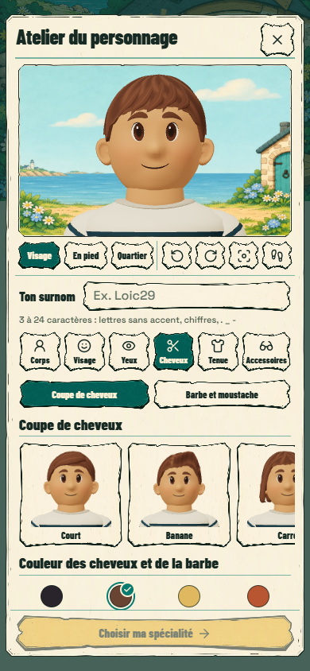
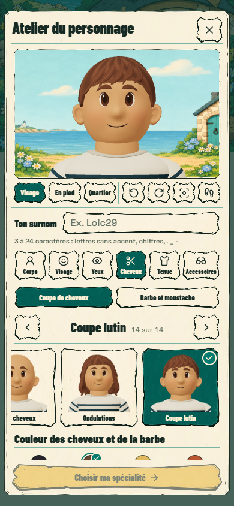

# Retrouver sa coiffure dans l’atelier

Recette locale du 25 novembre 2026. Depuis l’entrée du Quartier, ouvrir l’atelier, choisir **Cheveux → Coupe lutin**, passer à **Yeux** puis revenir à **Cheveux**. Avant la correction, le portrait gardait la coupe lutin mais le bandeau revenait à « Court ». À 390 px, seules « Court » et « Banane » étaient entièrement visibles. Le choix enregistré se trouvait en quatorzième position.

| Avant, 390 × 844 | Après, même profil et même fenêtre |
| --- | --- |
|  |  |

Le bandeau montre le nom et la position de la coupe portée. Les flèches de 44 × 44 px permettent de passer d’une coupe à la voisine et de parcourir tout le catalogue en boucle. Le joueur peut aussi toucher une vignette, faire défiler la rangée ou annuler son choix. La sélection revient dans le cadre à la réouverture et au redimensionnement. Le même geste utilise le brouillon et l’historique du vestiaire. La confirmation finale enregistre le profil.

La planche de référence de l’atelier distingue la coiffure de sa teinte, avec un gros plan stable et une coche sur le choix actif. L’implémentation reprend les enseignes en papier, les titres Barlow Condensed et le texte Space Grotesk, l’encre `#172923` et le turquoise `#087b70`. Les vignettes et le portrait représentent le modèle habillé du jeu. [Références de l’atelier](atelier.json)

## Parcours et preuves

La page serveur `src/app/arene/placard/page.tsx` contrôle la session. `ArenaGameEntry` et `QuarterCharacterGate` ouvrent l’aventure, `ChanvrierProfileEditor` porte le brouillon et `PlacardPlayerShell` pilote les destinations. Les Route Handlers utilisent les services Supabase et les RPC PostgreSQL. Les assets du jeu sont dans `public/placard` et `public/contest`. Le lockfile fixe Next.js 16.4.6, React 19.2.3, Three.js 0.187.0, Fiber 9.8.1, Supabase JS 2.95.3 et SSR 0.8.0. `vercel.json` contient la configuration d’hébergement. Le poste exécute Windows PowerShell 5.1, Node 25.3.0 et Puppeteer Core 25.16.0. ImageGen et Runway sont exposés dans la session. Les maillages procéduraux et les références existantes ont suffi. Blender était absent du PATH et de son emplacement Windows usuel.

| Axe | Observation et portée |
| --- | --- |
| Interface | Vignette choisie entièrement visible sur **0/5** fenêtres avant, **5/5** après. Portraits 320 × 640 et 390 × 844, paysage 844 × 390, tablette 768 × 1024, bureau 1360 × 900. Captures inspectées. |
| Navigation | La recette d’arrivée exerce annulation, retour du focus, erreur, réessai, rechargement, compte différent et stockage indisponible. La recette du menu exerce onze destinations, le retour à l’Arène, le clavier, le tactile et le menu de nuit. Le shell et son canvas sont réels. Les écrans métier de destination et les API de cette recette sont simulés. |
| Personnages et 3D | Le créateur et les intérieurs utilisent Three.js directement. Le village utilise `VillageCanvas` avec React Three Fiber et `frameloop="demand"`. L’atelier, le village et la salle de culture partagent `createGrowWorker`. Drei et le chargement glTF sont absents des chemins inspectés. [Rendu à la demande de Fiber](https://r3f.docs.pmnd.rs/advanced/scaling-performance) |
| Plaisir et progression | Les 14 coiffures se parcourent par deux commandes, avec un portrait immédiatement comparable. La première arrivée enchaîne grange, personnage, spécialité définitive et guide facultatif. Culture, stockage, équipements, cartes à collectionner, quiz, encyclopédie et classements ont leurs composants dans le dépôt. Compréhension, plaisir perçu et équilibre à long terme restent à observer avec des joueurs. |
| Performance | Deux passages par version et par taille sur le même PC, après préchauffage. Chiffres ci-dessous. Téléphone physique et réseau cellulaire non vérifiés. |
| Sauvegardes | Reprise après rechargement, confirmation, refus puis réessai testés avec une API locale simulée. Chaque parcours de création réussi envoie un seul POST. Sur PGlite, les tests du projet vérifient le capital unique et les anciens profils. Une session multiappareil avec une véritable connexion Supabase reste à éprouver. |
| Intégrité | Session et identité vérifiées côté serveur, catalogue validé à la lecture et à l’écriture. La spécialité et le capital initial relèvent de la transaction PostgreSQL. Les dates proviennent de la base. Le bouton aléatoire du vestiaire choisit des éléments cosmétiques. Le classement utilise le profil pour afficher un avatar. Aucun tirage de récompense n’intervient dans ce parcours. |

### Mesures du créateur

Chrome headless 157.0.8103.79 sous Windows, Intel Iris Xe via ANGLE/D3D11, DPR 1. Les deux serveurs de test chargent les composants d’entrée et du créateur du dépôt. Même navigateur, même profil fictif, cache HTTP désactivé, deux passages alternés de trois secondes par version et par taille. Le portrait est au repos avec ses animations normales. Les intervalles sont pris entre rendus WebGL du grand aperçu. Les appels GL excluent les vignettes. Le tas et les ressources couvrent la page entière.

| Fenêtre et version | Entrée → aperçu utilisable¹ | Frame médiane / p95 | Frames > 50 ms | Appels GL / image | Tas JS | Ressources / corps des images WebP et polices |
| --- | --- | --- | --- | --- | --- | --- |
| 390 × 844 avant | 1,44–1,61 s | 16,7 / 17,0 ms | 0 | 11 | 36,5–54,7 Mio | 94 / 563 774 octets |
| 390 × 844 après | 1,29–2,75 s | 16,6–16,7 / 17,0–17,4 ms | 0 | 11 | 44,7–61,2 Mio | 94 / 563 774 octets |
| 1360 × 900 avant | 0,71–0,90 s | 16,7 / 17,1 ms | 0 | 11 | 70,1–73,0 Mio | 95 / 614 674 octets |
| 1360 × 900 après | 1,01–1,17 s | 16,7 / 17,1–18,0 ms | 0 | 11 | 64,5–80,1 Mio | 95 / 614 674 octets |

¹ Depuis la navigation locale jusqu’au premier état 3D prêt, avec le clic automatisé sur « Créer mon personnage ». Les transferts du serveur Vite augmentent de 8 392 octets aux deux tailles et comprennent ses modules de développement. L’API de tutoriel est simulée en mémoire. Ces échantillons courts permettent de contrôler le rendu et ne suffisent pas pour conclure sur le temps de chargement en production. [Mesures brutes locales](../../../output/atelier-20261125/mesures.json)

La recette complète du studio a également enregistré le personnage sur sa fixture, rouvert son apparence depuis le village et rendu le modèle habillé dans la salle de culture et la boutique. L’aperçu en marche atteint 60 images/s aux deux tailles, avec un p95 de 17,6 ms sur environ 2,4 s. La recette vérifie le repli fixe en désactivant WebGL. L’inspection de la coupe lutin à 0°, 45° et 90° porte sur la silhouette, le visage et le raccord aux oreilles dans le créateur. Une revue exhaustive de chaque coiffe et de chaque déformation reste ouverte. [Rapport du studio](../../../output/atelier-20261125/studio/report.json) · [Face](../../../output/atelier-20261125/face.png) · [Trois quarts](../../../output/atelier-20261125/trois-quarts.png) · [Profil](../../../output/atelier-20261125/profil.png)

## Rejouer et poursuivre

`node scripts/audit-quarter-character-entry.mjs` lance les 14 groupes de recette depuis la grange, avec une API fictive. Le cas coiffure vérifie les flèches au clavier, le focus visible, le tactile émulé et la rotation de fenêtre à 320 px. `node scripts/audit-placard-navigation.mjs --quarter-menu` couvre les destinations. `npm.cmd run audit:village -- --avatar-studio` exerce le modèle dans les scènes. `node scripts/test-chanvrier-customization.mjs` vérifie le contrat SQL en mémoire. [Recette d’arrivée](../../../output/quarter-character-entry/report.json) · [Recette du menu](../../../output/placard-navigation/quarter-menu-report.json)

Le build Next a produit ses 158 pages statiques, le typage global et le lint ciblé sont passés, ainsi que 41 tests Vitest du profil, de ses routes et du modèle. Le build isolé a journalisé des lectures de catalogue Supabase indisponibles. Les connexions distantes étaient neutralisées. Avec `next start`, la route anonyme a fourni la redirection de connexion en HTML et l’enseigne turquoise a répondu en HTTP 200. Les avertissements PostCSS, `THREE.Clock` et `onNavigate` de la recette locale sont consignés dans ses sorties.

La branche `feat/atelier-quartier-codex` sépare le socle préexistant `64e92db7`, l’installation `470cbd11` et le lot de jeu. Pour retirer le lot, utiliser `git revert` sur le commit « Retrouver la coiffure choisie dans l’atelier du Quartier ». Pour retirer aussi le nouvel environnement, utiliser ensuite `git revert 470cbd11`. Les trois spécialistes locaux sont versionnés dans le premier commit. [Équipe Codex](../equipe-codex.md) · [Manifeste tiers](../../../.agents/third-party/awesome-gamedev-agent-skills/manifest.json)

| Priorité | Constat, coût et risque | Vérification attendue |
| --- | --- | --- |
| Livré · forte confiance | Dans `ChanvrierWardrobe.tsx`, le remontage du champ réinitialisait le défilement horizontal. Impact immédiat sur la comparaison des coupes. Faible coût et faible risque, correction limitée au sélecteur et à sa CSS. | Le même choix est visible après changement de rubrique et rechargement. Le focus, le cadrage et l’unicité de l’enregistrement sont conservés. |
| Corrigé localement · impact confirmé | Deux modifications simultanées du surnom pouvaient faire échouer une des sauvegardes. La migration du 25 novembre aligne l’ordre des écritures. | Deux sessions PostgreSQL indépendantes aboutissent et les deux profils affichent le même surnom. |
| Puis · impact moyen, confiance forte sur le code | La RPC d’apparence v2 remplace l’objet complet. Deux éditions ouvertes sur des états différents peuvent perdre une retouche. Effort moyen et risque de compatibilité. Voir `20261118000500_chanvrier_appearance_v2.sql`. | Essayer deux éditions de test. Évaluer une révision serveur et la conservation du brouillon en cas de conflit. |
| Terrain · coût faible | L’émulation couvre la géométrie de l’écran. Le clavier logiciel, l’encoche et la manipulation de la palette restent à contrôler sur matériel. | Sur un téléphone physique, rouvrir la dernière coupe, choisir une teinte puis confirmer sur un compte de préproduction autorisé. |

### Sauvegarde du surnom · vérification du 25 novembre

Sur PostgreSQL 18.7 local, un compte fictif a modifié son surnom depuis le concours et son apparence depuis l’atelier. Avant correction, l’une des deux transactions simultanées a reçu `40P01` et a été annulée. Après correction, les deux aboutissent. Le surnom final est commun au concours et au personnage. La coupe lutin, la spécialité, le solde et la date de création ont été vérifiés après relecture. Une tentative de changer la spécialité définitive annule aussi le changement de surnom.

La migration modifie seulement la fonction de sauvegarde du personnage. Elle conserve le verrou du portefeuille, écrit le profil concours, puis vérifie et enregistre le personnage dans la même transaction. Un surnom déjà pris peut donc être signalé en premier si la même demande contient aussi une spécialité interdite. Les sauvegardes valides gardent la règle du dernier surnom écrit. [Migration](../../../supabase/migrations/20261125000100_chanvrier_nickname_lock_order.sql)

La recette utilise la RPC et l’upsert SQL du backend, deux connexions sous `service_role` et une base jetable dans le cluster dédié. Les dépendances de jeu proviennent de la fixture de personnalisation. Les appels HTTP et une base Supabase hébergée restent hors de cette mesure. Depuis la racine, avec le cluster de recette démarré sur la boucle locale et le client PostgreSQL déjà présent, lancer la commande suivante.

```powershell
$env:KQ_TEST_POSTGRES_CLIENT = (Resolve-Path 'output/placard-reliability/postgres/client/package/src/index.js').Path
node scripts/test-chanvrier-customization.mjs --concurrent-nicknames
```

Pour un retour arrière après une éventuelle application, conserver au préalable le résultat de `SELECT pg_get_functiondef('public.rpc_arena_save_chanvrier(uuid,jsonb)'::regprocedure)`. Tant que la fonction n’a pas évolué depuis, réappliquer cette définition dans une transaction. Cette restauration et la conservation des droits d’exécution ont été vérifiées sur la base jetable.
