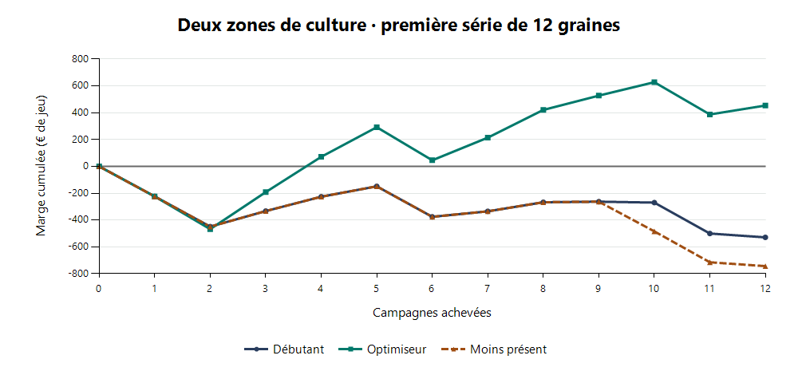

# Audit global de Kanab Quest · 22 novembre 2026

**66/100, note provisoire de la bêta locale.** Le jeu obtient **57,75 points sur 87,50 évalués**. Le Quartier offre déjà de vraies décisions de gestion et une identité reconnaissable. Sa faiblesse se voit au moment où un débutant engage l’essentiel de sa trésorerie. Le guide perd alors la commande suivante, et le devis donne une vision incomplète de la dépense nécessaire pour vendre le premier lot.

**Aucun P0 de jeu établi sur les parcours vérifiés.** On peut créer un personnage, financer et installer le premier plan, semer, reprendre une culture, obtenir des lots et les valoriser. Une décision distincte précède toute attribution de lots réels selon le projet de règlement saisonnier. Le calcul actuellement testé et le parcours de remise divergent des modalités écrites. L’audit n’a observé ni attribution ni perte chez un joueur réel.

Confiance élevée sur les gestes reproduits, les prix et les règles rapprochées du SQL. Confiance moyenne sur l’équilibrage et la difficulté vécue. L’autonomie d’un novice, la rétention, le confort sur téléphone physique et la qualité de service hébergée demandent d’autres preuves. La matrice recense **19 domaines fonctionnels**, avec la méthode et les limites de chacun. [Matrice de couverture](couverture.md)

## Notes et calcul

Quatre sous-critères de même poids par domaine, fixés à la reconnaissance. Les valeurs ci-dessous sont dans l’ordre de la grille. « NE » retire le poids correspondant. Chaque point de note sur un critère rapporte un vingtième du poids du domaine. La note de domaine est la moyenne sur les critères évalués. [Protocole et échelle 0–5](protocole.md)

| Domaine | Poids | Notes des quatre critères | Moyenne /5 | Acquis / évalués | Justification |
|---|---:|---|---:|---:|---|
| UI et lisibilité | 10 | 3 · 4 · 3 · 4 | 3,50 | 7,00 / 10 | L’entrepôt commence par des montants et des états lisibles. Les panneaux empilent assez de commandes pour repousser le plan de départ sous l’écran. Le devis distingue paiement et solde, mais les termes « potentiel » et « récolte estimée » varient selon la fiche. Carte et article utilisables aux petites largeurs essayées. [Expérience](experience.md) |
| UX, prise en main et accessibilité | 15 | 3 · 2 · 4 · NE | 3,00 | 6,75 / 11,25 | Loïc mène à de vrais gestes et mémorise l’étape. La transition après travaux demande de retrouver deux commandes. Clavier, tactile, retour de focus dans le Carnet et navigation sans WebGL éprouvés. L’autonomie sans assistance attend une observation humaine. [Parcours](experience.md) |
| Graphismes et direction artistique | 10 | 4 · 4 · 4 · 4 | 4,00 | 8,00 / 10 | L’île, ses bâtiments et ses pancartes se distinguent au premier regard. Le papier, l’encre et les aplats relient carte, avatar et atelier. Les volumes restent lisibles en perspective et les neuf noms séparent les destinations à 320 px. L’examen visuel porte sur les scènes et les écrans échantillonnés. [Village](ux-village-1440.png) · [Devis](ux-devis-320.png) |
| Immersion et retours visuels | 10 | 4 · 4 · 3 · 3 | 3,50 | 7,00 / 10 | Loïc donne un interlocuteur au départ, les PNJ et le courrier donnent une activité observable au village. La révélation des cartes et le débit après installation rendent le geste perceptible. Il faut ensuite recouper panneaux, lot et trésorerie pour comprendre toute la conséquence économique. [Expérience](experience.md) · [Économie](economie.md) |
| Gameplay et intérêt des décisions | 15 | 4 · 4 · 4 · NE | 4,00 | 9,00 / 11,25 | Placement, rotation, temps de travail et canal de vente modifient le résultat dans des essais comparables. Missions, collection, commerce et tournoi offrent des buts différents. L’intérêt durable de cette variété en fin de partie reste ouvert. [Scénarios](economie.md) · [Couverture](couverture.md) |
| Cohérence chiffrée et économie | 20 | 3 · 2 · 2 · 4 | 2,75 | 11,00 / 20 | Les unités et le devis initial se recoupent en SQL. La règle affichée du laboratoire sous-estime les campagnes multizones. La marge change brutalement au seuil de qualité, et deux séries donnent des résultats très différents. Les bornes de capacité, d’exposition et de stock sont mieux étayées. [Économie](economie.md) · [Fiabilité](fiabilite.md) |
| Difficulté, progression et rythme | 10 | 2 · 3 · 3 · NE | 2,67 | 4,00 / 7,50 | Un premier cycle défavorable laisse peu de réserve. La récupération existe via les missions et les ventes, mais réclame de connaître ces leviers. L’absence retarde la progression et peut dégrader la valeur du lot. Les paliers ajoutent des arbitrages, dont la rotation des variétés. Rythme vécu sur plusieurs semaines non évalué. [Comparaison](economie.md) |
| Fiabilité et performance | 10 | 4 · 3 · 3 · NE | 3,33 | 5,00 / 7,50 | Reprise et rejeu protégés sur plusieurs écritures. Trois recettes SQL anciennes s’arrêtent avant la fin, et une clé de reprise de préparation vit seulement dans l’écran. La cadence locale dépend fortement de l’accélération graphique. Service complet hébergé non mesuré. [Fiabilité](fiabilite.md) · [Mesures](mesures-experience.json) |
| **Total** | **100** | | | **57,75 / 87,50** | **100 × 57,75 / 87,50 = 66,00.** |

Les 12,50 points non évalués correspondent à l’autonomie en première visite (3,75), à l’intérêt durable en partie avancée (3,75), au rythme vécu sur plusieurs semaines (2,50) et au service hébergé complet (2,50). Aucun score de satisfaction ou d’abandon n’est déduit des tests.

## Ce qui fonctionne et mérite d’être conservé

- **Le premier investissement a des conséquences réelles et réversibles jusqu’à confirmation.** Le joueur passe par un brouillon, voit le prix et le solde après travaux. Un refus simulé préserve le plan. Le nouvel essai débite une seule fois. Le pack inaugural fournit trois variétés gratuitement. [Devis](ux-devis-320.png) · [Parcours](experience.md)
- **L’espace change la production.** Cent mètres carrés de sol initial n’équivalent pas à cent mètres carrés productifs. Le plan de départ active 1 m². La lumière, la ventilation desservant réellement cette zone, la réserve de contenants et le personnel répondent à des besoins différents. Déplacer une cloison et améliorer un appareil ne produisent pas le même effet. [Surface et services](fiabilite.md) · [Plan chiffré](economie.md)
- **La carte illustrée reste un moyen d’agir.** Les destinations ont des noms HTML activables, un menu et un chemin de repli en cas de perte du rendu 3D. À QuizzShow, la salle, le rayon, l’article, le tournoi et le classement fonctionnent au toucher comme au clavier sur les deux formats parcourus. Les six transitions chronométrées par largeur n’ont présenté aucun débordement horizontal. [Village mobile](ux-village-320.png) · [Parcours de l’école](parcours-ecole.json)
- **La comptabilité permet de distinguer richesse et liquidité.** Les factures, le journal, les reçus et les limites de prélèvement à la vente donnent une raison de gérer son fonds de roulement. Les tests isolés du crédit bancaire conservent les échéances à travers les changements d’heure, les arriérés et le remboursement anticipé. [Banque et marché](couverture.md) · [Contrôles des écritures](fiabilite.md)

## Du premier devis à la première vente

**Lecture à 320 px.** Sur la capture nocturne, l’encre et le fond dominants de la ligne « Je peux te montrer » donnent un rapport de luminance de **7,67:1** (`#172923` sur `#fba546`). Pour la pancarte « Commerce », le rapport est **10,33:1** (`#213e35` sur `#f9f1dd`). Mesure sRGB sur deux rectangles de la capture, aux coordonnées x/y/largeur/hauteur (67, 38, 124, 13) et (58, 527, 52, 13), en prenant la couleur d’encre et la couleur de papier les plus fréquentes. Le contraste local est bon. La taille reste plus contraignante : la feuille de style prévoit un texte de base de 12 px et une hauteur minimale de pancarte de 26 px sur petit écran. Le focus du village dispose d’un contour de 3 px. Les graphiques de charges donnent le libellé, le montant et la part en texte. Tous les thèmes et états interactifs n’ont pas fait l’objet d’une mesure de contraste. [Capture](ux-village-320.png) · [Pancartes et focus](../../../src/components/placard/world/VillagePrototype.module.css) · [Lecture des graphiques](../../../src/components/placard/KqWarehouseCharts.tsx)

**Premiers pas.** Depuis l’invitation de Loïc, six activations suffisent sur le chemin guidé pour installer le plan, dont quatre pour établir le brouillon. Puis le guide affiche « Choisir une variété ». À 320 × 710 et à 1 440 × 900, la commande annoncée manque. Le joueur reste au bas d’Aménager et le focus revient au document. Remonter, passer en Pilotage, puis ouvrir Priorités fait réapparaître l’action. Le test intégral antérieur contournait ce passage en visitant QuizzShow. Le problème touche donc une transition précise du premier parcours. [Après installation, mobile](ux-apres-installation-320.png) · [Après installation, ordinateur](ux-apres-installation-1440.png)

**Reprise.** Loïc accepte la pause, la fermeture, le rechargement et le retour par le menu. En fin de parcours, « 7/30 » mélange les premiers gestes et les fiches ultérieures. À 320 × 540, les deux choix de l’invitation sont entièrement hors de la zone visible à l’ouverture. Un glissement ou Tab les révèle. À 320 × 710, l’action de proposer le plan est à y = 927 px alors que le panneau s’arrête à y = 698 px. Ces observations expliquent pourquoi un chemin jouable peut sembler bloqué. Leur effet sur les départs de joueurs reste une hypothèse. [Carnet](ux-carnet-fin-320.png) · [Invitation courte](ux-invitation-320x540.png) · [Relevés](experience.md)

**Boucle économique de départ.** Scénario sans achat réel, salaire, abonnement optionnel ou prime de mission. Le joueur possède 1 000 € de jeu, trois Buddies communs et un plan vide. Les dépenses sont en euros du jeu. Une journée du calendrier économique vaut 4 heures réelles. Les heures de travail affectées aux tâches et les heures équivalentes facturées aux appareils sont encore deux grandeurs différentes. [Horloge et fiscalité](../../../src/lib/kanab-quest-business.ts) · [Paramètres](economie.mjs)

| Étape | Exemple joué au moteur, graine 113 |
|---|---|
| Investir et préparer | 786,74 € de travaux. Il reste 213,26 € en caisse. La zone active de 1 m² dispose de 1 000 g de capacité de séchage et de 1 200 g de stockage. |
| Réserver de quoi terminer | Le devis annonce 60,00 € d’énergie et 23,60 € de fournitures, soit 83,60 €. Un lot terminé entraîne 45,00 € de laboratoire. Une réserve de **128,60 €** laisse **84,66 €** disponibles après l’investissement. Les factures ont leurs propres échéances. |
| Produire et récolter | Le plan affiche un potentiel de 189,375 g avant les conditions de cette partie. Le modèle calcule 167,6 g à la préparation de cette graine et obtient **69,1 g** à la récolte. Le stockage n’est pas le goulot de ce lot. |
| Traiter et stocker | 1,5 heure de travail virtuel pour le trim manuel. Le scénario régulier attend six heures réelles avant le passage au jury et la vente. Aucune machine de transformation ni salarié dans ce cycle. |
| Vendre | Qualité commerciale 5,1/10, biomasse à 0,30 €/g. **20,73 € TTC** pour 69,1 g. TVA de jeu 3,46 €. Marge économique du cycle **20,73 − 3,46 − 128,60 = −111,33 €**. |
| Lire le portefeuille | Après le règlement modélisé, 221,90 € d’encaisse et 119,97 € de factures ouvertes donnent **101,93 € nets**. Après le deuxième cycle, 228,89 € d’encaisse et 241,58 € de factures donnent **−12,69 € nets**. Ce déficit signale un besoin de financement. L’encaisse permet encore d’agir. |

**Point mort.** Pour couvrir 128,60 € de charges avec la TVA de ce cas et le grossiste comme seul débouché, il faut environ **73,5 g à 2,10 €/g TTC**, ou **514,4 g à 0,30 €/g TTC**, avant rémunération du joueur. Le tarif commercial de la fleur brute démarre à 6,5/10. La biomasse et la fleur sous le seuil peuvent relever de conditions distinctes et la reprise peut être inférieure. La quantité de stockage est confortable au départ. La qualité vendable et le débouché décident de la marge bien avant que le premier bocal soit plein. [Formules de commerce](../../../src/lib/kanab-quest-commerce.ts) · [Résultats](economie-resultats.json)

**Plusieurs styles de jeu.** Même ordre de douze graines pour les trois profils de chaque configuration. Le débutant accepte les résolutions et revend au grossiste. L’optimiseur des débouchés privilégie le CBD Shop lorsque l’offre existe et applique la politique de soins décrite dans l’annexe. Le joueur moins présent revient à intervalles simulés d’une semaine. Le second état de départ dispose de 5 000 € et quatre variétés, avec deux zones installées pour 1 149,83 €. C’est un état avancé de comparaison, pas une subvention ni une durée d’accès mesurée. Les marges ci-dessous cumulent charges et ventes avant primes de missions et avant récupération de l’investissement.

| Configuration | Profil | Marge sur 12 campagnes, série A | Marge sur 12 campagnes, série B | Lots au seuil de 6,5, série A | Travail médian par campagne, série A |
|---|---|---:|---:|---:|---:|
| 1 zone | Débutant | −458,55 € | −982,78 € | 6 / 12 | 6,5 h de jeu |
| 1 zone | Optimiseur | −76,38 € | −838,15 € | 6 / 12 | 6,5 h de jeu |
| 1 zone | Moins présent | −458,55 € | −982,78 € | 6 / 12 | 6,5 h de jeu |
| 2 zones | Débutant | −529,38 € | −1 962,70 € | 16 / 24 | 9,5 h de jeu |
| 2 zones | Optimiseur | **+453,75 €** | **−1 725,15 €** | 16 / 24 | 9,5 h de jeu |
| 2 zones | Moins présent | −743,73 € | −2 117,95 € | 14 / 24 | 9,5 h de jeu |

Le meilleur canal change bien le résultat. Aucune de ces trajectoires de base n’amortit son plan en douze campagnes. Dans la série A, le profil régulier couvre 14 jours réels simulés et le profil hebdomadaire 245 jours pour le même nombre de campagnes. Cette différence vient du calendrier de visites choisi. Avec une zone, l’absence laisse la même marge cumulée dans cette série, mais le joueur hebdomadaire termine avec seulement **22,42 € liquides** contre **206,82 €** chez le débutant régulier. À deux zones, deux lots supplémentaires passent sous le seuil commercial. Ces échantillons appariés montrent une sensibilité aux décisions et aux dates. Ils ne donnent pas une probabilité de ruine. [Graines, calendriers, factures et politiques](economie.md)

Deux contre-épreuves modèrent le verdict. Avec trois cartes de soutien à usage limité, la politique optimisée à une zone donne **+157,85 €** sur la série A et **−647,65 €** sur la série B. Et cinq premières missions peuvent apporter **350 € ponctuels** lorsque leurs conditions sont remplies et les gains réclamés. Le score de difficulté tient compte de cette récupération. Un montant ponctuel et une marge d’exploitation n’ont pas la même portée pour la campagne suivante. [Missions](../../../src/lib/kanab-quest-missions.ts) · [Sensibilités](economie-resultats.json)

**En exploitation développée.** Pour un lot synthétique de 100 g, qualité 8/10, débouché CBD Shop disponible, la vente brute laisse 250 € après TVA. Transformer le lot donne 18 g de tamisage ou 15 g de rosin d’essai. Les offres laissent respectivement 86,66 € et 121,60 € après TVA et 18 € de frais de préparation, avant coûts communs et acquisition de machines à 5 040 € et 4 500 €. À ce volume et sur ce canal, investir ne se rembourse pas par la seule vente de ce lot. Autres volumes, prix, expertises, missions ou canaux peuvent changer l’ordre. Les doses, surfaces desservies, affectations de personnel et rotations des Buddies créent d’autres contraintes. [Devis atelier et conditions](economie.md)

### Plausibilité extérieure

Le jeu affiche 0,25 €/kWh pour le plan d’entrepôt contrôlé. À 240 kWh équivalents, cela explique les 60 € du devis. Pour situer cette convention, la moyenne française des professionnels en 2025 était de 0,1488 €/kWh hors TVA, avec de grands écarts selon la consommation. La catégorie fiscale et le contrat d’un exploitant précis ne sont pas spécifiés dans le jeu. Le tarif fixe et les heures équivalentes constituent une simplification lisible. La comparaison justifie d’expliquer leur périmètre, pas de réaligner mécaniquement le tarif. [Entrepôt](../../../src/lib/kanab-quest-warehouse.ts) · [SDES, enquête 2025, publiée le 23 juillet 2026](https://www.statistiques.developpement-durable.gouv.fr/prix-de-lelectricite-en-france-et-dans-lunion-europeenne-en-2025)

La base du modèle est de 250 g secs/m² avant les modificateurs. Une étude en intérieur de 2021 sur le cultivar Stillwater a mesuré de 116 à 519 g/m² d’inflorescences sèches à l’étuve sous différents éclairages. Le chiffre de base du jeu appartient à cet ordre de grandeur. L’espèce, le cultivar, le protocole de séchage et l’état du produit vendu limitent la comparaison. Un autre repère est le luminaire TS1000, représenté à 150 W dans le jeu et annoncé à 150 W par le fabricant. La couverture commerciale annoncée varie avec le stade, alors que le jeu emploie une case de 1 m². Il est raisonnable d’utiliser cette case pour décider où installer l’appareil. Aucune cote de gros réelle suffisamment comparable n’a servi à noter le tarif ludique de 2,10 €/g. [Étude originale, Rodriguez-Morrison et coll., 2021](https://www.frontiersin.org/journals/plant-science/articles/10.3389/fpls.2021.646020/full) · [Fiche constructeur TS1000, consultée le 22 novembre 2026](https://wholesale.mars-hydro.com/products/ts-1000/) · [Catalogue du jeu](../../../src/lib/kanab-quest-warehouse-catalog.ts)

## Activités annexes, équité et service

La même identité permet de jouer, acheter et publier un avis sur le site. Les effets diffèrent selon le geste.

| Geste | Conséquence vérifiée | Incidence sur l’équité |
|---|---|---|
| Soutenir la ferme | La contribution utilise un registre de paiement séparé. La fiche décrit un soutien facultatif sans objet, bonus ou avantage de concours. | Vérifications locales du registre. Aucun paiement réel effectué. [Soutien](../../../src/components/placard/KqSupportCampaign.tsx) · [Contrôles SQL](fiabilite.md) |
| Acheter un produit admissible | Une commande fictive de 50 € de produits + 5 € de port crédite 500 € de jeu. Le rejeu préserve un crédit unique. Ce montant représente la moitié du capital de départ de Loïc. | Avantage de trésorerie direct. Le solde bancaire seul ne donne pas de points d’entreprise. Financer plus tôt les surfaces actives et les ventes peut influer **indirectement** sur le rang. Amplitude non mesurée. [Commande](../../../scripts/test-order-cash-rewards.mjs) · [Calcul entreprise](../../../supabase/migrations/20261018000200_kq_business_score_v3.sql) |
| Faire valider un avis admissible | 100 points de dégustation par fleur distincte achetée et évaluée dans la saison. Le classement général additionne dégustation, duels humains et entreprise. L’éligibilité aux lots accepte trois duels ou une dégustation admissible selon la formule actuelle. | Avantage d’achat explicite sur la dégustation. L’achat seul n’accorde pas ces 100 points. Les défis contre bots et le fauteuil de QuizzShow suivent des règles distinctes. [Classement](../../../supabase/migrations/20261018000300_arena_tasting_first_rankings.sql) · [Lots](../../../src/lib/arena-customer-rewards.ts) |
| Remporter une part en fleurs | La prévisualisation répartit les grammes. Dans le test de trois ex æquo aux premières places, 58 g couvrent le groupe, 39 g vont aux deux éligibles et 19 g restent sans attribution dans ce groupe. L’interface dirige le gagnant vers un bon utilisable au panier. | Le projet saisonnier prévoit le reclassement des éligibles, la réaffectation et une remise sans nouvelle commande. Le barème réellement publié, les conditions effectives et les remises hébergées restent à rapprocher avant attribution. [Cas testé](../../../src/lib/arena-customer-rewards.test.ts#L81) · [Interface](../../../src/components/contest/ArenaCustomerRewards.tsx#L231) · [Décisions consignées](../reglement-saisonnier-mise-en-oeuvre.md) |

**Réactivité.** Dans Chrome 157 sur Intel Iris Xe, la scène du village a produit 73 effacements du canvas en 2,4 s à 320 × 710 et 145 à 1 440 × 900. Avec le rendu logiciel SwiftShader forcé, les deux échantillons n’ont compté que 7 et 6 rappels en 2,42 et 3,02 s. À QuizzShow, l’ouverture de l’encyclopédie a pris 6,95 s puis 7,20 s sur la prévisualisation Vite locale. Ces durées incluent l’automate et le chargement des modules. La machine était partagée entre essais. Elles identifient les parcours à profiler en version de production sur téléphone, sans établir la latence perçue par les joueurs. [Mesures du village](mesures-experience.json) · [Transitions QuizzShow](parcours-ecole.json)

**Intégrité.** Les écritures ordinaires de semis, les stocks dédiés, les offres périmées, les reprises de commande et la suspension d’abonnement ont des protections vérifiées. Le test SQL de campagne partagée passe avec un lot, une facture d’énergie et une analyse par zone achevée. Trois recettes longues de la revue technique échouent sur la postrécolte, la capacité et l’usure. La suite combinée usure/campagne rencontre également `warehouse_condition_invalid`. Deux écarts ont été reliés à des migrations de catalogue absentes des jeux de test. L’erreur d’usure reste à isoler. Sur une connexion PGlite, les transactions sont sérialisées. Une charge hébergée ou une contention réelle ne s’en déduit pas. [Échecs, commandes et limites](fiabilite.md) · [Campagne multizone](../../../scripts/test-placard-shared-campaigns.mjs#L196)

**Revente et cumul de bonus.** Pour un équipement payé 100 € de jeu, les cas testés donnent une valeur de revente de 100, 80, 50, 20 puis 0 € à 0, 20, 50, 80 et 100 % d’usure. Le déplacement de l’actif conserve son prix d’acquisition et son usure. Les préparations modernes écartent les programmes d’irrigation expirés et évitent de compter deux fois un effet passif. Ce sont des contrôles ciblés de conservation de valeur. La suite d’intégration d’usure en échec laisse ouverte la vérification du parcours complet. [Revente et déplacement](../../../src/lib/kanab-quest-warehouse-condition.test.ts#L13) · [Préparations](../../../src/lib/supabase/kanab-quest-warehouse-preparations-sql.test.ts#L216)

## Constats classés et chantier proposé

La gravité concerne la conséquence décrite. Les fréquences « systématique » et « conditionnelle » valent pour les états testés. Les effets d’abandon ou de lassitude restent des hypothèses. Les observations secondaires sur un même écran sont regroupées pour ne compter chaque cause qu’une fois.

| ID, priorité, nature | Emplacement, preuve, conséquence | Gravité et fréquence probable · confiance | Action, effort et dépendance |
|---|---|---|---|
| **UX01 · P1 · guidage interrompu après travaux** | L’instruction « Choisir une variété » apparaît sans cible. Focus perdu, sélecteur hors écran, puis deux commandes pour récupérer la préparation. Le nouveau joueur vient d’engager 78,7 % de son capital. [Deux formats et reprise](experience.md) | Haute, systématique sur la transition reproduite · élevée | Après confirmation, proposer « Préparer mes cultures », avec focus, en gardant la possibilité de revoir le plan. Effort **moyen**, dépend du mode d’entrepôt et du repère de Loïc. |
| **ECO-01 · P1 · règle de coût trompeuse** | L’aménagement affiche 83,60 € de charges pour la zone. L’aide de Factures évoque une analyse commune à toutes les tentes. Une campagne SQL de trois zones achevées produit trois factures, soit 135 € au lieu des 45 € que cette lecture suggère. La réserve nécessaire est sous-estimée de 90 € dans cet exemple. [Aide](../../../src/components/placard/KqTreasuryInvoices.tsx#L118) · [Contrôle SQL](../../../scripts/test-placard-shared-campaigns.mjs#L202) | Haute, à chaque prévision de campagne multizone · élevée | Nommer les deux charges de lancement, ajouter les analyses prévisibles par lot, leurs échéances et le disponible après réserve. Effort **faible à moyen**, partager les mêmes valeurs entre devis, semis et factures. |
| **ECO-02 · P1 · seuil commercial et récupération peu lisibles** | À 6,5/10, le grossiste passe d’au plus 0,30 €/g à 2,10 €/g pour la fleur brute admissible. Une première campagne d’apparence normale coûte 111,33 € nets dans le cas décrit. Le portefeuille masque temporairement la dette et les missions nécessitent une réclamation. [Cas chiffrés](economie.md) | Haute, dès qu’un lot approche le seuil · élevée pour le tarif, moyenne pour le risque de décrochage | Montrer marge à deux qualités, coût déjà engagé et mission réclamable au bon moment. Évaluer ensuite un palier intermédiaire. Effort **moyen**, devis commerce, journal, missions et tests d’équilibrage. |
| **LOT-01 · P1 avant attribution réelle · règles de gains divergentes** | Le traitement testé des ex æquo et le bon au panier divergent du projet saisonnier. Un participant éligible peut recevoir une part différente de celle attendue sous ce projet. [Répartition](../../../src/lib/arena-customer-rewards.test.ts#L81) · [Modalités envisagées](../projet-reglement-saisonnier.md) | Haute pour les gagnants, conditionnelle à une clôture · élevée sur l’écart local, inconnue sur les saisons servies | Rapprocher règle affichée, simulation de clôture, bénéficiaires et remise sur une saison fictive. Rendre visibles les effets distincts des dons, commandes et avis. Effort **élevé**, décision produit, règlement effectivement applicable, registre et remise des lots. |
| **TEC-01 · P1 avant validation du cycle complet · défaut de recette** | Des jeux de test anciens s’arrêtent sur un tarif, un contenant et une garde d’usure. Une recette navigateur s’arrête sur un repère de guide retiré. Des sous-suites passent alors que le scénario global n’atteint plus sa fin. [SQL](fiabilite.md) · [Navigation](experience.md) | Haute pour la capacité à détecter une régression, à chaque exécution des suites concernées · élevée | Remonter le schéma isolé avec les migrations actuelles, achever une campagne jusqu’à sa vente et vérifier solde, lots, réserves et reçus après reprise. Effort **moyen à élevé**, fixtures partagées SQL et navigateur. |
| **ECO-03/04 · P2 · investissement difficile à comparer** | Après une campagne de deux zones, les trois Buddies initiaux ne laissent qu’une variété disponible pour la suivante. Une quatrième permet l’enchaînement à deux zones. Le rendement matériel porte deux noms et les machines changent simultanément coût, poids et valeur. [Rotation, devis et comparatif atelier](economie.md) | Moyenne à forte, à la première extension ou machine · élevée pour les règles | Au devis, afficher variétés disponibles à la campagne suivante, potentiel et rendement constaté séparément, puis le net par débouché. Effort **moyen**, inventaire, règles de rotation et devis serveur. |
| **ECO-05 · P2 · absence et temps de jeu** | Après sept jours réels, la culture manuelle attend toujours un geste, mais les fournitures ont pu être réglées. La conservation peut dégrader un lot après sa maturité. [Deux calendriers comparés](economie.md) | Moyenne, retour après échéance · élevée pour les règles, moyenne pour la trajectoire économique | Au retour, réunir l’étape en attente, le prochain lot à risque et les prélèvements intervenus. Effort **moyen**, horloge serveur, stock et comptabilité. |
| **UX02/05 · P2 · première action hors de l’écran** | À 320 × 540, ni « Commencer avec Loïc » ni « Jouer librement » n’est visible au premier affichage. À 320 × 710, le plan proposé arrive après plusieurs rangées d’outils. [Captures et récupération tactile](experience.md) | Moyenne, systématique aux dimensions et états cités · élevée | Garder un premier choix dans la zone visible et rapprocher le plan proposé du sélecteur. Effort **faible à moyen**, hauteur du panneau, ordre de lecture et focus. |
| **TEC-02 · P2 · reprise et performances à qualifier** | La clé du registre de Préparations reste en mémoire d’écran. Une réponse perdue suivie d’un rechargement nécessite un rapprochement à vérifier. Le village ralentit sous rendu logiciel. Le chargeur qualifié de lecture seule appelle un bootstrap qui peut rapprocher des crédits ou packs. [Code et mesures](fiabilite.md) | Moyenne, conditionnelle à l’interruption, au matériel ou à l’essai de charge · élevée sur le code, conséquence financière inconnue | Tester un rechargement après réponse incertaine et deux sessions sur base jetable. Profiler le premier geste sur appareil physique. Effort **moyen**, isolation de l’application **et** de sa base, comptes fictifs. |
| **UX03/04 · P3 · carnet et saisie de personnage** | « 7/30 » à la fin des gestes initiaux et surnom effacé après fermeture avant validation. [Comptage et atelier](experience.md) | Faible à moyenne, fin du guide ou fermeture du studio · élevée sur les états | Distinguer départ terminé et fiches facultatives, garder les choix du studio jusqu’à validation ou abandon explicite. Effort **faible à moyen**, libellés et brouillon local. |

### Ordre de réalisation et critères de succès

Le plan détaillé chiffre le passage de 66 à 80/100 et associe à chaque livraison un responsable proposé, une dépendance et un critère de réception. [Plan d’amélioration vers 80/100](plan-80.md)

1. **Rétablir le premier parcours et son budget.** Enchaîner installation → préparation sans quitter l’entrepôt, à 320 px et au clavier sur ordinateur. Vérifier le texte, le focus, le prix et la réserve de campagne pour une puis trois zones. En parallèle, décider quelle règle de lots peut être appliquée avant la prochaine attribution réelle.
2. **Rendre la prochaine décision économique calculable.** Présenter les deux débouchés et les factures à venir. Le changement de lampe fournit un bon cas de contrôle. Dans le plan étudié, 26,41 € de mise supplémentaire diminuent de 22,50 € l’énergie par cycle, à potentiel matériel affiché identique mais avec un effet de qualité différent. Comparer ensuite les marges nettes et les missions sur les **mêmes graines**. Un lissage du seuil reste une proposition à tester contre la valeur des meilleurs lots et la possibilité de se remettre d’une mauvaise récolte. [Sensibilité du matériel](economie.md)
3. **Sécuriser une traversée complète avant toute conclusion sur la fiabilité en ligne.** Terminer une campagne multizone sur un schéma à jour, puis rouvrir la session au moment d’un reçu incertain. Contrôler que lots, factures et stock concordent. Pour les gains réels, ajouter une clôture fictive avec ex æquo et inéligible, et dérouler le mode de remise retenu.
4. **Observer 5 à 8 nouveaux joueurs sur la version corrigée.** Leur demander de créer un personnage, préparer le premier lot, retrouver une action après interruption et expliquer ce que coûtera la vente. Relever les détours, le temps actif, la compréhension des 45 € et du seuil commercial. Pour le rythme, revoir des joueurs peu présents après une échéance. Ajuster les notes humaines uniquement à partir de ces observations.

## Périmètre technique et niveau de preuve

La coordination a cartographié les destinations, les règles et les suites avant de répartir le travail entre **trois spécialistes Sol 6.2, réflexion élevée**. Le premier a joué le parcours d’accueil, le village et l’entrepôt. Le deuxième a reconstruit les campagnes et les états financiers. Le troisième a vérifié les écritures, la persistance, les recettes SQL et les mesures de rendu existantes. La coordination a testé l’entrée Next sans session, parcouru QuizzShow au clavier et au toucher, vérifié banque, marchés, missions, liens commerciaux et règlement, et recoupé la facturation multizone.

L’évaluation porte sur l’arbre local de `master` au commit `d6f48a16`, **avec les changements déjà présents** sur les pancartes du village, les réglages, l’avatar et le lien de soutien. La refonte du plan et les nouveaux tarifs d’atelier sont pris en compte. Le prototype 3D seul et les anciennes captures d’audit ne représentent pas à eux seuls l’entrée du produit. Le parcours lié au compte a été joué avec réponses locales et identifié comme tel. Le dépôt permet de reproduire une redirection de connexion, des scénarios de composants et des transactions PGlite séparés. Il ne permet pas de conclure qu’un navigateur authentifié bénéficie de la même version sur l’hébergement.

Les urgences UX ont été contre-vérifiées sur deux tailles et confrontées aux conditions d’affichage. Les montants importants ont été confrontés aux devis, aux migrations et aux reçus simulés. Les deux séries de douze graines sont des tests de sensibilité appariés, avec marché normal et politiques fixes. Le profil nommé « optimiseur » explore des choix accessibles et ne garantit pas l’optimum. Le temps actif d’un joueur humain, la concurrence PostgreSQL réelle, le service en production et la remise physique de lots restent non vérifiés. Ce dossier livre l’analyse, les preuves et le chantier priorisé. [Couverture et commandes](couverture.md) · [Économie reproductible](economie.md) · [Parcours et captures](experience.md) · [Fiabilité](fiabilite.md)
