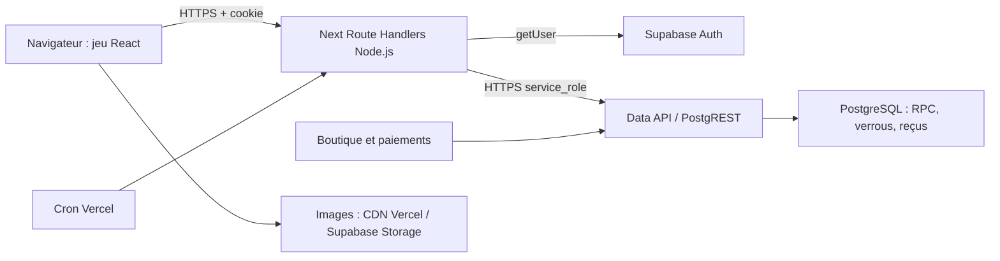

# Audit technique du Quartier — 9 novembre 2026

## 1. Verdict

**Le jeu possède des protections serveur sérieuses et son parcours guidé fonctionne dans les essais locaux examinés. Sa capacité de production est non déterminable actuellement.** Aucun palier, même 10 joueurs, n'a été validé avec les services réellement déployés. Les tests locaux ne mesurent ni le plaisir des joueurs, ni la contention de PostgreSQL en production.

Deux corrections passent avant l'acquisition de joueurs : la progression des Défis peut compter une réservation salariée utilisée zéro heure (**GD-1**, reproduction SQL isolée), et Personnel/Atelier perd l'identité d'une confirmation après réponse perdue puis fermeture/rechargement (**UX-01**, reproduction navigateur). Le second problème crée une issue incertaine ; **un double débit réel n'a pas été démontré**. Aucune faille P0 ni gain infini n'a été établi dans le périmètre inspecté, ce qui ne certifie pas leur absence ailleurs.

Les premiers facteurs de saturation à mesurer sont le calcul des devis Atelier par lot et filière, le rattrapage des ventes au retour d'absence, puis les classements globaux. Une hausse du nombre de comptes anciens peut augmenter ces coûts même si peu de joueurs sont connectés. Le quota Supabase Realtime n'est pas une capacité de jeu : aucun abonnement Realtime n'a été trouvé dans les chemins applicatifs inspectés.

**Décision recommandée :** conserver un accès encadré, traiter GD-1 et UX-01/02, puis établir une référence avec comptes synthétiques sur une base isolée. Aucun seuil d'exploitation chiffré fiable ne peut être conseillé avant cette mesure. Un pilote de 10 personnes serait une étape de validation, pas une garantie de capacité.

L'audit n'a modifié ni code métier, ni migration, ni paramètres d'hébergement. Aucun achat, gain réel, test de charge distant ou déploiement. Exactement deux agents spécialisés ont contribué : [game design](game-design.md) et [UI/UX](ui-ux.md).

## 2. Architecture et couverture

### État observé et sécurité des vérifications

- Arbre local basé sur `70ce99c5`, avec de nombreuses modifications utilisateur préexistantes. Les constats portent sur cet arbre, **pas sur une version de production identifiée**. Le statut Git a aussi évolué pendant la session ; aucun travail extérieur à ce dossier n'a été repris ou annulé.
- `package.json` : Next **16.4.1**, React **19.2.3**, Supabase JS déclaré `^2.95.3`, SSR `^0.8.0`, Vitest `^4.1.12`, PGlite `0.5.8`. Node local **25.3.0**, Windows. Guide Route Handlers du Next installé lu ; guide de test navigateur lu par l'agent UX.
- **370 fichiers de migration** locaux. Les migrations composent parfois les fonctions par `pg_get_functiondef` et remplacement de texte : une définition historique isolée ne suffit pas à décrire la base déployée.
- `.env.local` utilise un domaine `*.supabase.co` distant, ainsi que des destinations de paiement, livraison et fabrication réelles. `.env.development.local` ne remplace pas la destination Supabase. Les valeurs secrètes n'ont pas été affichées. Un frontend local ou une Preview ne constitue donc pas un bac à sable.
- **Précision utilisateur intégrée : Supabase Pro avec compute Micro, Vercel Pro.** Le libellé « 3pro » est interprété comme « Pro », sans en déduire trois sièges. Il s'agit d'une déclaration utilisateur, pas d'une lecture des consoles. Régions, nombre de projets/sièges facturés, mode Fluid, CDN, budget, quotas consommés et options restent inconnus. La tentative de lecture `supabase projects list --output json` n'a pas fourni de métadonnées utilisables. Les intégrations Supabase/Vercel ont été trouvées mais leur connexion n'est pas confirmée. La présence d'une clé Data API locale ne fournit pas la facturation.

Le client n'envoie pas un solde faisant foi : les routes prennent le propriétaire dans la session validée (`src/lib/supabase/customer-backend.ts:getCurrentSupabaseSessionIdentity:526-549`), puis les backends utilisent `createSupabaseServiceClient` (`admin.ts:7-23`). Les accès métier sont des `.from`/`.rpc` HTTPS, pas un pool PostgreSQL par navigateur. Les limites de connexions directes ou Supavisor ne se traduisent donc pas en joueurs ; le pool interne Data API et les connexions de PostgreSQL restent à observer. [Modes d'accès Supabase](https://supabase.com/docs/guides/database/connecting-to-postgres).

Les RPC `SECURITY DEFINER` et le rôle serveur rendent les contrôles de propriétaire des routes/backend essentiels. Les grants privés sont explicites. Les tests examinés utilisent des doublures pour cette frontière, complétées par du vrai SQL isolé ; ils ne prouvent pas toutes les politiques du catalogue distant.

Les routes jeu inspectées utilisent `runtime=nodejs`, généralement `force-dynamic`, et des réponses privées sans cache. `vercel.json:3-9` programme quatre appels crypto par jour et un traitement commerce par heure. Les deux crons limitent leur fonction à 60 secondes et vérifient `CRON_SECRET`. Région, mémoire, mode Fluid, concurrence, cold starts et limites effectives ne sont pas déclarés dans ces fichiers. **Ne pas supposer une région Vercel ni une proximité avec Supabase** : les réglages du projet peuvent compléter le dépôt. [Configuration des régions](https://vercel.com/docs/functions/configuring-functions/region).

Caches existants : catalogues publics en mémoire avec expiration (`kanab-quest-backend.ts:48-63`), classements publics par `unstable_cache` 30 s avec regroupement des requêtes simultanées (`arena-shared-cache.ts:5-17`), snapshot SQL classement 60 s, vérification des récompenses bootstrap 5 min. Les états privés ne doivent pas entrer dans un cache partagé sans clé propriétaire et stratégie d'invalidation. Les événements `kq:*` sont des `CustomEvent` locaux, pas des messages Supabase (`KqTutorialApiContext.ts:17-25`).

**Ressources partagées :** authentification, base, stockage, infrastructure Vercel, catalogue, commandes, paiements, avis, récompenses et classements. La synchronisation des récompenses au bootstrap lit le domaine boutique ; les classements utilisent les dégustations éligibles et les portefeuilles. Une saturation jeu peut donc dégrader les achats. Aucun coût de boutique actuel n'a été mesuré.

### Preuves produites

Toutes les exécutions ci-dessous datent du **9 novembre 2026**, environnement local décrit ci-dessus.

| Vérification | Résultat et portée | Preuve / reproduction |
| --- | --- | --- |
| Routes, propriétaires, validation, budgets d'appels, reçus | **240/240 tests**, 16 fichiers ; dépendances réseau simulées | [tests.json](tests.json), [tests.log](tests.log). Commande Vitest exacte dans [suivi.json](suivi.json) |
| Réserve commune, rejouabilité et rollback SQL | **206 contrôles réussis** ; PGlite, une connexion ; frontières métier explicitement doublées | `node scripts/test-placard-player-workday.mjs`, [workday.log](workday.log) |
| Permissions déclarées des migrations | **370 vérifiées** ; contrôle de convention, pas audit du catalogue déployé | `npm run check:supabase-grants` (exécuté via `node scripts/check-supabase-grants.mjs`), [grants.log](grants.log) |
| Défi validé avec zéro travail consommé | Progression **0 → 1**, `claimable=true`, aucun claim effectué | [diagnostic](mission-zero-work-diagnostic.mjs), [résultat](mission-zero-work-result.json) |
| Parcours guidé 320/390/1440 px | **19 groupes passent** ; lancement/lancer/résolution dans une mémoire synthétique | [guide-report.json](browser-journey/guide-report.json), `node docs/bete-de-concours/audit-technique-2026-11-09/journey-diagnostic.mjs --guide-only` |
| Réponse perdue, POST pendant, 401, clavier | **5 observations**, quatre défauts documentés ; aucune erreur JS ni requête externe/API réelle | [report.json](browser-journey/report.json), `node docs/bete-de-concours/audit-technique-2026-11-09/ui-edge-probe.mjs` |

Le navigateur utilise Vite sans lecture des `.env`, interception de réseau et API en mémoire. Il ne valide ni l'hydratation Next de production ni son authentification réelle. Aucun build, Lighthouse de production, plan SQL, charge multiconnexion ou p95/p99 réseau n'a été exécuté. CPU/RAM serveur, attentes, I/O, taille facturée, connexions DB et consommation réelle sont **indisponibles**, pas nuls. Les mesures antérieures de `output/arena-cost-audit/payloads.json` (13 septembre) ne sont réutilisées que comme ordre de grandeur historique : 40 lots marché représentaient 268 393 octets JSON non compressés. Ce n'est pas le poids réseau actuel.

## 3. Problèmes et corrections minimales proposées

P0 = intégrité critique/faille grave démontrée ; P1 = blocage ou risque substantiel avant croissance ; P2 = amélioration utile ; P3 = finition. Efforts indicatifs : S ≤ 1 jour, M 2–4 jours, L au-delà, avec validation ciblée. Aucun correctif ci-dessous n'a été appliqué.

| ID / priorité | Preuve et nature | Impact | Correction minimale ; effort ; confiance |
| --- | --- | --- | --- |
| **GD-1 P1** | Vraie métrique SQL et état mission exécutés sur archive synthétique zéro heure : `20261109000200_kq_mission_progression.sql:kq_mission_metrics:22-38`. Transition vers archive lue dans `kanab-quest-staff.ts:completeTask:227-242`, pas exécutée de bout en bout | Récompense réclamable sans travail réellement fourni ; progression faussée. Ce n'est ni un claim répété ni un gain infini démontré | Compter le travail consommé des réservations Culture/Transformation, vérifier les autres tâches ; S/M ; élevée sur métrique, moyenne sur parcours complet |
| **UX-01 P1** | Réponse perdue puis fermeture/rechargement reproduits. `KqStaffOperations.tsx:37,96-114` | Perte de la clé de reprise ; nouvelle demande difficile à distinguer d'une répétition ; double débit non démontré | Persister la seule commande soumise non acquittée, liée au propriétaire ; réconcilier/reprendre même clé ; M ; élevée |
| **UX-02 P1** | Requête laissée pendante dans le navigateur ; POST sans délai et dialogue bloqué, `KqStaffOperations.tsx:98-112,147-151` | Le joueur est poussé au rechargement, aggravant UX-01 | Délai puis « confirmation à vérifier » ; fermer la présentation sans prétendre annuler le serveur ; S après UX-01 ; élevée |
| **T01 P1** | `scripts/load-test-placard.mjs:35-93,151-161` autorise localhost sans vérifier sa DB, réutilise au minimum deux cookies, étiquette « read-only ». `bootstrap/route.ts:27-34` et `kanab-quest-bootstrap-rewards.ts:9-31` attribuent potentiellement des récompenses | L'outil peut modifier la vraie base sous une étiquette trompeuse ; ne teste ni une population distincte suffisante ni les mutations habituelles | Manifeste cible app **et DB** isolées, utilisateurs distincts vérifiés, bornes globales/arrêt en cours d'essai ; M ; élevée |
| **T02 P1 avant croissance** | `vercel.json:8`, `cron/placard-online/route.ts:7-25` : 100 comptes/h ; `20261011150000_kq_online_commerce.sql:330-400,661-675` : rattrapage transactionnel par événements, arrêt à 50 000 | Retard de comptes absents et transactions longues au retour ; un compte dépassant la limite peut échouer à nouveau. Existence du mécanisme prouvée, fréquence actuelle inconnue | Mesurer âge des comptes éligibles/durée ; pagination du worker et reprise bornée, en conservant ordre ventes/charges/prêts ; M/L ; élevée sur code, moyenne sur saturation |
| **T03 P1 pour grands inventaires** | `kanab-quest-market-backend.ts:getKqMarketSnapshot:237-310` appelle un RPC par lot × filière disponible, même en aperçu ; `kanab-quest-processing-work-backend.ts:17-29`. Commerce parcourt tous `rawFlowerIds` par lots de 100 (`commerce-backend.ts:181-193`) | Amplification des allers-retours SQL, CPU et mémoire ; plusieurs lots sont lancés en parallèle. Aucun délai réel mesuré | Devis détaillé à la sélection, ou RPC groupé borné ; conserver devis serveur à la confirmation ; M ; élevée sur appels, moyenne sur gain |
| **T04 P2 avant gros historique** | `20261018000300_arena_tasting_first_rankings.sql:143-188` parcourt tous les candidats, appelle le score métier par joueur et agrège tout. `kanab-quest-backend.ts:2356-2426` charge puis découpe/hache l'ensemble | Coût lié aux comptes/historiques, pas seulement aux joueurs actifs. Les caches 30/60 s réduisent déjà la fréquence, pas le travail d'un recalcul | Mesurer sur catalogue représentatif ; pagination côté SQL/snapshot public borné + rang personnel ; M/L ; élevée sur structure |
| **T05 P2** | Jauge globale `KqPlayerWorkStatus.ts:11,20-57` recharge le snapshot Personnel aux événements ; écran Personnel recharge aussi (`KqStaffOperations.tsx:59-85`) | Une mutation ou un changement d'écran peut provoquer des consultations redondantes. Plusieurs sont des lectures avec règlement | Partager un snapshot **dans le compte et la page** ou utiliser celui de la réponse ; regrouper seulement les requêtes identiques en cours ; M ; élevée sur mécanisme, moyenne sur fréquence |
| **T06 P2** | Devis commerce insérés `commerce-backend.ts:225-233`, ventes/archives/reçus conservés. Aucun mécanisme général de rétention trouvé par recherche ciblée | Croissance disque/index, snapshots et temps de lecture ; absence de purge universelle ne constitue pas en soi un bug | Mesurer volumes ; expirer devis non consommés selon fenêtre sûre, archiver historiques paginés ; **ne pas supprimer les reçus d'idempotence sans règle de conservation** ; M ; moyenne |
| **GD-5 P2** | `kanab-quest-hub.ts:getKqPlacardResume:178-196` garde seuils 1 h/0,5 h ; catalogue et SQL actuels rendent démarrage gratuit et gestes réduits avec compétences | Le hub recommande parfois d'attendre alors qu'une action est possible | Utiliser le coût de l'action et les compétences/devis actuels ; S ; élevée, inspection code |
| **UX-03 P2** | 401 reproduit : « Non autorisé » et Réessayer sans reconnexion ; retour constant `arene/placard/page.tsx:20` | Boucle d'erreur et perte de contexte | État session expirée, destination interne validée, conservation commande incertaine ; M ; élevée sur écran testé |
| **UX-04 P2** | Retour clavier Atelier → quartier : focus `BODY` ; `PlacardPlayerShell.tsx:415-430` | Reprise clavier/lecteur d'écran désorientée | Focus du titre ou prochaine action du quartier ; S ; élevée, navigateur |

**Limite de déploiement GD-1 :** cette migration est non suivie dans l'état Git initial. Une preuve locale de déploiement découverte par l'agent la déclare appliquée et vérifiée, code applicatif non publié ; ce reçu n'est pas un contrôle actuel de production. Il faut comparer versions avant tout correctif SQL.

Points protecteurs confirmés : identité serveur, whitelist de commandes, devis révisés/refus 409, verrouillage et comparaison d'état attendu, reçus et unicité. `applyKqPlayerRunAction` relit la culture par propriétaire, utilise `updated_at`, reprend certaines réponses perdues (`kanab-quest-backend.ts:2701-2785`) ; le lancer SQL verrouille portefeuille, Personnel et culture et conserve le reçu par étape (`20261108000300_kq_culture_work_steps.sql:137-226`). `staff-backend.ts:85-123` retente au maximum trois conflits et évite de créer des reçus lorsque seul le temps d'une consultation avance. Le rate limit ajoute néanmoins un RPC pour chaque POST (`security-rate-limit.ts:115-137`) ; fallback local uniquement si RPC absent, efficacité interinstances à vérifier si cette situation existe. Ces protections ne remplacent pas un essai concurrent de deux requêtes réelles.

## 4. Coût des actions et capacité par palier

### Ce qui génère la charge

Dans ce tableau, **un appel Data API/RPC n'est pas une instruction SQL** : fonctions, triggers et rattrapage peuvent effectuer de nombreuses lectures/écritures. Les nombres d'appels sont déduits du code, pas d'une capture HTTP de production. Authentification supplémentaire en mode préouverture : `isKqPlayerRequestEnabled` peut hydrater une session complète avant le second contrôle d'identité (`kanab-quest-player-request-access.ts:23-30`).

| Action | HTTP navigateur | Serveur → Auth/Data API et SQL | Realtime | Volume/fréquence |
| --- | --- | --- | --- | --- |
| Entrée officielle | 1 bootstrap ; autres panneaux/jauge selon destination | ≥ 1 Auth ; environ **14–16** appels Data API à catalogues chauds, sans rattrapage/fallback ; davantage à froid. Collection 3, Héritage 1, core 6–8, route 1, rotation 1, synchronisations 2 | 0 observé dans code | Taille actuelle inconnue ; une entrée/remontage. 4 HTTP/entrée retenus seulement dans scénario mensuel |
| Lancer/résoudre/avancer Culture | 1 POST ; souvent lecture jauge ensuite | Auth + rate RPC + snapshot Personnel + SELECT culture propriétaire + RPC mutation ; Personnel peut ajouter commit/relecture, campagne toucher plusieurs zones | 0 | État de culture retourné ; actions en salves, 40 POST/min limite applicative de cette route |
| Personnel consultation | 1 GET | Auth + snapshot RPC, puis commit éventuel si événement à régler ; retries bornés | 0 | Montage, toutes 60 s visible, événements/retour focus selon écran |
| Vente | POST devis puis POST confirmer, lectures de mise à jour | Devis : état réglé, énergie, INSERT devis ; confirmation : rate + validation/reçu/transaction stock/portefeuille/journal, éventuel règlement Personnel | 0 | Montants du serveur ; aucun nombre fixe d'écritures valable en cas de rattrapage |
| Commerce/Atelier | 1 GET | Personnel + état commerce + énergie ; lot brut : lectures communes, puis **L × F RPC de travail**, et éventuellement L préparations de lot sur chemin non aperçu | 0 | Commerce visible 60 s ; tous lots bruts par paquets de 100 ; historique 40 lots ≈ 268 Ko non compressés en septembre |
| File duel | 1 POST de vérification par tick ; si match, fleurs/batailles/classement | Rate + RPC de file ; transaction de match/verdict si adversaire | 0 | **30 s**, visible seulement, pas de chevauchement (`arena-visible-polling.ts:2-37`, prototype:1132-1167) |
| Classement | 1 GET par demande | Cache 30 s ; sinon snapshot SQL 60 s ; recalcul global sous verrou de saison, puis avatars de la page | 0 | Réponse publique paginée 50, max 100 ; transfert DB interne complet sur cache manqué |
| Joueur absent | 0 navigateur | Worker horaire, jusqu'à 100 comptes éligibles ; rattrapage au prochain accès ; aucun tick obligatoire par culture | 0 | Charge liée aux ventes/échéances/stock et durée d'absence |

Références bootstrap : `bootstrap/route.ts:36-54`, `kanab-quest-backend.ts:792-818,1177-1243,1518-1529`, `equipment-backend.ts:129-138`. GET bootstrap et GET commerce **peuvent écrire**. Les montants d'appels ci-dessus excluent le mode préouverture et les fallbacks pour migrations manquantes.

Les onglets masqués suspendent les pollers inspectés ; les horloges CSS/React locales (1 ou 15 s) ne sont pas toutes des requêtes réseau. Un onglet **visible mais sans interaction** peut continuer à consulter Commerce/Personnel/file : il faut le compter dans le trafic automatique. Au retour du focus plusieurs composants peuvent recharger indépendamment. Un utilisateur avec deux onglets peut doubler ce trafic ; il ne crée pas pour autant deux connexions PostgreSQL dédiées.

Les calculs temporels à la demande sont déjà présents et doivent être conservés. Remplacer le rattrapage par « durée × revenu moyen » changerait les effets des échéances, stocks, vieillissement, salaires et prêts. L'optimisation correcte doit maintenir les événements intermédiaires, la chronologie et les plafonds.

### Modèle explicite

Comptes inscrits = population persistée ; MAU = identités actives pendant le mois ; connectés = sessions/onglets ouverts ; actifs simultanés = joueurs prenant réellement des décisions ; requêtes simultanées ≈ débit × durée moyenne en régime stable. Connexions Realtime et PostgreSQL sont deux métriques distinctes de ces populations.

`R_API = actifs × (actions/min × HTTP/action + automatique/min) / 60 + entrées + autre site`.

| Profil hypothétique | Actions/min actif | HTTP/action, actualisations comprises | Automatique/min actif | Justification |
| --- | ---: | ---: | ---: | --- |
| Calme | 0,5 | 1,5 | 0,25 | Observation et longues attentes ; peu de changements |
| Normal | 2 | 2 | 1 | Commandes courantes + jauge ; écran visible à 60 s |
| Intense | 6 | 3 | 2 | Navigation et devis/confirmation, attente duel à 30 s |

Ce sont des **profils de test proposés**, pas de l'analytique joueur. Hypothèse additionnelle : 20 % des connectés sont masqués, sans polling de jeu permanent ; donc connectés ≈ actifs/0,8. Le temps visible sans décision est représenté dans la moyenne automatique. Les états riches qui déclenchent T02/T03 peuvent largement dépasser ces coefficients.

| Actifs simultanés | API/s calme | API/s normal | API/s intense | Statut de capacité / premier risque à vérifier |
| ---: | ---: | ---: | ---: | --- |
| 10 | 0,17 | 0,83 | 3,33 | **Non testé**, référence latence, auth et reprise |
| 50 | 0,83 | 4,17 | 16,67 | **Non testé**, amplification devis et consultations |
| 100 | 1,67 | 8,33 | 33,33 | **Non testé**, Data API, rattrapages simultanés |
| 250 | 4,17 | 20,83 | 83,33 | **Non testé**, CPU/I/O DB et files d'attente |
| 500 | 8,33 | 41,67 | 166,67 | **Non testé**, mêmes facteurs ; historique comptes |
| 1 000 | 16,67 | 83,33 | 333,33 | **Non testé**, mêmes facteurs ; aucune preuve de tenue |
| 5 000 | 83,33 | 416,67 | 1 666,67 | **Non testé**, rattrapage, recalcul global, egress |
| 10 000 | 166,67 | 833,33 | 3 333,33 | **Non testé**, dimensionnement entièrement à établir |

Ces débits excluent entrées et autre site. Dans le scénario normal de sessions de 20 minutes, ajouter environ `4×actifs/1200` HTTP/s d'entrées, soit 3,33/s à 1 000 actifs. À durée hypothétique de 0,5 s, 83,33/s donnent environ 42 requêtes en vol, **pas 42 connexions DB garanties**.

Calcul SQL séparé : `SELECT/s = Σ débit_action × lectures_SQL_action`, `DML/s = Σ débit_action × écritures_SQL_action + règlements + cron`. Les coefficients complets ne sont pas mesurés et restent `null` dans le calculateur. Pour un profil composé de commandes Culture réussies, le seul SELECT de culture impose déjà `actifs×actions/min/60`, et compteur de débit + mutation imposent au moins deux DML/commande. Au profil normal, planchers **SELECT / DML par seconde** : 10 → 0,33 / 0,67 ; 50 → 1,67 / 3,33 ; 100 → 3,33 / 6,67 ; 250 → 8,33 / 16,67 ; 500 → 16,67 / 33,33 ; 1 000 → 33,33 / 66,67 ; 5 000 → 166,67 / 333,33 ; 10 000 → 333,33 / 666,67. Ce sont des **planchers partiels pour ce mélange précis**, pas la consommation SQL totale, ni des lignes/s, ni des IOPS. Mesurer triggers/rattrapages avant toute estimation supérieure.

Realtime du chemin inspecté : **0 connexion de jeu, 0 message de jeu**, indépendamment de ces paliers ; métrique du compte inconnue. Si un abonnement est ajouté plus tard, compter messages produits × destinataires, canaux et reconnexions séparément.

Non-linéarités : `L×F` devis ; classement croissant avec tous les candidats/historiques ; rattrapage croissant avec événements accumulés ; concurrence sur portefeuille et état Personnel d'un même compte ; verrou de classement commun ; cache froid ; multi-onglets ; arrivée synchronisée après indisponibilité. Sans aucune visite, N commerces constamment éligibles ne sont examinés qu'environ toutes `ceil(N/100)` heures : 1 000 → 10 h, 10 000 → 100 h au mieux, hors échecs/verrous. **Ces N sont des commerces absents, pas les actifs du tableau.** Le compute Micro est désormais déclaré, mais aucun palier matériel ne peut être validé ou exclu par sa seule taille sans mesure représentative. Vercel Pro autorise le cron horaire présent dans le dépôt : la restriction Hobby n'est donc plus un obstacle pour le plan déclaré. L'exécution réelle et ses durées restent à vérifier. [Limites Cron officielles](https://vercel.com/docs/schedules/cron-jobs/usage-and-pricing).

## 5. Estimation mensuelle et économies

### Tarifs vérifiés, offres déclarées et paramètres encore inconnus

Sources officielles consultées le 9 novembre 2026, USD hors taxes. Une entrée de moteur de recherche Vercel indiquait encore un million d'invocations incluses en Pro ; **la page officielle ouverte à jour facture dès la première invocation avec crédit de 20 $**. Le calcul suit cette page, sans soustraire une deuxième franchise.

| Poste | Valeur retenue |
| --- | --- |
| Supabase Pro | 25 $/mois ; crédit compute 10 $/organisation. Compute horaire Micro 0,01344 $, Small 0,0206 $, Medium 0,0822 $, Large 0,1517 $ : Pro ne détermine pas la taille serveur. [Compute](https://supabase.com/docs/guides/platform/manage-your-usage/compute) |
| Supabase quotas | 100 000 MAU puis 0,00325 $/MAU ; disque 8 Go/projet puis 0,125 $/Go ; fichiers 100 Go puis 0,0213 $/Go ; egress 250 Go puis 0,09 $/Go, egress mis en cache 250 Go puis 0,03 $/Go. [Tarifs](https://supabase.com/pricing) |
| Realtime et Edge Functions | Realtime 5 M messages inclus puis 2,50 $/million ; 500 connexions de pic incluses puis 10 $/tranche de 1 000. Zéro usage de jeu identifié. Edge Functions : aucun chemin déployé identifié ici ; si utilisées, 2 M puis 2 $/million. [Realtime](https://supabase.com/docs/guides/realtime/pricing), [facturation Supabase](https://supabase.com/docs/guides/platform/billing-on-supabase) |
| Vercel Pro déclaré | Barème : 20 $/mois, un siège déployeur, crédit consommation 20 $ ; siège supplémentaire 20 $. Le nombre de sièges, les crédits effectivement disponibles et la facture restent à vérifier. [Pro](https://vercel.com/docs/plans/pro-plan) |
| Fluid, hypothèse Paris | CPU 0,177 $/h ; mémoire 0,0146 $/Go·h ; invocations 0,60 $/million, crédit appliqué une fois. La mémoire se facture par durée de l'instance occupée, pas par somme naïve des durées de toutes requêtes concurrentes. [Fluid](https://vercel.com/docs/functions/usage-and-pricing) |
| Réseau Vercel Paris | Origin Transfer 0,06 $/Go. Si CDN à l'usage : 2,40 $/million requêtes et 0,15 $/Go transféré. Ne pas cumuler ces deux derniers postes avec le forfait CDN couvrant les mêmes ressources. [Paris](https://vercel.com/docs/pricing/regional-pricing/cdg1) |
| CDN forfaitaire, si activé | Inclus : 1 M requêtes/1 To ; +20 $ : 10 M/50 To ; +100 $ : 50 M/50 To ; +300 $ : 150 M/50 To. Ce sont des paliers, pas une pente au Go ; dépassement mensuel peut changer le palier au cycle suivant. Origin Transfer reste à part. [Flat Rate CDN](https://vercel.com/docs/pricing/flat-rate-cdn) |

Realtime est facturé par tranches arrondies, pas par fractions arbitraires de connexions. Les limites techniques varient aussi selon Spend Cap et configuration ; elles ne s'appliquent pas au chemin sans Realtime étudié. [Connexions](https://supabase.com/docs/guides/platform/manage-your-usage/realtime-peak-connections), [limites](https://supabase.com/docs/guides/realtime/limits).

### Calcul reproductible

Fichiers : [parametres.json](parametres.json), [modele.mjs](modele.mjs), [calculs.json](calculs.json). Exécuter `node docs/bete-de-concours/audit-technique-2026-11-09/modele.mjs`. Il n'effectue **aucune requête réseau**, seulement des calculs. Un chemin JSON alternatif peut être passé comme argument.

Exemple : 30 jours, 2 sessions/jour de **20 minutes actives + 5 masquées**, profil normal, 4 HTTP d'entrée/session ; DAU/MAU=20 %, pic=4×moyenne quotidienne. Chaque API : 20 Ko vers navigateur, 50 Ko cumulés depuis Supabase ; assets 3 Mo et 30 requêtes/session ; nouveaux reçus/journaux estimés 1 Ko/action. CPU **20–80 ms/API**, mémoire effective **0,1–1,6 Go·s/API**, hypothèses de sensibilité **non mesurées**. Ce dernier intervalle correspond par exemple à des instances de 2 Go occupées 0,4–0,8 s et une concurrence moyenne de 1–8. L'attente SQL ne devient pas du CPU actif.

Le scénario utilise désormais les offres déclarées **Supabase Pro Micro et Vercel Pro**. Un seul projet, un siège, Fluid Paris, CDN forfaitaire actif, base initiale 8 Go et autres usages nuls restent des hypothèses financières. 744 h de compute arrondissent le socle fixe à **45 $/mois HT** après crédits, sous ces conditions. Les montants calculés ne changent pas : le scénario initial utilisait déjà Micro et Pro. Le mois de trafic de 30 jours est une convention indépendante de cette réserve compute de 31 jours. **La confirmation de Micro ne prouve pas qu'il tient les débits ci-dessous.** Si les mesures justifient ensuite Small/Medium/Large, les fixes deviendraient environ **50,33 / 96,16 / 147,86 $** avec cette convention ; aucun changement d'offre n'est recommandé sans cette preuve.

| DAU / MAU hypothétiques | Pic actif hypothétique | API/mois | Egress Supabase | JSON + assets Vercel | Ajout DB fin de mois | Total partiel USD HT, Micro conservé |
| --- | ---: | ---: | ---: | ---: | ---: | ---: |
| 100 / 500 | 11 | 624 000 | 31,2 Go | 12,48 + 18 Go | 0,24 Go | **45** |
| 1 000 / 5 000 | 111 | 6,24 M | 312 Go | 124,8 + 180 Go | 2,4 Go | **71–127** |
| 5 000 / 25 000 | 556 | 31,2 M | 1 560 Go | 624 + 900 Go | 12 Go | **343–625** |
| 10 000 / 50 000 | 1 111 | 62,4 M | 3 120 Go | 1 248 + 1 800 Go | 24 Go | **784–1 347** |

Décomposition des totaux, pour ne pas masquer les crédits :

| DAU | Fixes | Vercel CPU+mémoire+invocations+origine avant crédit | Supplément après crédit 20 $ | CDN supplémentaire | Supabase egress + disque moyen supplémentaire |
| ---: | ---: | ---: | ---: | ---: | ---: |
| 100 | 45 $ | 1,99–7,63 $ | 0 $ | 0 $ | 0,02 $ |
| 1 000 | 45 $ | 19,90–76,27 $ | 0–56,27 $ | 20 $ | 5,73 $ |
| 5 000 | 45 $ | 99,49–381,33 $ | 79,49–361,33 $ | 100 $ | 118,65 $ |
| 10 000 | 45 $ | 198,99–762,67 $ | 178,99–742,67 $ | 300 $ | 259,80 $ |

Les coûts disque utilisent la moitié de l'ajout du mois comme moyenne, sans prétendre mesurer VACUUM, index, WAL ou rétention ; les mois suivants accumulent l'historique. Les transferts Supabase→Vercel et Vercel→navigateur correspondent à des services distincts, pas à une double facturation inventée du même fournisseur. MAU sous franchise dans ces scénarios, pas dans tous les scénarios possibles.

**Ce ne sont pas des factures totales promises.** Il manque le site existant, le dimensionnement réellement requis, les builds, caches/images, observabilité/Sentry/Analytics, rétention des déploiements, emails, options Supabase, et toute remise/TVA/change. Les paramètres de trafic ne sont pas des mesures. Le calculateur sépare `coût(site + jeu) − coût(site)` et ne réaccorde pas les franchises à chaque activité. Remplacer `illustrativeBaseline` par les métriques de facturation ; pour les MAU, compter l'union des utilisateurs du site et du jeu, pas les mêmes identités deux fois.

**Budgets 50 / 100 / 200 € par mois**, faute de budget utilisateur : à parité pédagogique **1 € = 1 $** (ce n'est pas un cours observé), les fixes Micro+Pro laissent respectivement **5 / 55 / 155 € HT** pour tout le reste. Avec une sensibilité de taxes de 20 %, ces seuls fixes valent 54 € : **50 € TTC serait déjà incompatible**. À 100 €, le scénario 1 000 DAU peut dépasser le budget ; à 200 €, il peut rentrer avec ce compute mais pas si le site/options et les mesures exigent davantage. Medium+Pro consomme déjà environ 96 € HT à cette parité, Large+Pro environ 148 €. Le budget de 200 € ne finance pas le scénario 5 000 DAU de ce modèle. Renseigner le taux effectif de conversion et les taxes réellement facturées, sans déduire une fiscalité de cet exemple.

**Récompenses physiques :** séparer `coût de revient des lots + emballage + transport + incidents/retours + frais de paiement`, multiplié par distributions réellement prévues. Le prix public des lots et l'argent virtuel ne sont pas un coût de revient. Les quantités/coûts actuels, les dotations engagées et frais Viva restent inconnus. Les bonus d'achats et la dotation clients sont distincts des récompenses saisonnières KQ ; désactiver un flag KQ ne neutralise pas automatiquement tous les engagements. Aucun montant fictif de fixture de test n'a été repris comme dette réelle.

### Économies prioritaires et surveillance

| Action proposée | Coût actuel connu | Gain estimé, pas encore mesuré | Effort / effet jeu |
| --- | --- | --- | --- |
| Devis Atelier à la sélection ou groupés | L×F RPC/consultation, coût $ inconnu | Exemple 20 lots × 3 filières = 60 RPC ; 1 devis sélectionné évite 59 appels de détail, si les aperçus restent calculables sans eux | M ; devis précis conservé avant achat, pas de modification de prix |
| Réutiliser snapshot de réponse et consultations identiques | Jusqu'à une consultation Personnel supplémentaire par événement/écran | Dans exemple 1 000 DAU, éviter 1 appel sur chacune des 2,4 M actions économise jusqu'à 2,4 M HTTP/mois, 120 Go Supabase et 48 Go JSON selon hypothèses ; environ **0–35 $/mois** de postes modélisés après crédits | M ; jauge doit rester confirmée et isolée par joueur ; pas de cache privé partagé |
| Réduire polling sans décision | Commerce/Personnel 1/min, file 2/min visible ; masqués déjà suspendus | Passer un écran stable 60→180 s : −67 % de ses lectures périodiques seulement, gain financier actuel inconnu | S/M ; rafraîchir sur mutation, échéance et retour ; préserver délai utile de match |
| Pagination/recalcul classement et index worker | Recalcul global sous cache ; absence d'index dédié `settled_until` trouvée dans migrations inspectées | Gain impossible à chiffrer avant plan/volumes ; comparer coût requête et durée verrou | M/L ; montrer heure du snapshot ; aucun service payant nécessaire par principe |

Le Spend Cap Supabase n'est pas un plafond monétaire personnalisable : il couvre certains dépassements (egress, disque, MAU, Realtime…), mais exclut notamment compute, branches/réplicas, PITR, IPv4 et IOPS supplémentaires. Il peut limiter le service. [Contrôle Supabase](https://supabase.com/docs/guides/platform/cost-control). Vercel permet notifications et pause de production, **un seuil seul n'arrête rien** ; la pause est différée de quelques minutes, touche les projets de l'équipe, et ne supprime pas les frais de stockage/abonnements. [Spend Management](https://vercel.com/docs/spend-management). Aucun réglage n'a été changé.

Proposer alertes à 50/75/90 % du budget disponible, projection de fin de mois, appels et octets par parcours, erreurs/p95/p99, DB CPU/I/O/attentes, durée et ancienneté du worker, cardinalité des devis/reçus, et mémoire/CPU Vercel. Partager la surveillance avec le paiement boutique. Vérifier concrètement le périmètre d'une éventuelle pause avant activation : elle peut rendre la boutique indisponible.

## 6. Conclusions des deux agents

**Game design.** La boucle est lisible sur le papier : découvrir/choisir une variété et des cartes → six étapes de culture → trim/affinage → jury → vendre/transformer → investir et progresser. Argent, réserve personnelle, temps réel, personnel, qualité et capacité sont de vraies contraintes. L'essai local réduit le coût d'apprentissage. Les nouveaux Défis couvrent 72 objectifs/12 secteurs et 20 niveaux dans l'arbre local. Voir [preuves et formules](game-design.md).

Outre GD-1/GD-5, trois risques **de conception, pas des exploits démontrés** : les achats réels influencent ressources et classement (la contribution Carnet croît linéairement, les duels logarithmiquement) ; un mois de jeu dure cinq jours réels et des salaires peuvent continuer après arrêt du planning pour impayé ; une réserve de 12 h ne garantit pas qu'une tâche de deux heures réelles puisse finir avant le changement de jour. Priorité P2 : expliciter avantages d'achats, coût de l'absence et fenêtre de départ. Lier achats/avis/classement est un choix utilisateur déjà consigné : aucune suppression automatique ni conclusion juridique. Une stratégie dominante, le plaisir et l'équité ressentie exigent des observations/simulations ; pas de verdict humain inventé.

**UI/UX.** Le guide testé à 320/390/1440 conserve coûts, prérequis, prochaine action et états inconnus, sans débordement détecté dans ce périmètre. Il distingue action réelle, ouverture d'une confirmation et résultat confirmé. Les matériaux papier/cartoon et l'interaction clavier doivent être préservés. Les corrections prioritaires concernent la commande incertaine, le délai réseau, la reconnexion et le focus du retour au quartier. Voir [constats et captures](ui-ux.md). Les graphes de tout le jeu, contraste de tous les écrans et navigation lecteur d'écran complète n'ont pas été audités de nouveau ; les preuves précédentes ne certifient pas la version actuelle entière.

## 7. Plan ordonné et test minimal de capacité

**Maintenant :** traiter GD-1 et UX-01/02 avec scénarios avant/après commit, double onglet et propriétaire différent ; corriger le seuil du hub ; identifier version déployée, régions, réglages Vercel et coût réel de référence sur les offres Micro/Pro déclarées. Sécuriser l'outil de charge avant son emploi. Les corrections nécessitent un chantier distinct : cet audit n'en a appliqué aucune.

**Avant le prochain palier d'acquisition :** mesurer Atelier et rattrapage, réduire les appels sans décision, vérifier l'index du worker par plan, aligner régions si nécessaire après lecture des paramètres. Tester le catalogue/les parties volumineuses et les retours après 1/15/30 jours synthétiques, pas seulement des comptes neufs. Le diagramme montre pourquoi une fonction éloignée de la DB pénalise les chemins séquentiels.

**Ensuite :** pagination et rétention avec préservation des reçus, tests d'absence/équilibrage, 5–8 nouveaux joueurs sur première session et retour ; ne lancer une migration ou changer d'offre que si une mesure justifie son coût.

Protocole préparé, **non exécuté** :

1. Environnement séparé app **et** projet/base/Storage/Auth, fournisseurs de paiement/mail neutralisés dans ce bac, dataset synthétique et comptes distincts. Vérifier les destinations réellement résolues côté serveur et les versions/migrations. Ne pas supprimer les protections pour réussir un essai. Les commandes passent par les routes authentifiées de joueurs ; aucune clé administrateur dans le générateur. L'application conserve son architecture serveur `service_role`.
2. SLO provisoires : confirmation courante p95 < **1 s**, p99 < **2 s**, erreurs techniques < **1 %**, aucune perte ni duplication. Compter séparément 401/409/429 attendus, succès métier et erreurs techniques. Relever API, page et actions d'interface séparément ; rattrapage identifié comme parcours distinct avec durée et message d'attente.
3. Première campagne bornée : référence 1 compte/2 min, montée 1→10/2 min, plateau 10/3 min, montée 10→50/3 min, plateau 50/5 min, pic 50/1 min, récupération 4 min. **20 min, 50 comptes, 10 HTTP/s et 12 000 requêtes maximum**, premier seuil atteint arrête la génération. Profil normal et temps de réflexion variables ; le pic reste sous la limite globale. Collecter au moins 1 000 confirmations pertinentes avant d'interpréter p99 ; prolongation = nouvel essai borné si nécessaire, pas retrait de limite en cours.
4. Arrêt immédiat sur incohérence de solde/inventaire/reçu ou destination inattendue ; arrêt sur erreurs >1 % sur 60 s avec au moins 100 réponses, p95 >2 s pendant 60 s, timeout répété ou CPU DB >80 %/60 s, pool >80 % des connexions utilisables ou backlog qui augmente. Conserver les métriques avant arrêt. Seuils opérationnels provisoires, à adapter à l'instance identifiée.
5. Mesurer p50/p95/p99, RPS, codes, octets, Auth, CPU actif/mémoire/durée Vercel, CPU/RAM/I/O/cache/verrous/connexions PostgreSQL, durée SQL et lag du cron. Le générateur conserve CPU <70 %, RAM stable et retard d'émission ; sinon essai invalide. Les [requêtes de diagnostic préparées](mesures-lecture-seule.sql) sont bornées, sans contenu joueur, **non exécutées**. Aucun `EXPLAIN ANALYZE` d'un RPC susceptible de régler une opération.
6. Vérifier les soldes/receipts attendus après essais, non seulement HTTP 200. Deux actions identiques même clé, deux clés sur le même stock, réponse perdue avant/après commit, double onglet, changement de jour et horloge client décalée. PGlite à une connexion ne remplace pas ces courses PostgreSQL.
7. Après succès, ajouter les paliers 100/250/500… avec plafonds explicites et données réalistes. Un seuil conseillé pourrait être au plus **70 % du dernier plateau représentatif validé**, en réservant 30 % aux variations, crons et boutique ; vérifier que la charge boutique tient effectivement dans cette marge. Ce pourcentage est une règle provisoire, **pas une capacité déjà attribuée au site**.

Le script existant ne remplit pas ce protocole : salve de sept chemins GET par participant, pas de durée de session réaliste, deux cookies pouvant être réutilisés, budgets surtout analysés après l'essai et absence de vérification de la DB derrière localhost. Il n'a pas été lancé.

## 8. Données manquantes pour conclure

| Information | Vérification minimale / décision permise |
| --- | --- |
| Production exacte | Commit/build et variables de destination/flags, sans exporter secrets ; migrations appliquées et signature des fonctions clés |
| Supabase | Micro déclaré ; région, CPU/RAM consommés, disque, connexions Data API, options, Spend Cap, nombre de projets, 30 jours d'usage et facture restent à vérifier |
| Vercel | Pro déclaré ; sièges, région, Fluid ou ancien mode, mémoire/durée/concurrence, CDN activé et palier, crédits et postes consommés restent à vérifier |
| Baseline du site | 7–30 jours ventilés jeu/boutique : requêtes, octets, CPU, transferts, Auth, ventes et périodes de pointe |
| Population et données | DAU/MAU/sessions/durée, onglets visibles/masqués, cultures/lots/tâches/commandes par compte, comptes anciens et comptes sans visite |
| Capacité | Essai isolé ci-dessus et diagnostic SQL à volume représentatif ; comparer production sans injecter de charge ni d'actions réelles |
| Économie réelle | Budget total, prix de revient des lots, expédition, frais prestataires et dotations engagées ; traitement du change/taxes réel |
| Compréhension/plaisir | 5–8 nouveaux joueurs : trouver prochaine action, distinguer temps réel/travail et argent réel/jeu, puis retour après absence |

**Réévaluer** après correction des P1 et première mesure isolée, avant chaque hausse significative du trafic ou ajout de mécanique/polling, et à 75 % du budget mensuel projeté. Les résultats locaux sont livrés ; l'incertitude critique sur la production demeure explicitement ouverte. Le suivi compact [suivi.json](suivi.json) permet de reprendre par ces vérifications sans refaire l'audit entier.
