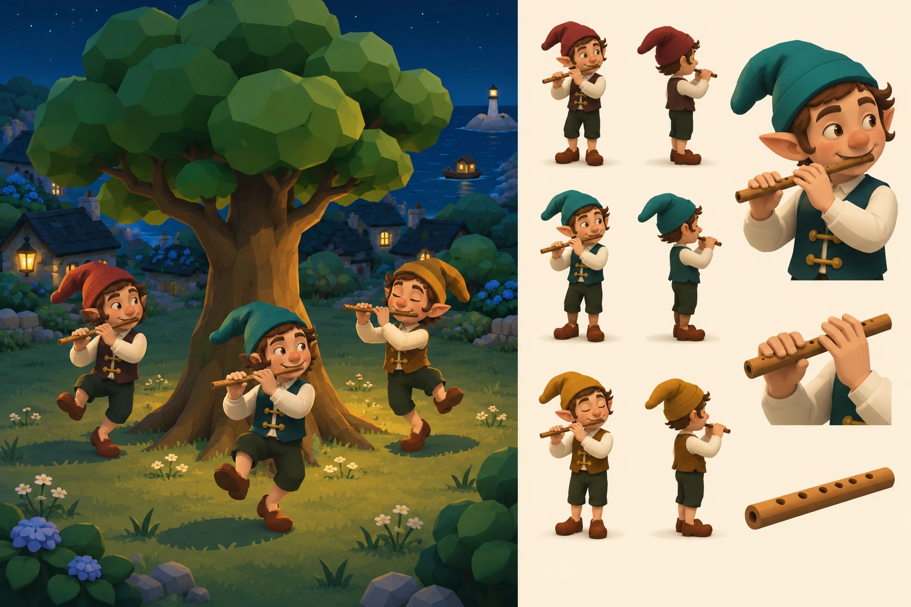
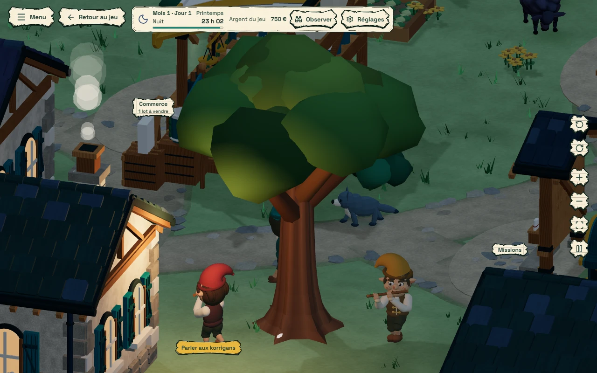

# Le marché nocturne des korrigans

### Trouver la ronde

Dans le Quartier, la nuit commence à 21 h de jeu et finit à 5 h. « Observer » puis « La ronde des korrigans » cadre le chêne. Le panneau fixe « Parler aux korrigans » donne accès au marché à la souris, au toucher ou au clavier. La clairière et l’arbre restent en place à l’aube. Les trois danseurs ont des bonnets garance, bleu canard et ocre, des gilets à attaches de laiton et des flûtes traversières.

La [planche ImageGen](reference.webp) a été réalisée à partir des captures du Quartier `output/village-calendar/nuit.png` et `output/village-npcs/sonneur-marche.png`. Elle sert de référence aux géométries Three.js, aux couleurs et à la prise des instruments. La ronde est silencieuse.

| Planche de modélisation | Capture de la ronde en jeu |
|---|---|
|  |  |

[Détail des flûtistes en jeu](ronde-detail.webp) · [Ronde sur mobile](ronde-mobile.webp) · [Machine sur ordinateur](machine-ordinateur.webp) · [Bilan sur mobile](machine-mobile.webp)

### La machine au bonnet rouge

Sous le chêne, Bonnet rouge propose trois tours de levier contre des fleurs sèches. Bonnet bleu s’inquiète pour sa carte épique. Le joueur peut répondre « Je veux voir la machine » ou « Une autre fois ». Les deux lutins reconnaissent aussi une offrande en cours. La réaction au tirage arrive après la révélation et la remise du gain éventuel. [Invitation sur mobile](invitation-mobile.webp) · [Recette du dialogue](../../../output/korrigan-dialogue/navigateur.json)

La façade est une illustration ImageGen du 25 novembre 2026, créée à partir de la capture du marché fournie par Sylvain. La direction retenue associe une enseigne bretonne vue de face, un korrigan au bonnet garance, des fougères gravées, du bois sarcelle et des garnitures en laiton. Le guichet central a été dessiné vide pour recevoir les rouleaux du jeu. La façade détourée est exportée en WebP transparent de 960 × 640 pixels et pèse 133 Kio. [Illustration de la machine](../../../public/placard/ui/korrigan-machine-v1.webp)

Les cinq motifs imprimés des rouleaux partagent une feuille WebP de 720 × 144 pixels et 30 Kio. Le plant et les cartes viennent des onglets Culture, les pièces à la coquille du registre des comptes. Le booster et le dos de carte viennent de la collection Buddies. Les multiplicateurs et le bilan restent du texte. [Motifs des rouleaux](../../../public/placard/ui/korrigan-reels-v1.webp)

Une fois l’offrande confirmée, toucher la poignée ou activer « Lancer le tirage » au clavier déclenche la même commande. Les rouleaux s’arrêtent de gauche à droite à la réception du résultat. « Passer l’animation » garde la demande en cours. La préférence de réduction des mouvements affiche directement le résultat reçu. Les trois voyants du socle et le compteur indiquent les tirages réglés. Quand les lots admissibles sont épuisés, « Voir mes récoltes » ouvre le stock.

Sept parcours ont été joués dans Chrome 157 avec SwiftShader, à 1 280 × 800 et à 320 × 700 en émulation tactile. La vue vide a aussi été reprise à 903 × 576, aux dimensions de la capture d’origine. Une seconde recette sur PostgreSQL local vérifie qu’une coupure après l’écriture de l’offrande laisse un seul prélèvement et trois tirages. [Machine sans lot](offrande-vide-ordinateur.webp) · [Parcours navigateur](../../../output/korrigan-finition/apres/navigateur.json) · [Recette PostgreSQL](../../../output/korrigan-finition/apres/navigateur-postgres.json)

### Offrande et règlement

Le joueur choisit des grammes entiers de fleurs sèches en vrac, mûres, stockées et admissibles à la reprise du CBD shop. La quantité tient compte du reliquat disponible et de la capacité de reprise du canal. Les paquets déjà préparés pour la boutique en ligne sont hors de ce reliquat. Le devis utilise le prix de vente du lot, y compris le bonus de demande applicable et les arrondis du registre.

Le seuil d’entrée est **100 € de reprise en monnaie du jeu**. Au tarif de base de 3 €/g, 33 g valent 99 € et 34 g valent 102 €. Ce minimum réserve les objets de collection aux offrandes qui engagent une quantité significative à l’échelle d’une récolte. Il n’existe aucun palier de chances supplémentaire.

Confirmer inscrit le poids, la valeur totale de reprise **V**, les probabilités et l’échéance dans la session. Le stock est prélevé une fois. Chacun des trois tirages indépendants utilise la table suivante.

| Résultat | Chance par tirage | Paiement ou objet |
|---|---:|---|
| Aucun gain | 85 % | 0 € |
| Monnaie ×5 | 3,20 % | 5 × V |
| Monnaie ×10 | 0,80 % | 10 × V |
| Monnaie ×50 | 0,03 % | 50 × V |
| Buddie épique | 0,02 % | Une instance d’une carte épique active admissible de HEMP_HEROES_2026 |
| Pack Botte du Chanvrier | 10 % | Un pack scellé de 10 cartes |
| Pack Buddies | 0,95 % | Un pack scellé de 3 cartes |

Le pack Botte représente deux tiers des résultats gagnants. Le catalogue compte trois Buddies épiques dans cette sélection, Charlotte’s Web (HH2026-002), Cannatonic (HH2026-003) et Harlequin (HH2026-004). La sélection porte sur les définitions admissibles actives, même si le joueur détient déjà la carte. Les packs se retrouvent à la Maison des cartes et suivent leur ouverture habituelle.

### Effet sur l’économie

La probabilité d’une session blanche est **61,4125 %**. Celle d’au moins une récompense est **38,5875 %**. L’espérance monétaire pour trois tirages est **0,765 × V**. Au seuil de 100 €, cela représente 76,50 € en moyenne pour une vente équivalente de 100 €. Pour 300 € d’offrande, la moyenne passe à 229,50 €. Les chances d’obtenir un objet sont identiques dans les deux cas. Le plus gros paiement d’un tirage est 50 × V et le cumul maximal de la session est 150 × V.

Par session, on attend en moyenne 0,30 pack Botte et 0,0285 pack Buddies. Aux prix catalogue de 5 et 100 points fidélité, cela correspond à 4,35 points de coût catalogue moyen, plus 0,0006 Buddie épique direct. Le jeu ne fournit pas de conversion des points en euros de caisse. Pour un joueur assidu à raison de 52 offrandes, l’espérance annuelle est de 15,6 packs Botte, 1,482 pack Buddies et 0,0312 carte épique directe. Ce sont des moyennes mathématiques. Une absence ne rapporte aucune offrande en réserve.

### Simulation reproductible

`node scripts/simulate-korrigan-market.mjs` simule un million de sessions de trois tirages avec la graine `0x51c0ffee`. Le script utilise la table du jeu. Le serveur tire avec le générateur cryptographique PostgreSQL.

| Mesure | Observation |
|---|---:|
| Sessions sans récompense | 614 732 sur 1 000 000 |
| Monnaie moyenne | 0,76237 × V |
| Tirages perdants | 2 551 113 sur 3 000 000 |
| Gains ×5 / ×10 / ×50 | 95 854 / 23 805 / 901 |
| Buddies épiques directs | 582 |
| Packs Botte / Buddies | 299 150 / 28 595 |
| Plus gros cumul observé | 60 × V |

Aucun double jackpot n’est apparu dans cet échantillon. Le calcul exhaustif des 343 suites de catégories donne une probabilité de 0,0000269946 % pour au moins deux jackpots et de 0,0000000027 % pour trois. Les scénarios très rares s’évaluent par ce calcul et par les cas imposés en base de test.

### Sauvegarde

Le calendrier du Quartier part de l’origine de la partie et d’une journée de quatre heures réelles. Le serveur recalcule la phase sous le verrou du stock avec les seuils du même calendrier. Une session acceptée enregistre une échéance indépendante de **604 800 secondes réelles**. L’heure de l’appareil et le calendrier de prévisualisation ne participent pas à la validation.

La clé de confirmation retrouve l’offrande même après épuisement du lot. La paire session et numéro de tirage retrouve le résultat enregistré. Si la remise d’un gain échoue, la base conserve le résultat et réessaie l’attribution. À l’aube, le joueur garde ses tirages payés pour une autre nuit. Une nouvelle offre exige que la session précédente soit terminée et que l’échéance soit passée.

### Recette locale

| Parcours | Vérification |
|---|---|
| Quartier sur ordinateur et à 320 px | Clic, clavier et toucher sur le panneau, ronde en mouvement, PNJ et zones de clic, cadrage, aube à la proposition et pendant le tirage, reconnexion, pause et mouvement réduit |
| Banque, Personnel, Commerce, Missions, Jury et Maison des cartes | 12 scénarios Chromium. Pour chaque salle, la première nuit et le retour à la nuit donnent la même image, après affichage du personnel en journée. Le premier service reste accessible sur le canevas et dans le repli illustré sans WebGL à 320 px |
| Transport et sauvegarde | Dans Chromium, les commandes passent par les gestionnaires Next et la RPC PostgreSQL. Une coupure simulée après l’écriture de l’offrande laisse 65 g sur 100 g. Le joueur retrouve ses trois tirages et une seule échéance de 604 800 secondes |
| Concurrence et inventaire | Deux connexions PostgreSQL, vente CBD concurrente, stock réservé en paquets, double confirmation, double tirage, rejeu après épuisement du lot, attribution en panne puis rétablie |
| Cas rares imposés en base isolée | Deux exemplaires de la même carte épique, ×10, trois ×50 consécutifs crédités à hauteur de 150 × V, refus du quatrième tirage, cinq semaines d’absence sans cumul de sessions |
| Accessibilité du marché | Boucle Tab et Maj+Tab, toucher bloqué derrière l’invitation, refus avec retour du focus, reprise d’une remise en attente à l’aube, bilan de trois pertes |
| Économie | Concordance du devis TS et SQL avec prime aromatique et arrondi cumulé, table exacte des 10 000 intervalles de tirage, simulation et énumération exhaustive des cumuls |

Les commandes de recette sont `node scripts/audit-village-3d.mjs --korrigans`, `node scripts/audit-village-3d.mjs --korrigans-postgres` et `node scripts/test-korrigan-market.mjs`. Les deux parcours PostgreSQL utilisent le cluster local dédié du projet, sélectionné par `KQ_TEST_POSTGRES_CLIENT`. La recette intégrée injecte une identité de test et un adaptateur RPC local. Les captures utilisent Chromium avec SwiftShader et une émulation tactile.

Le point de reprise est la recette sur téléphone physique et sur la préproduction Supabase avec un compte de test connecté. La migration à appliquer lors de cette étape est `20261122001400_kq_korrigan_market.sql`.
