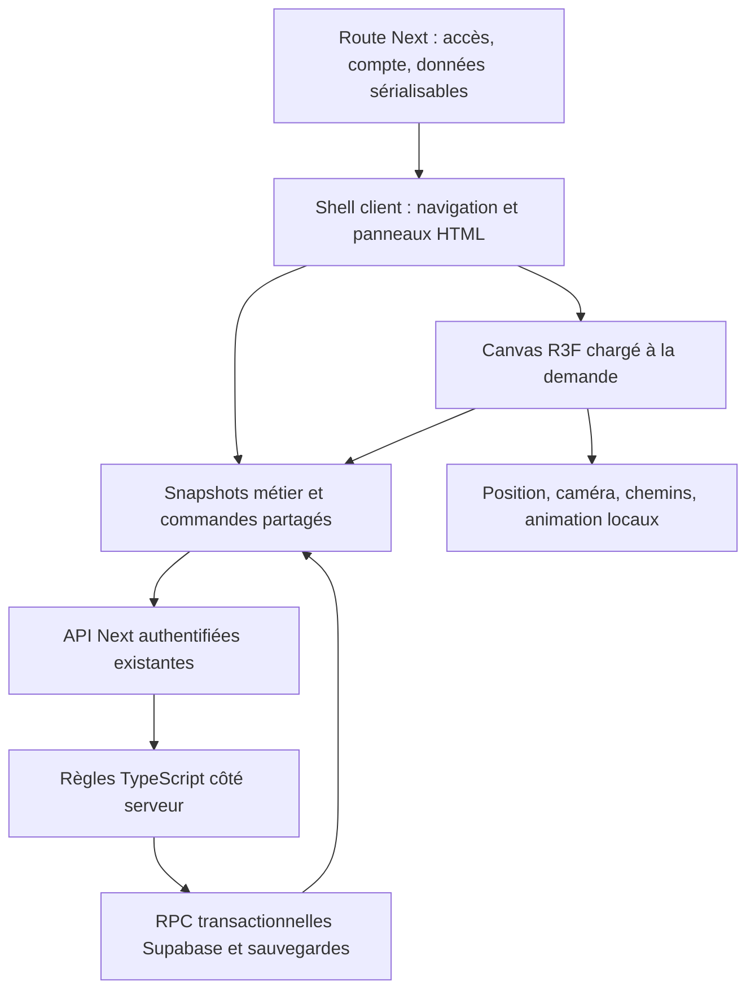

# Étude du Quartier en 3D isométrique

**Verdict : faisable sous conditions.** Les règles, les comptes et les sauvegardes existants permettent de construire un véritable Quartier 3D sans réécrire le jeu ni ajouter un serveur de déplacements. La solution recommandée est une scène **Three.js + React Three Fiber**, principalement procédurale, complétée par quelques ressources artistiques et par les interfaces HTML actuelles. Les conditions sont de préserver l’autorité du serveur, d’extraire progressivement la coordination des écrans, de valider la direction artistique et de mesurer un prototype sur des téléphones réels. Le dépôt ne démontre encore ni ces performances ni le bénéfice joueur.

Étude du **17 novembre 2026**, sur l’arbre local au commit `f87dfd74`, comprenant de nombreuses modifications préexistantes non commitées. Ce rapport décrit cet arbre, pas une version certifiée déployée. Aucun développement de la nouvelle version, changement de dépendance, migration, configuration de compte ou déploiement effectué.

## 1. Couverture, faits et limites

### Méthode et niveau de preuve

- **Fait** : comportement établi dans les sources ou observé pendant cette session. **Hypothèse** : point encore dépendant d’un compte, d’un appareil ou d’un essai. **Proposition** : architecture ou expérience à réaliser.
- **Analysée** : points d’entrée, contrat et conséquences pour la migration examinés ; cela ne signifie pas audit exhaustif de toutes les branches. **Partielle** : structure et raccordements identifiés, détails métier ou exécution incomplets. **Non vérifiée** : aucune preuve suffisante dans cette session.
- Les versions, identifiants et inventaires chiffrés sont des constats documentaires, **mesurés par lecture**. Les performances et volumes futurs portent explicitement la mention **objectif** ou **estimé** ; aucune mesure du futur moteur n’est présentée comme acquise.
- Une cartographie initiale, puis deux missions distinctes exécutées avec `gpt-6.1-sol`, raisonnement `high`, via les outils disponibles : rendu/performance et game design/UX. Aucune sous-délégation. Backend, sauvegardes, coûts, essais et synthèse traités par l’agent principal.
- `AGENTS.md` et le début pertinent de `docs/bete-de-concours/ux-progress.json` ont été lus. L’audit antérieur `docs/audit-global-jeu.md` a servi d’index ; ses anciens résultats ne sont pas attribués à cette session. Pas de relecture de chaque fiche encyclopédique ou question.

Chemins abrégés dans les tableaux : **UI** = `src/components/placard/`, **C** = `src/components/contest/`, **L** = `src/lib/`, **DB** = `src/lib/supabase/`, **API** = `src/app/api/arena/placard/`. Les symboles sont préférés aux numéros de ligne dans cet arbre en cours de modification.

### Socle observé

| Élément | Fait établi | Conséquence |
|---|---|---|
| Framework | `package.json` : Next **16.4.6**, React/React DOM **19.2.3**, TypeScript, App Router | Conserver le site Next et ses routes serveur ; ajouter une application graphique cliente à l’intérieur |
| Outils | npm et `package-lock.json`, Vitest, ESLint, Vite pour des bancs d’essai, Lighthouse, Chrome Launcher, analyseur de bundle | Une grande partie de l’outillage de vérification existe |
| Rendu actuel | WebP, SVG/HTML/CSS et canvas 2D ; `@3d-dice/dice-box-threejs` **0.0.12** pour les dés, GSAP | Il existe des dés 3D, pas un monde parcourable avec collisions |
| Entrée | `src/app/arene/placard/page.tsx` → `ArenaGameEntry` → `QuarterCharacterGate` → `PlacardPlayerShell` | Préserver accès conditionnel, session, consentement et création du personnage |
| Navigation | `PlacardPlayerShell`, `PlacardView`, paramètres `view`, `zone`, `run`, lot/Fleur, provenance et retours ; imports dynamiques | Les destinations sont déjà des contrats utiles, au-delà des boutons visibles |
| Données | API Next authentifiées, services TypeScript et RPC PostgreSQL via `createSupabaseServiceClient` | La 3D n’a pas besoin d’un accès direct aux tables |
| Hébergement | `vercel.json` contient les tâches planifiées crypto/activité en ligne ; `next.config.ts` prépare le déploiement et les images Supabase | Intégration Vercel/Supabase établie ; offres et réglages réels non établis |

La boucle principale est : **aménager → préparer une culture → arbitrer les étapes, cartes, incidents et travail → récolter et préparer les lots → jury, transformations et commercialisation → réinvestir**. Collections, missions, carrière, personnel, QuizzShow et compétition donnent des objectifs parallèles. Les contrats de défi restent implémentés mais leur accès dans Missions est actuellement masqué. Les dépenses récurrentes, les échéances et les traitements différés ne doivent pas devenir dépendants du temps passé dans la scène.

### Matrice de couverture

| Fonctionnalité identifiée | Couverture | Preuves principales et limite |
|---|---|---|
| Framework, routes, chargement | Analysée | `package.json`, `next.config.ts`, page `/arene/placard`, `PlacardPlayerShell` ; guides Next locaux |
| Compte, accès bêta/public, introduction | Analysée | `L/customer-backend.ts`, `L/kanab-quest-player-access.ts`, `…player-request-access.ts`, `C/ArenaGameEntry.tsx` ; réglages distants non vérifiés |
| Quartier et navigation contextuelle | Analysée | `UI/KqPlacardMap.tsx`, `…geometry.ts`, `…scene.ts`, `PlacardPlayerShell` ; carte distincte de `C/ArenaWorldMap.tsx` |
| Personnage, apparence et spécialité | Analysée | `C/QuarterCharacterGate.tsx`, `ChanvrierAvatar.tsx`, `L/arena-chanvrier.ts`, `getChanvrierAppearance` ; pas de modèle 3D existant |
| Tutoriel, Loïc, aide et reprises | Analysée | `UI/KqFarmGuide.tsx`, `KqTutorialApiContext.tsx`, `L/kanab-quest-farm-persistence.ts`, `…farm-progress.ts` ; guide attaché en partie au DOM |
| Culture, étapes, dés, incidents, récolte | Analysée | `L/kanab-quest-game.ts`, `KQ_STAGES`, `applyKqRunAction`, `DB/kanab-quest-backend.ts`, `UI/KanabQuestDicePrototype.tsx` ; cycle connecté complet non joué |
| Soins, santé et produits | Partielle | `UI/KqCultureCarePanel.tsx`, `L/kanab-quest-care.ts`, routes `care` et `runs/[runId]/care` ; activation du soin distincte de son effet à la résolution |
| Buddies, Botte, Héritages, decks, packs | Partielle | `KQ_COLLECTIONS`, `UI/KqDeckPreparation.tsx`, `KqBotteCollection`, `KqSupportBoosterShop`, `DB/kanab-quest-backend.ts` ; effets et tirages non revérifiés un par un |
| Entrepôt, zones, plan, capacité et équipement | Analysée | `L/kanab-quest-warehouse.ts`, `KqWarehouseState`, `getKqWarehouseDimensions`, `API/warehouse/route.ts`, `UI/KqWarehouseEntry` ; coexistence de plans historiques et récents |
| Campagnes, cultures liées et productions multiples | Partielle | `startKqPlayerRun`, `applyKqPlayerRunAction`, `L/kanab-quest-campaign.ts` ; chef de campagne et membres à respecter |
| Énergie, bâtiment, sécurité, entretien et usure | Partielle | `L/kanab-quest-energy.ts`, `…equipment.ts`, imports du moteur, `UI/KqCultureEquipmentWear` ; équilibrage non refait |
| Travail du joueur et disponibilité | Analysée pour le raccordement | `API/runs/[runId]/actions`, `…/work`, `rpc_kq_roll_culture_step`, `UI/KqPlayerWorkStatus` ; planning complet partiel |
| Personnel, recrutement, compétences, paie, délégation | Partielle | `L/kanab-quest-staff.ts`, `applyKqStaffCommand`, `advanceKqStaff`, `UI/KqStaffDesk` ; effets différés et toutes formes de contrat non rejoués |
| Séchage, trim, affinage, contenants, débordement | Partielle | `L/kanab-quest-storage.ts`, `API/storage`, `UI/KqHarvests`, `KqWarehousePostHarvest` ; durée réelle et absence longue non simulées |
| Transformations, machines et rendements | Partielle | `L/kanab-quest-economy-balance.ts`, `UI/KqWorkshopMachineDialog`, `KqWarehousePostHarvest` ; inspection des contrats, pas de nouvelle analyse de marge |
| Commerce, canaux, prix, stock et ventes | Partielle | `L/kanab-quest-commerce.ts`, `quoteKqCommerce`, `API/commerce`, `UI/KqMarketDesk` ; chaîne transactionnelle non exécutée |
| Demande clients, publicité, marque, site et produits dérivés | Partielle | `UI/KqCustomerDemandDashboard`, `KqOnlineBusiness`, `L/kanab-quest-customer-demand.ts` et modules `…releve-merch` ; cartographie via vues et imports |
| Contrats initiaux et renouvelables | Partielle | `API/contracts`, `contracts/board`, `L/kanab-quest-contracts.ts`, `…renewable-contracts.ts` ; accès masqué dans `KqMissionCenter`, confirmé par `ux-progress.challengeContractsHidden` ; règles détaillées non rejouées |
| Comptabilité, trésorerie, factures, banque et reprise de transaction | Partielle | `UI/KqTreasuryDesk`, `KqBankLoans`, `KqFinanceRecovery`, `API/bank`, `L/kanab-quest-finance-recovery.ts` ; pas d’opération financière effectuée |
| Crypto, bourse et ordres différés | Partielle | `API/crypto`, `API/stocks`, `vercel.json`, modules correspondants ; fournisseurs, cours et activation en production non vérifiés |
| Réseaux et sponsors simulés | Partielle | `L/kanab-quest-social.ts`, `applyKqSocialCommand`, `UI/KqSocialNetworks` ; ne constitue pas un chat de joueurs |
| Jury, Fleurs, duels humains et entraînement bots | Partielle | `API/flowers`, `battles`, `bot-battles`, `L/kanab-quest-battle.ts`, services `kanab-quest-backend` ; aucune rencontre réelle jouée |
| Missions, progression, carrière et épargne du personnage | Partielle | `UI/KqMissionCenter`, `L/kanab-quest-mission-progression.ts`, `chanvrier-career.ts`, `chanvrier-savings.ts`, API `chanvrier/savings` ; validations historiques non reprises comme mesures |
| QuizzShow et tournoi partagé | Analysée structurellement | `UI/KqSchool.tsx`, `KqSchoolTournament.tsx`, `L/kanab-quest-school-tournament-server.ts` ; interrogation HTTP périodique, pas de parcours multi-comptes effectué |
| Encyclopédie, thèmes, recherche et sources | Analysée structurellement | `UI/KqCannabisReference`, `L/kanab-quest-cannabis-reference.ts`, `loadCannabisReferenceCatalog` ; catalogues chargés à la demande, contenu éditorial non réaudité |
| Banque de questions et ancien quiz | Analysée structurellement | `L/kanab-quest-hemp-quiz-bank.ts` marqué `server-only`, corrections/ajouts/retraits par identifiant ; `API/school/_retired-quiz.ts` renvoie vers le tournoi, ancien solo retiré |
| Classements, profils et récompenses | Partielle | routes `rankings`, `/arene/profils/[pseudo]`, `DB/arena-customer-rewards-backend.ts`, services de saison ; attribution réelle non testée |
| Arène, carnets de dégustation, concours et avis | Partielle | `/arene`, `/arene/carnet`, `C/ContestArenaPage`, `ContestNotebookPanel`, `ContestTastingBook` ; frontières externes du Quartier, pas à reconstruire en 3D initialement |
| Boutique réelle, commandes et collections du site | Partielle | `DB/kanab-quest-bootstrap-rewards.ts`, `…order-cash-backend.ts`, `…contest-bundle-rewards-backend.ts` ; des commandes peuvent déclencher des récompenses, paiement non exécuté |
| Sauvegarde, reprise, isolation tutoriel | Analysée | `L/kanab-quest-persistence.ts`, `…repository.ts`, `…farm-persistence.ts`, `UI/KqTutorialApiContext` ; restauration distante non testée |
| Graphismes, animations, panneaux et dés | Analysée pour réemploi | `KqPrintedArt`, `KqChapterHeading`, `KqVisuals`, `C/ArenaRetro.module.css`, `UI/KqPhysicsDice`, fichiers de provenance ; pas d’inventaire artistique exhaustif |
| Administration, migrations, saisons et exploitation | Partielle | APIs administrateur et services découverts, SQL ciblé culture/travail, `vercel.json` ; aucune opération administrative exécutée |
| Offres, quotas, sauvegardes opérationnelles, charge et téléphones | Non vérifiée | Pas d’accès aux tableaux de bord, pas de restauration ni de test physique ; aucune capacité simultanée annoncée |

### Exécution locale de cette session

| Vérification | Résultat et portée |
|---|---|
| Environnement | **Mesuré** : `node --version` → `v25.3.0`, `npm.cmd --version` → `11.12.0`. `npm.ps1` est bloqué par la politique PowerShell ; `npm.cmd` fonctionne sans la modifier |
| Démarrage Next | Tentative sur le port proposé **3107** ; Next détecte un serveur existant pour le même dépôt sur **3000**. Serveur existant conservé et utilisé |
| Navigation réelle non authentifiée | Chromium automatisé : `/arene` chargé ; après résolution de l’entrée, `/arene/placard` redirige vers `/compte/connexion?next=%2Farene%2Fplacard`. Aucun compte de test connecté disponible ; un statut HTTP initial réussi ne prouve pas l’accès au jeu |
| Arrivée et personnage | **Mesuré : 13 scénarios réussis**, `node scripts/audit-quarter-character-entry.mjs`, vues **320/1440 px** : récit, création, annulation/reprise, sauvegarde simulée unique, Loïc, guide, erreurs/session/stockage. Capture de la rencontre mobile inspectée |
| Navigation générale isolée | `node scripts/audit-placard-navigation.mjs --clarity-only` : port initial occupé, puis nouvelle tentative avec `NAVIGATION_AUDIT_PORT=3619`. Échec avant le parcours : `ArenaJourneyTour` demande un `CookieConsentProvider` absent du banc d’essai. Aucun scénario validé par ce lancement ; ce résultat n’établit pas un défaut de la page Next complète |
| Autres contrôles | Pas de build, suite globale, charge distante ou modification SQL pour ce livrable documentaire. Le banc d’arrivée utilise des réponses simulées et remplace une partie du shell ; il ne valide pas le jeu complet ni Supabase |

Traces locales : `output/quarter-character-entry/report.json`, `output/placard-navigation/clarity-report.json`, `output/etude-isometrique/local-entry-after-consent.png`. Ces sorties d’analyse ne sont pas des ressources de la future version. L’accès connecté et la remise en état du banc de navigation seront nécessaires avant la recette d’intégration.

## 2. Expérience proposée

### Un Quartier personnel relié aux fonctions partagées

**Proposition :** commencer par une carte personnelle. Le personnage traverse son Quartier ; sa ferme représente ses zones, son équipement et ses activités. Les lieux communs donnent accès aux duels, aux classements et au tournoi existants. La présence de ces fonctions partagées ne justifie pas de synchroniser les positions de tous les avatars.

La carte actuelle comporte **8 bâtiments pour 12 vues** applicatives, inventaire **mesuré par lecture** de `KqPlacardMap` et `PlacardView`. La Ferme regroupe Culture, Atelier et Récoltes ; Commerce inclut Réseaux. Conserver cette organisation. Les objets intérieurs ci-dessous sont proposés ; ils n’existent pas déjà comme objets 3D. Une maison ou chambre personnelle n’est pas nécessaire pour cette livraison : la grange est le véritable point de départ identifié.

### Parcours concret

Le joueur reprend l’arrivée « Tout commence dans une grange », crée son personnage avec les choix actuels, puis retrouve Loïc devant la porte. La scène indique la prochaine action et permet de rejoindre la grange au clic, au toucher ou au clavier. Un accès HTML « Aménager ma grange » conduit directement au même endroit.

Dans la grange, une zone représente son installation réelle. Le joueur la sélectionne ; une fiche lisible expose culture, étape, santé, travail et coûts disponibles. Il prépare sa culture avec les cartes existantes ou reprend un `runId` existant. Au lancement d’une étape, son personnage rejoint le poste et effectue une courte animation ; l’état reste « en cours de confirmation » tant que le serveur n’a pas répondu.

La réponse confirmée affiche les dés et l’incident. Le joueur choisit ses cartes, résout l’étape et voit le stade des plants évoluer. Après récolte, les lots sont représentés selon leur état et les placements effectivement enregistrés ; un lot non placé reste à ranger. Il peut consulter les quantités, ouvrir le jury ou rejoindre le commerce par un raccourci conservant le lot sélectionné. Une erreur de réseau laisse un état explicite à reprendre ; elle ne transforme pas l’animation en réussite fictive.

### Correspondance fonction → monde → action → interface → réemploi → changement

| Fonction actuelle | Lieu/objet proposé et action | Interface HTML conservée | Code réutilisable | Changement ; bénéfice / complexité estimée |
|---|---|---|---|---|
| Arrivée, profil, spécialité | Porte de grange, Loïc ; discuter et personnaliser | Éditeur, confirmations et aide | `QuarterCharacterGate`, `ChanvrierProfileEditor`, profil `arena-chanvrier` | Avatar et mise en scène 3D ; identité plus présente / forte pour fidélité de toutes les apparences |
| Accueil et prochaine action | Place, enseignes ; choisir un lieu ou reprendre | HUD, mission suivie, destinations rapides | `KqPlacardLobby`, `kanab-quest-hub`, `KqPlacardNavigation` | Lire les mêmes snapshots ; orientation / moyenne |
| Aménagement et équipements | Ferme, plan de travail ; inspecter ou modifier une zone | Plan, devis, catalogue, validation | `KqWarehouseEntry`, `KqWarehouseState`, route `warehouse` | Traduire rectangles/équipements vers géométrie, sans changer les surfaces facturées ; compréhension / forte |
| Culture, cartes, soins et énergie | Tente/plant/poste attaché à `zoneId` et `runId` ; intervenir | Préparation, main, choix de travail, coûts, dés et incident | `KanabQuestDicePrototype`, `KqCultureCarePanel`, moteur `kanab-quest-game`, API `runs` | Extraire commandes et état partagés ; action incarnée / forte, essentielle |
| Récolte, séchage, trim et affinage | Séchoir, établi et contenants ; sélectionner un lot | Stockage, capacité, échéances, confirmation | `KqHarvests`, `KqWarehousePostHarvest`, `kanab-quest-storage` | Projection visuelle des lots et étapes ; chaîne plus compréhensible / moyenne |
| Transformations | Machines réellement possédées ; sélectionner une recette/opération | Rendement, coût, travail, résultat | `KqWorkshopMachineDialog`, services d’atelier | Animations et correspondance machine/lot ; activité visible / moyenne à forte |
| Commerce et demande | Boutique/comptoir/colis ; vendre ou gérer | Canaux, prix, demande, publicité, marque/site/merch | `KqMarketDesk`, `KqOnlineBusiness`, `quoteKqCommerce` | Mise en espace, provenance du lot conservée ; continuité / moyenne |
| Réseaux et sponsors | Poste de communication du commerce ; publier dans la simulation | Choix, audience, énergie, contrepartie | `KqSocialNetworks`, `kanab-quest-social` | Objet d’entrée, sans nouvelle simulation sociale ; repérage / faible |
| Trésorerie, banque, crypto et bourse | Bâtiment Finances, bureau et comptoir ; consulter/signaler un ordre | Registres, factures, contrats, risque et reçus | `KqTreasuryDesk`, `KqBankLoans`, `KqFinanceRecovery`, marchés | Panneaux presque inchangés ; faible bénéfice à tout rendre en 3D / faible si limités à l’accès |
| Personnel et travail | Bureau Personnel, planning ; recruter/affecter | Disponibilités, paie, contrats et semaine type | `KqStaffDesk`, `KqPlayerWorkStatus`, `kanab-quest-staff` | Personnel décoratif rattaché aux tâches confirmées ; compréhension / moyenne ; trajets des salariés plus tard |
| Buddies, Botte, Héritages et packs | Maison des cartes, comptoir et album ; choisir/ouvrir | Collection, inventaire, préparation et ouverture | `KqSupportBoosterShop`, `KqBotteCollection`, services collection | Ne pas transformer chaque carte en mesh ; ambiance / faible à moyenne |
| Jury, duels humains et bots | Salle du jury/table ; présenter une Fleur | Conditions, comparaison, confirmation, verdict | Mode `arena`, services `battles`/`bot-battles`, `KqBattleVerdictDialog` | Première version : accès au panneau ; spectacle ultérieur / moyenne puis forte |
| Missions, carrière et progression | Tableau central et dossier du joueur ; suivre/réclamer | Objectif, preuve, récompense, carrière/épargne | `KqMissionCenter`, `KqPinnedMission`, modules `chanvrier-*` | Déclencheurs confirmés et raccourcis ; cap clair / faible à moyenne. Contrats de défi conservés mais masqués, sans réactivation implicite |
| Encyclopédie, quiz, tournoi et classement | QuizzShow : bibliothèque, pupitre, tableau ; lire/jouer/comparer | Recherche, articles, réponses, scores, compte à rebours | `KqSchool`, `KqCannabisReference`, `KqSchoolTournament`, `KqSchoolRankings` | Garder le tournoi réseau et la banque privée côté serveur ; lieu mémorable / moyenne |
| Carnet, concours, communauté et boutique réelle | Sortie explicite vers l’Arène/le site | Pages existantes | Routes `/arene`, `/arene/carnet`, compte et boutique | Préserver frontières, session et récompenses ; pas de faux magasin 3D ni de paiement implicite |
| Paramètres, accessibilité et aide | Menu HTML permanent ; changer le confort | Réglages, commandes, mode classique | Préférences existantes et nouveaux réglages locaux | Toujours accessible sans déplacement ; essentiel / faible |

### Commandes, lisibilité et progression

| Sujet | Première version essentielle | Plus tard, seulement après validation |
|---|---|---|
| Déplacement | Clic/toucher sur sol praticable ; destination visible et annulable. Flèches et ZQSD/WASD configurables, mouvement relatif à la caméra | Manette ou joystick tactile facultatif |
| Proximité | Cliquer un objet sélectionne sa destination et sa zone d’approche ; « Interagir » déclenche l’action à portée. Une porte attend la fin du déplacement ; aucun paiement automatique en arrivant | Conversations/animations de voisinage |
| Chemins | Contourner obstacles ; destination impossible signalée ; pas de traversée d’un coin de bâtiment. Les raccourcis ne demandent pas de marche | Navmesh pour relief et escaliers si réellement nécessaires |
| Caméra | Orthographique, angle fixe, zoom borné, recentrage. Toit/mur occultant masqué ou atténué, silhouette du joueur repérable | Rotation par angles fixes si les façades et interactions la supportent |
| Animation | Attente, marche, action courte ; animation réduite et interruption propre ; résultat confirmé séparé du geste | Visages expressifs, gestuelle riche, foule |
| Signalisation | Même illustration par destination et en-tête ; enseignes, icônes et libellés HTML ; coûts/prérequis visibles avant confirmation | Signes contextuels plus élaborés |
| Tâches répétitives | Menu permanent, dernière activité, mission épinglée, accès direct zone/lot/run ; pas de déblocage payant du voyage rapide | Favoris personnalisables si les accès actuels ne suffisent pas |
| Progression | Montrer uniquement installations achetées, zones actives, stade confirmé, lots et équipements possédés. Une estimation reste étiquetée comme telle | Variantes de bâtiments et animations de production dérivées des données |
| Tutoriel | Conserver arrivée, Loïc et identifiants d’objectifs ; ajouter des événements de sélection/commande confirmée partagés avec le HTML | Nouveaux chapitres après test d’apprentissage |

Les mètres parcourus ne consomment pas le budget de travail du jeu. Les zones historiques n’ayant pas d’allée restent utilisables : accès depuis leur bord, sélection HTML et vue en coupe. **Ne pas réduire une surface productive sauvegardée pour fabriquer des couloirs.** L’aménagement libre ne doit pas pouvoir enfermer définitivement le personnage ; point de retour accessible et commande de recentrage/déblocage.

Le canvas ne remplace pas la navigation accessible. Les destinations existent aussi en boutons/liens HTML, les panneaux conservent Tab, Échap, intitulé et retour du focus. Le clavier de déplacement est actif seulement lorsque la scène a le focus, jamais dans un champ de formulaire. Les gestes caméra ne doivent pas bloquer le défilement des panneaux. Prévoir lecteur d’écran, contraste, zoom texte, réduction des mouvements et largeur **320 px — objectif de compatibilité**, avec coûts et prochaine action visibles.

Le guide actuel emploie notamment `MutationObserver` et des attributs `data-guide-*`. Un mesh seul ne prouve donc rien au tutoriel. Entrer dans la ferme ne valide pas « enregistrer une zone » ; l’événement doit venir du résultat métier. De même, un entretien active un effet pour une étape : ne pas montrer une guérison instantanée que les règles ne produisent pas.

## 3. Choix du rendu et architecture recommandée

### Les trois approches

| Approche | Résultat et interaction | Maintenance et coût de production | Performance attendue, non mesurée | Avis |
|---|---|---|---|---|
| Vraie 3D surtout générée par code | Relief, occultation et personnage articulé réels ; bâtiments modulaires et caméra cohérente | Peu de modèles à acheter, mais beaucoup de code artistique, de paramètres et de tests visuels ; formes humaines délicates | Moins d’assets possibles, mais génération CPU, compilation shaders et milliers de petits meshes peuvent coûter cher | Faisable pour un diorama stylisé ; ne promet pas la richesse des illustrations actuelles |
| Vraie 3D procédurale + ressources ciblées | Même liberté spatiale, avec silhouettes/textures mieux maîtrisées ; HTML intégré | Modules pour répétitions, petites ressources locales pour l’identité ; nécessite provenance, licence et budget artistique | Meilleur compromis probable ; poids, textures et objets à budgéter | **Recommandée** ; vraie 3D, pas un habillage de la peinture |
| 2,5D isométrique | Images découpées, sprites, parallaxe, profondeur simulée ; collisions toujours à construire | Réemploi plus direct du décor, mais orientations, masques et animations à produire ; une rotation révèle vite les limites | Potentiellement moins de géométrie, mais grandes images/overdraw et mémoire restent coûteux | Comparaison utile ; mode classique actuel préféré comme repli immédiat, sans développer un second moteur |

| Technologie pertinente | Atout pour ce dépôt | Coût/limite | Décision |
|---|---|---|---|
| Three.js direct | Contrôle fin et moteur connu par la dépendance des dés | Synchronisation, cycle de vie et composants à organiser impérativement | Possible, moins adapté au volume d’interface React à conserver |
| Three.js + React Three Fiber | Scène exprimée en composants, intégration React et HTML naturelle ; boucle spécialisée | Discipline sur refs, ressources partagées et frontière React/rendu ; ce n’est pas un moteur de gameplay complet | **Choix recommandé**, stable compatible React actuel |
| Babylon.js | Moteur intégré, outils et systèmes 3D plus complets | Nouvelle organisation impérative/interface ; bénéfice limité pour cette petite carte sans physique lourde | Alternative si le produit devient un jeu autonome beaucoup plus ambitieux |

### Versions et backend graphique

**Proposition de base à verrouiller au début de la réalisation :** `three@0.187.0`, `@react-three/fiber@9.8.1`, types Three correspondants ; `@react-three/drei@10.7.9` optionnel. React/DOM **19.2.3** entrent dans les plages déclarées de Fiber stable (`>=19 <19.4`, Three `>=0.156`). Drei stable déclare Fiber 9, React 19 et Three `>=0.159`. Cela vérifie la compatibilité déclarée, pas un build réalisé dans ce dépôt. Fiber 10/Drei 11 alpha ne font pas partie de la proposition. Sources : [registre Three](https://registry.npmjs.org/three/latest), [release Fiber 9.8.1](https://github.com/pmndrs/react-three-fiber/releases/tag/v9.8.1), [manifeste Fiber consulté](https://raw.githubusercontent.com/pmndrs/react-three-fiber/master/packages/fiber/package.json), [releases Drei](https://github.com/pmndrs/drei/releases), [manifeste Drei consulté](https://raw.githubusercontent.com/pmndrs/drei/master/package.json).

Les manifestes de branche sont évolutifs : revérifier ceux des versions effectivement installées et le lockfile lors du lot initial. Les lectures du registre pour les paquets scoped n’ont pas abouti dans cette session ; les releases et manifestes officiels ont servi de contrôle complémentaire. Aucun paquet ajouté.

**WebGL 2 en première livraison.** Le `WebGLRenderer` de Three moderne ne prend plus WebGL 1 en charge. Tester la création effective du contexte, pas seulement le nom du navigateur. WebGPU ne répond à aucun besoin indispensable ici ; le renderer correspondant demande une initialisation asynchrone et comporte des différences de matériaux et de post-traitement, même avec son repli WebGL 2. L’étudier seulement si un profil réel révèle une limite que cette migration résout. [Three WebGLRenderer](https://threejs.org/docs/pages/WebGLRenderer), [guide WebGPURenderer](https://threejs.org/manual/pages/webgpurenderer), [Babylon WebGPU](https://doc.babylonjs.com/setup/support/webGPU/).

### Organisation proposée

| Couche proposée | Responsabilité | Frontière à tenir |
|---|---|---|
| `/arene/placard/isometrique/page.tsx` | Entrée expérimentale, mêmes gardes d’accès et identité que la route actuelle | Route et nom proposés ; drapeau serveur dédié, sans contourner `isKqPlayerRequestEnabled` |
| `components/placard/world/WorldEntry.tsx` | Composant Client, import dynamique du canvas, chargement et repli | `dynamic(..., { ssr: false })` dans ce wrapper Client, pas dans la page Server |
| `world/WorldCanvas.tsx`, scènes et caméra | Un canvas durable entre ouvertures de panneaux ; extérieur et intérieur chargés selon besoin | Aucun objet Three transmis à travers la frontière serveur/client |
| `lib/kanab-quest-world/scenes/*.ts` | Descriptions de bâtiments, empreintes au sol, entrées, navigation, points d’interaction | Identifiants stables ; géométrie artistique distincte des données économiques |
| `world/procedural/*` et ressources locales | Fabriques de bâtiments, plantes, mobilier, matériaux, avatar | Modules petits, caches explicites, variantes déterministes ; pas de fichier géant |
| `lib/kanab-quest-world/navigation/*` | Projection du pointeur, A*, collisions et transitions | Calcul local, aucune écriture de position en base |
| `lib/kanab-quest-world/adapters/*` | Traduire snapshots entrepôt/culture/profil en objets de scène | Le modèle existant reste canonique ; pas de copie divergente de la partie |
| Contrôleur de session partagé | Snapshots, commandes, invalidation, erreurs, provenance de navigation | Context/store léger et abonnement ciblé suffisent initialement ; pas de nouvelle bibliothèque d’état obligatoire |

Les guides **livrés avec cette version** de Next ont été lus : `node_modules/next/dist/docs/01-app/02-guides/lazy-loading.md`, `…/01-getting-started/01-installation.md` et directive `use-client`. Le premier précise les contraintes de `ssr:false` et du découpage automatique depuis un Server Component. Le chargement du moteur doit rester absent des routes boutique, carnet et compte. L’HTML de chargement, les erreurs et l’accès classique sont disponibles avant le canvas. Référence publique complémentaire : [Next, lazy loading](https://nextjs.org/docs/app/guides/lazy-loading).

### Déplacement, scène et cycle de vie

- Monde sur le plan XZ, caméra orthographique. Angle isométrique strict possible : azimut **45°**, élévation **environ 35,264° — proposition géométrique**, ajustable pour lire la ferme. Pas de rotation libre initiale.
- Raycast du pointeur vers le sol, grille/graphes des surfaces praticables, A*, puis suivi du chemin. Élargir les obstacles du rayon du personnage et empêcher la coupe diagonale des coins. Cliquer un bâtiment cible sa zone d’approche, pas son centre.
- Les polygones de `KqPlacardMap.geometry.ts` sont des silhouettes dans une peinture ; `MAP_ENTRANCES` fournit des destinations utiles, **pas** un navmesh ni des empreintes au sol utilisables directement. Les nouvelles coordonnées doivent être conçues et vérifiées.
- Marche clavier avec collision locale simple et glissement le long des bords. Recalculer après un aménagement confirmé ; replacer sans dommage un avatar dont le point est devenu invalide. Moteur physique général et WebAssembly inutiles pour ce périmètre.
- Positions/orientation/animation en refs dans `useFrame`, delta borné et simulation indépendante du débit d’images. React gère sélection, panneaux, états de chargement et événements discrets ; aucun `setState` de la partie à chaque image. [Conseils R3F](https://r3f.docs.pmnd.rs/advanced/pitfalls).
- Rendu à la demande lorsque rien ne bouge ; animation active pendant déplacement/action ; pause en arrière-plan. Un panneau opaque peut suspendre le monde sans perdre ses données. [R3F, réduction du travail de rendu](https://r3f.docs.pmnd.rs/advanced/scaling-performance).
- Ressources partagées par type, instancing des plantes répétées, caches bornés. À la sortie d’une zone : annuler requêtes obsolètes, chemins, écouteurs, timers et animations ; libérer géométries/matériaux/textures exclusifs, conserver les ressources communes encore utilisées. Retirer un mesh ou libérer un matériau ne libère pas automatiquement ses textures. [Three, nettoyage](https://threejs.org/manual/pages/how-to-dispose-of-objects.html), [cycle des objets R3F](https://r3f.docs.pmnd.rs/api/objects).

### Synchronisation et commandes

Conserver les identifiants `ownerId`, `zoneId`, `runId`, `flowerId`, `lotId`, les versions de règles et la provenance des retours. Les positions sont une préférence locale facultative, séparée de la sauvegarde de partie. Une scène se reconstruit depuis les snapshots ; elle n’est jamais nécessaire pour comprendre la sauvegarde.

Le contrôleur applique le cycle **intention → confirmation/prérequis → commande existante → réponse serveur → snapshot et représentation visuelle**. Une animation peut anticiper un mouvement, jamais un gain, une consommation ou un résultat de dé. Après interruption ambiguë, relire la partie et les reçus disponibles avant toute nouvelle commande ; un timeout ne prouve pas l’échec de la transaction.

`KqTutorialApiContext` offre déjà une abstraction `request/notify/subscribe` et une isolation des exercices. Réemployer ce contrat, mais ne pas confondre ses événements `window` avec du temps réel réseau. Mutualiser les chargements du lobby, du HUD et des panneaux ; ne pas monter une seconde instance métier complète sous la scène. Sur changement de compte, annuler les requêtes et vider les snapshots et préférences propres au joueur.

## 4. Conserver, adapter, reconstruire ; possibilités du procédural

| Conserver | Adapter | Construire |
|---|---|---|
| Authentification, gardes serveur, routes/API métier, règles, RPC, identifiants et reçus | Contrôleur de partie actuellement réparti dans les écrans ; chargements et événements | Scène, caméra, locomotion, navigation et collisions |
| Collection, cartes, données encyclopédiques, questions côté serveur, classements | Panneaux pour ouverture depuis un objet et retours contextualisés | Géométrie du quartier et intérieurs |
| Profils du personnage et portraits | Correspondance apparence → matériaux/modules 3D | Avatar articulé, marche et gestes |
| UI papier, illustrations, tableaux et visualisations utiles | Tutoriel DOM → événements sémantiques, sans effacer sa progression | Budgets graphiques et instrumentation du canvas |
| Sauvegardes et plans de l’entrepôt | Projection du plan sauvegardé, y compris les sols historiques | Manifeste de scène et repli graphique |

Le fichier `KanabQuestDicePrototype.tsx`, malgré son nom, orchestre une grande partie du jeu actuel : préparation, sauvegarde, appels API, étapes, dés, incidents et verdicts. Le réutiliser d’abord comme panneau permet de conserver les règles ; l’extraction doit viser la commande et le snapshot nécessaires au prototype, pas une réécriture préalable de tout ce composant.

### Direction artistique proposée

Un petit village breton en diorama : silhouettes de grange et toitures lisibles, proportions légèrement exagérées, végétation groupée, aplats crème/teal/or/apricot et contours encre discrets. Le personnage doit être reconnaissable à distance avant de posséder des détails de visage. Quelques imperfections contrôlées dans les poutres et volumes peuvent rappeler les illustrations sans ajouter un bruit aléatoire à chaque chargement.

Les panneaux restent conformes aux matériaux existants : `--game-control-art`, palettes/slices/edges et `border-image` avec `fill`, fond/bordure natifs transparents ; panneaux `panel-*-v1.webp`, `--game-panel-art`, `--game-surface-warm`, `KqPrintedArt`, `KqChapterHeading`, `KqVisuals`. Ne pas appliquer des rectangles de contrôle ordinaires sous les contours illustrés. Textes, coûts, unités, erreurs, focus et graphiques restent HTML. Les cartes et dés gardent leur géométrie intentionnelle.

| Élément | Ce que le code peut produire proprement | Limite et ressource ciblée utile |
|---|---|---|
| Terrain et chemins | Plans/faible relief, bordures, pavés regroupés, couleurs par zone | Éviter un maillage par caillou ; petite texture/atlas possible pour retrouver le grain |
| Bâtiments | Modules de murs, toits, poutres, portes et fenêtres aux proportions cohérentes | Enseigne ou façade emblématique dessinée localement si les primitives deviennent trop génériques |
| Mobilier, outils et machines | Étagères, tables, pots, contenants et équipements simples réutilisables | Un modèle pour une machine très reconnaissable peut être moins coûteux que du code spécialisé |
| Plantes et croissance | Tiges/feuilles groupées, variantes déterministes par espèce et stade confirmé | Pas une feuille-mesh unique multipliée sans limite ; richesse botanique fine et feuillage transparent à mesurer |
| Avatar et personnalisation | Corps articulé stylisé, peau/couleurs, coiffures/accessoires modulaires | Les dessins 2D ne donnent ni dos, ni profil, ni rig ; vêtements, visages et intersections demandent du travail artistique |
| Animation | Marche par rotations articulaires, attente, gestes courts, ressort amorti | Course naturelle, mains/outils et expressions : petit modèle riggé/animations glTF souvent plus efficaces |
| Matériaux et éclairage | Palette limitée, matériaux simples, éclairage doux, ombres de contact simplifiées | Le rendu « dessiné » sophistiqué et les contours temps réel peuvent coûter cher ; les valider à part |

**Tout en code n’est pas automatiquement léger.** Un générateur réduit parfois le téléchargement mais ajoute du JavaScript, du temps CPU, des allocations et une maintenance artistique. Un modèle glTF optimisé et partagé peut coûter moins au chargement qu’une reconstruction procédurale complexe. Comparer séparément octets transférés, temps de génération, temps de compilation graphique, mémoire et qualité. Mettre en cache la géométrie statique ; ne pas régénérer les bâtiments à chaque changement de panneau.

Le prototype peut utiliser un avatar procédural simple et des ressources déjà présentes, sans achat obligatoire. Pour la suite, privilégier une petite ressource locale riggée si elle améliore clairement la fidélité. Conserver les identifiants d’apparence et le portrait complet lorsque certaines variantes n’ont pas encore d’équivalent 3D. Consigner toute ressource externe, licence et transformation dans la provenance, à côté des JSON déjà présents sous `docs/bete-de-concours/`.

## 5. Backend, sauvegardes et échanges entre joueurs

### Autorités et réemploi

| Donnée/action | Autorité | Persistance proposée |
|---|---|---|
| Caméra, position, chemin, animation, survol | Navigateur | Mémoire ; préférence locale facultative par compte et version de scène |
| Panneau ouvert, sélection, brouillon | Interface et navigation existantes | URL/stockage local adapté, garde des brouillons conservée |
| Argent, cartes possédées/consommées, travail, achat, culture, récolte, mission et récompense | API serveur + règles + transactions PostgreSQL | Tables/RPC existantes ; aucun résultat économique calculé comme autorité dans le canvas |
| Tournoi, duels et classement | Services partagés existants | Conserver leurs protocoles ; indépendants de la position locale |
| Présence d’avatars d’autres joueurs | Aucune exigence actuelle | Option ultérieure nécessitant décision produit, protocole, authentification et budget dédiés |

`getCurrentCustomerSessionByBackend("identity")` identifie le joueur côté serveur. `createSupabaseServiceClient` utilise le rôle de service ; sa clé ne doit jamais atteindre le bundle 3D. Les droits de table et l’exécution des RPC restent explicitement limités. Toute future migration devra appliquer les règles `AGENTS.md` : droits nommés dans le même fichier, tables privées révoquées, droits de séquence si nécessaires, pas de rétablissement de droits génériques.

Exemple concret réutilisable : `POST /api/arena/placard/runs/[runId]/actions` vérifie session, action, corps, fréquence et choix de travail. `applyKqPlayerRunAction` charge une culture appartenant au joueur, valide son état, calcule côté serveur et appelle notamment `rpc_kq_roll_culture_step` avec `p_expected_updated_at`. Le SQL `20261108000300_kq_culture_work_steps.sql` verrouille les ressources concernées et réserve l’exécution publique au rôle prévu. Le plan de ferme vérifie aussi `expectedRevision`, `requestKey` et `expectedCostCents` via `saveKqWarehouseLayout`.

Ces protections existent, mais toutes les commandes n’ont pas le même contrat de reprise. Le lancement possède des clés/reçus ; les étapes s’appuient notamment sur phase, étape attendue et version. **Ne pas inventer une clé universelle que les endpoints ne comprennent pas.** Une double interaction, deux onglets, une réponse perdue ou un conflit doivent être testés pour chaque commande raccordée. La proximité de l’avatar est une règle de présentation locale, pas une preuve serveur anti-triche ; les raccourcis HTML disposent des mêmes droits.

### Sauvegardes

`encodeKqSave`/`parseKqGameSave` conservent une enveloppe versionnée et reconnaissent plusieurs générations de règles, d’équipement et de plans. Les positions artistiques ne doivent pas être ajoutées aux états économiques. `KqWarehouseState` contient déjà identifiants, rectangles, équipements et zones de service : les convertir en vue 3D, sans changer leur coût ou leur capacité.

En mode joueur, les cultures et possessions distantes restent canoniques. Le repository local sert aussi aux prototypes/exercices et à leurs journaux ; ce n’est pas une autorisation de réimporter un inventaire local dans une vraie partie. Le tutoriel conserve des données locales par compte via `farmProgressStorageKey` ; ses formats inconnus sont préservés. Il ne possède pas aujourd’hui une synchronisation multi-appareils démontrée. Garder cette limite explicite ou traiter ultérieurement une sauvegarde serveur comme un chantier séparé.

**Premier prototype : aucune migration de sauvegarde nécessaire a priori.** Tester une même partie avant/après passage 2D↔3D, les profils anciens, les plans historiques, les campagnes et les retours via liens. Un drapeau désactivé doit rendre immédiatement le parcours actuel utilisable avec le même état.

La présence de Supabase Pro a été annoncée par le propriétaire, pas vérifiée dans un tableau de bord. Les sauvegardes proposées par Supabase ne démontrent pas qu’une restauration du projet a été testée. La sauvegarde de base n’inclut pas les objets Storage eux-mêmes : prévoir une conservation séparée des ressources qui ne sont pas dans Git et vérifier les besoins de restauration avant toute migration ultérieure. [Documentation Supabase, sauvegardes](https://supabase.com/docs/guides/platform/backups).

### Réseau actuel et futur

Les notifications `kq:*` observées sont des événements locaux. Aucun abonnement Supabase Realtime de déplacement n’a été identifié dans les sources applicatives recherchées. Le tournoi est déjà une activité partagée : `KqSchoolTournament` programme une lecture après **2 s** en salle active ou **15 s** lorsqu’elle est inactive/masquée, constantes **mesurées par lecture** ; la durée de requête s’y ajoute. Le rafraîchissement du chronomètre à l’écran n’est pas une requête réseau.

Ne pas poller `bootstrap` pour animer le village : son GET appelle `reconcileKqBootstrapRewards`, susceptible de régulariser des récompenses de commande. D’autres lectures règlent des activités différées. Un endpoint nommé « snapshot » n’est donc pas automatiquement sans écriture interne. Charger les états nécessaires à l’entrée, invalider après commande, réconcilier au retour d’onglet et aux échéances utiles ; adapter séparément le tournoi.

Un éventuel espace partagé viendrait plus tard, limité à présence/positions éphémères et salons autorisés ; il ne déplacerait pas l’économie vers le navigateur. Il faudrait préciser fréquence, interpolation, déconnexions, modération et fan-out. Aucun nombre de joueurs simultanés n’est déduit de cette étude.

## 6. Les trois configurations nécessaires

### A. Développement et outils Codex

| Élément | Statut | Configuration/pratique proposée, justification |
|---|---|---|
| Windows / éditeur | Déjà présent / à confirmer | Shell Windows observé ; Windows 11 et VS Code annoncés, version d’OS/éditeur non inspectée. Aucun changement d’éditeur nécessaire |
| Node | Déjà présent ; normalisation indispensable avant réalisation | Node **25.3.0 mesuré**, branche arrivée en fin de support selon la source officielle. Proposer **Node 24 LTS**, patch maintenu, commun au poste et à Vercel ; Node 26 LTS possible après vérification des dépendances natives. Pas changé ici |
| Compatibilité Node | Déjà présent | Manifestes locaux vérifiés : Next demande `>=20.9`; Vite installé demande `^20.19 \|\| >=22.12`. Ne pas prendre le minimum de Next comme cible recommandée pour tout l’outillage |
| npm | Déjà présent | **11.12.0 mesuré** via `npm.cmd`; conserver lockfile et version documentée. `npm.cmd ci` dans un checkout de réalisation propre ; ne pas réinstaller arbitrairement l’arbre actuel |
| Moteur | Indispensable à la réalisation | Three + Fiber stables proposés en section 3 ; pas de changement de React nécessaire selon les peers. Types Three correspondants |
| Helpers/physique/état | Optionnel | Drei ciblé ; A* JavaScript et collisions simples suffisent. Rapier, navmesh WASM, store supplémentaire et WebGPU non nécessaires au prototype |
| Lancement | Déjà présent | `npm.cmd run dev`; `npm.cmd run dev:mobile` expose sur le réseau local pour téléphone, avec pare-feu/origines à régler au besoin. Serveur existant à respecter |
| Vérifications de réalisation | Déjà présent | `npm.cmd exec tsc -- --noEmit`, `npm.cmd run lint`, `npm.cmd exec vitest -- run <tests-ciblés>`, puis `npm.cmd run build` au jalon d’intégration ; `npm.cmd run check:supabase-grants` si migration modifiée |
| Mesure du bundle | Déjà présent | `$env:ANALYZE='true'` puis `npm.cmd run build -- --webpack`, comme l’exige l’analyseur installé ; retirer ensuite cette variable de la session. Mesurer aussi la route avec le build de production habituel et `npm.cmd run start` |
| Navigateur automatisé | Déjà présent, reproductibilité à améliorer | Chromium lancé avec Puppeteer Core et Chrome Launcher dans cette session ; scripts existants et captures. `puppeteer-core` se résout localement mais n’est pas déclaré directement dans `package.json` : le déclarer explicitement à la réalisation pour fiabiliser les bancs |
| Inspection et performance | Déjà présent / indispensable | Captures locales, DevTools Performance/Memory/Network, `renderer.info`, Resource Timing et marques applicatives ; Lighthouse aide au chargement, pas à certifier la fluidité de jeu |
| Agents et raisonnement | Déjà présent dans cette session | Deux sous-agents `gpt-6.1-sol`, `high`, missions bornées et sources partagées. Pour des modifications simples, un agent suffit ; pas de frais/tokens inventés |
| Configuration Codex | À confirmer seulement si modification souhaitée | Aucun `config.toml` proposé ni appliqué, version du client non établie. Les options réellement disponibles ont suffi ; ne pas recopier une syntaxe de configuration sans vérifier la version concernée |
| Art et inspection glTF | Optionnel | Blender pour retoucher un petit rig/modèle ; achat d’assets non requis pour le premier prototype. Ajouter un outil seulement si le besoin artistique le justifie |
| Intervention du propriétaire | Indispensable aux validations suivantes | Direction artistique, téléphone(s) de référence, accès à un compte et une base de test identifiés, informations d’usage/facturation, validation avant publication |

La recommandation LTS suit [le cycle officiel Node](https://nodejs.org/en/about/previous-releases). Pour Codex, compétence `openai-docs` consultée : téléchargement du manuel impossible depuis le shell réseau restreint, référence officielle accessible par le navigateur documentaire. Les outils de session prouvent les agents et le terminal disponibles, pas les droits d’une autre installation. [Référence officielle de configuration](https://learn.chatgpt.com/docs/config-file/config-reference).

Codex peut concevoir et implémenter le prototype, adapter les composants, écrire les tests nécessaires, prendre des captures et mesurer un navigateur local. Il ne peut pas déduire les quotas des comptes, reproduire la chauffe d’un téléphone absent ni décider seul si le personnage respecte l’identité artistique voulue.

### B. Appareils des joueurs

| Élément | Statut | Cible et vérification |
|---|---|---|
| JavaScript, WebGL 2 et accélération graphique | Indispensable au mode 3D | Test effectif du contexte ; gestion d’échec et perte de contexte, avec sortie vers le mode classique |
| Navigateurs | À confirmer sur matériel | Chrome/Edge/Firefox maintenus sur ordinateur ; Safari sur macOS/iOS et Chrome Android. Les minima documentés de Next ne garantissent pas la compatibilité GPU |
| Ordinateur courant à GPU intégré | À confirmer | Cible proposée : profil standard, **60 images/s — objectif** ; tester aussi un portable moins puissant avec profil réduit |
| Téléphone intermédiaire | À confirmer | Cible proposée : profil réduit, **30 images/s — objectif**, ombres simples et résolution plafonnée ; contrôle tactile indispensable |
| Petit téléphone/ancien GPU | À confirmer | Chauffe, mémoire, lisibilité et perte de contexte peuvent imposer le mode classique ; aucune quantité minimale de RAM inventée |
| Niveaux graphiques | Indispensable | Réduit/standard, choix manuel conservé ; démarrage prudent sur mobile, ajustement de résolution sous contrôle. Pas de détail métier supprimé avec la qualité |
| Repli | Indispensable | Parcours HTML illustré existant et mêmes sauvegardes ; accessible avant le chargement 3D, après erreur et depuis les réglages |
| Accessibilité | Indispensable | Navigation HTML complète, clavier, lecteur d’écran, zoom, réduction des mouvements et largeur **320 px — objectif** |
| Matériel de recette | À confirmer avant minima publics | Portable Windows à GPU intégré, appareil Apple Safari, Android intermédiaire, téléphone plus ancien si cette population est visée ; noter modèle, OS, navigateur, résolution et état thermique |

Une émulation de largeur ou de CPU dans Chromium ne remplace pas Safari mobile, un écran tactile réel, la mémoire partagée ni la chauffe. Fixer la configuration minimale seulement après ces essais.

### C. Hébergement

| Élément | Statut | Conservation/changement et coût |
|---|---|---|
| Next sur Vercel | Déjà présent dans la configuration ; compte à confirmer | Garder routes, fonctions, domaine et CDN. La scène s’exécute chez le joueur, sans serveur GPU |
| Supabase Auth/PostgreSQL | Déjà présent | Conserver compte, règles, tables, RPC et identifiants ; pas de nouveau projet obligatoire pour héberger la 3D |
| Supabase Pro annoncé | À confirmer | Vérifier offre réelle, taille de calcul, région, stockage, quotas, facture et options ; l’annonce utilisateur ne renseigne pas ces réglages |
| Fichiers du monde | Indispensable | Ressources statiques versionnées dans `public/placard/world/` ou chemin décidé au prototype ; cache CDN adapté. Conserver les exclusions de tracing pour éviter leur duplication dans les fonctions |
| Storage Supabase | Déjà intégré, usage supplémentaire optionnel | Utile pour ressources gérées dynamiquement ; inutile d’y déplacer systématiquement les assets statiques du dépôt |
| Préproduction et données de test | Indispensable avant raccordement réel | Preview protégée ou environnement local avec base isolée ; éviter que la preview partage sans contrôle les écritures de production. Coût d’une branche/projet séparé à vérifier avant création |
| Cron | Déjà présent | Conserver tâches actuelles ; aucun cron pour marche, caméra ou plantes décoratives |
| Realtime / serveur de salons | Optionnel, différé | Aucun ajout pour une carte personnelle. Étude distincte si avatars partagés demandés ; pas d’abonnement supplémentaire recommandé aujourd’hui |
| Suivi erreurs/usage | Déjà présent dans le code, activation à confirmer | Sentry et Vercel Analytics configurés ; vérifier ingestion, sourcemaps, consentement et rétention. Mesures locales possibles sans nouvel abonnement |
| Sauvegarde/restauration | À confirmer ; validation indispensable avant migration | Vérifier restauration de base et conservation des objets Storage. PITR est une option à décider selon le besoin de reprise, pas une condition automatique du rendu 3D |
| Informations manquantes | À confirmer | Régions Vercel/Supabase, runtime Node, Fluid Compute, quotas et alertes, utilisateurs actifs/sessions, trafic froid, poids actuel, pics d’activité, appels/API, latences et restauration testée |

## 7. Risques, objectifs de performance et coûts

### Risques qui peuvent changer la décision

| Risque | Conséquence | Réponse / point de décision |
|---|---|---|
| Identité graphique perdue | Un village générique pourrait être moins agréable que la carte actuelle | Valider une grange et un personnage avant extension ; ressource hybride si le procédural échoue |
| Marche répétitive | Plus de temps pour les mêmes tâches | Mesurer la reprise d’une culture avec/sans scène ; raccourcis disponibles dès le départ |
| Double état métier | Solde, étape ou inventaire contradictoires | Un contrôleur partagé ; snapshots serveur canoniques ; tests de double entrée et retour classique |
| Actions et sauvegardes hétérogènes | Répétition d’une dépense après réponse perdue | Respect du contrat existant, lecture de réconciliation, tests ciblés ; pas de retry économique aveugle |
| Plans sans allées, anciennes sauvegardes | Avatar bloqué ou surface productive altérée | Pas de modification économique des plans ; sélection accessible, zones d’approche et retour sûr |
| Ancien moteur des dés | Duplication de Three, contextes GPU et allocations | `dice-box-threejs` embarque **Three r143** dans son bundle ; un `npm dedupe` ne suffit pas. Conserver le contrat de résultats, avec dés légers ou rendu réimplémenté dans le canvas moderne ; le DiceBox ancien ne se branche pas tel quel sur ce renderer. Mesurer tout maintien du moteur historique |
| Nettoyage des dés/ressources | Croissance mémoire lors de parties longues | `KqPhysicsDice` libère son renderer, mais `clearDice()` de la dépendance ne démontre pas un nettoyage complet des géométries/matériaux. Contrôler explicitement les allocations et les ouvertures répétées |
| CSP et décodeurs | Chargements de worker/WASM bloqués | `middleware.ts` ne prévoit pas `wasm-unsafe-eval` ni workers `blob:` ; éviter ce besoin initial, valider précisément la CSP si Draco/KTX2/physique sont ajoutés |
| Mobile réel | Chauffe, batterie, lenteur ou crash mémoire | Qualité réduite, résolution adaptative, pas d’effets coûteux, repli immédiat et mesures physiques |
| Banc de navigation incomplet | Régressions d’interface invisibles | Réparer son montage du consentement lors du lot de réalisation, avant d’en revendiquer les résultats |
| Production différente de l’arbre local | Fonctions ou migrations manquantes | Comparer code, migrations appliquées et flags avant préproduction ; conserver les travaux non committés existants |

### Budgets initiaux à valider

Tous les chiffres de ce tableau sont des **objectifs proposés**, jamais des performances obtenues.

| Mesure | Objectif initial | Protocole / décision |
|---|---|---|
| Temps avant de pouvoir jouer | **≤5 s**, cache froid, appareil cible, réseau contrôlé ; partie authentifiée et actifs essentiels prêts | Marque entre demande d’ouverture et avatar commandable avec action métier disponible ; mesurer séparément authentification et données |
| Transfert initial du mode 3D | **≤5 Mo compressés** pour moteur, scène initiale, avatar et UI nécessaires | Total réellement transféré, ventilé JS/images/modèles/données ; ne pas compter uniquement les modèles. Budgéter aussi le delta face au mode classique |
| Scène suivante | **≤2 s** après porte avec ressources préchargées, sur appareil cible | Transition sans écran bloqué ; rendre l’état de chargement et garder le retour possible |
| Fluidité ordinateur | **60 images/s**, frame p95 **≤16,7 ms** après chauffe des shaders | Marche, occultations et action représentatives ; distributions de frames, pas seulement moyenne |
| Fluidité mobile | **30 images/s**, frame p95 **≤33,3 ms** | Téléphone réel, session d’au moins **10 min** ; noter baisse liée à la chauffe |
| Profil graphique mobile | **≤150 appels de dessin**, environ **150 000 triangles visibles**, DPR initial **1 à 1,5** | Budgets diagnostiques, pas garantie : transparence, ombres et shaders peuvent dominer |
| Mémoire/stabilité | Pas de croissance monotone après **20 allers-retours** de zone/panneau ; variation stabilisée **≤10 %** après nettoyage comparable ; session **30 min** sans crash/perte de contexte non récupérée | Mesurer heap quand disponible et ressources Three ; la mémoire GPU totale n’est pas mesurable uniformément, donc ne pas annoncer un plafond global fictif |
| Déplacement réseau | **0 écriture et 0 requête liées aux pas** | Trace réseau pendant marche seule ; exceptions des systèmes déjà actifs identifiées séparément |
| Quartier inactif | Au plus **1 rafraîchissement agrégé/minute** hors échéance utile, commande et tournoi ; **0 polling périodique ajouté** en onglet caché | Relecture au retour ; ne pas utiliser `bootstrap` comme endpoint de polling |
| Commande métier | Réponse p95 **≤1,2 s**, hors upload/traitement distinct | Mesurer API et temps serveur, tester lenteur/conflit/perte de réponse ; reprendre le budget existant du script de charge comme cible à discuter |
| Accessibilité visuelle | Fonctionnel à **320 px**, clavier et zoom texte | Scène et alternative HTML ; coûts, erreurs et confirmation sans masquage |

Optimisations prioritaires : chargement par zone et par panneau, partage des ressources, instancing de végétation, matériaux simples, textures limitées, lumière principale unique, ombres simplifiées et absence initiale de bloom/SSAO. Les détails fins sont optionnels ; les quantités, états et actions ne le sont pas. Tester rendu réduit/standard, contexte perdu, reprise d’onglet, ouverture des dés et sortie de la route.

Le réseau du scénario de chargement doit être documenté, par exemple **10 Mbit/s et 80 ms RTT — paramètres de test proposés**, puis remplacé/complété par les conditions du public cible. Faire plusieurs parcours froids et chauds en build de production ; publier distributions, erreurs et configuration exacte. Les captures de cette étude en développement ne fournissent aucune référence FPS/poids de production.

### Impacts sur Supabase et Vercel

La hausse principale attendue vient des fichiers livrés et de l’éventuelle multiplication des chargements métier, pas du nombre d’images rendues. Les appels CPU de génération et le GPU de la scène sont sur l’appareil. La base continue à payer le coût des transactions, lectures, fonctions et régularisations existantes.

| Poste | Modèle d’évaluation et action |
|---|---|
| CDN du monde | **Estimation à construire** : sessions à cache froid × octets initiaux + ressources de zones non déjà en cache. Éviter de recharger les mêmes assets à chaque ouverture d’un panneau |
| API Vercel | **Estimation à construire** : entrées × appels d’entrée + commandes + lectures de réconciliation + polling réellement actif. Mesurer CPU, mémoire occupée, invocations et transfert selon l’offre réelle |
| Supabase | Mesurer requêtes/RPC par endpoint, contention et taille des réponses ; une requête HTTP peut provoquer plusieurs opérations SQL et des écritures de régularisation |
| Tournoi existant | À intervalle nominal sans latence, **environ 30 lectures/minute active ou 4/minute inactive — estimé à partir du code**, pas charge mesurée. Le monde ne doit pas multiplier les instances de ce composant |
| Ressources Storage | Seulement si de nouveaux assets y sont hébergés : stockage et transfert sortant ; ne pas compter ces fichiers comme inclus dans la sauvegarde de base |
| Temps réel éventuel | Connections, messages émis et messages livrés aux destinataires ; coût de diffusion pouvant croître avec la taille des salons. Hors prototype |
| Développement/maintenance | Coût principal probable : art, intégration, accessibilité, tests physiques et entretien de deux parcours pendant la transition. Aucune durée ou facture prétendument calculée sans périmètre validé |

Les postes de facturation sont documentés publiquement, mais les montants de ce projet restent inconnus : [Vercel Fluid Compute](https://vercel.com/docs/functions/usage-and-pricing), [Supabase egress](https://supabase.com/docs/guides/platform/manage-your-usage/egress). Ne pas conclure qu’un abonnement suffit à une charge particulière sans ses mesures et limites.

Pour un futur espace partagé, ne pas s’appuyer sur l’ancienne affirmation générale « Vercel ne supporte pas les WebSockets » : Vercel annonce leur disponibilité générale depuis octobre 2026. Cela ne démontre ni un serveur de jeu persistant adapté, ni un coût acceptable pour ce projet ; vérifier limites, durée et architecture au moment du besoin. [Annonce officielle Vercel](https://vercel.com/changelog/websocket-support-is-now-generally-available).

Avant toute projection de capacité : comptes de test distincts, environnement identifié, mix représentatif culture/commerce/tournoi, montée en charge progressive, latences p95, erreurs, verrouillages SQL, CPU et trafic, puis comparaison aux usages/factures. `scripts/load-test-arena.mjs` et `scripts/load-test-placard.mjs` existent ; leur simple présence n’est pas une preuve de capacité et ils n’ont pas été exécutés ici.

## 8. Migration progressive et premier prototype

### Lots et critères de passage

| Lot | Objectif et dépendances | Difficulté estimée | Critère de réussite |
|---|---|---|---|
| Cadrage de réalisation | Choisir appareils, profil artistique et données de test ; préserver/séparer les travaux locaux existants | Faible à moyenne | Périmètre, versions et environnements identifiés, aucun doute sur la base utilisée |
| Socle expérimental | Route séparée sous drapeau, wrapper Client, chargement/repli, budget et instrumentation ; normaliser Node/dépendances | Moyenne | Build, CSP et chargement isolé ; moteur absent des autres pages ; mode classique immédiatement accessible |
| Prototype représentatif | Petit monde, avatar, chemins/obstacles, lieux et une étape de culture réellement raccordée | Forte | Critères ci-dessous remplis ; décision de continuer ou de revoir art/rendu |
| Ferme complète | Adapter plan réel, campagnes, équipement, récolte, stockage et atelier | Forte | Sauvegardes anciennes/récentes, capacité et coûts identiques ; pas de zone inaccessible ; aller-retour classique fiable |
| Quartier complet | Accès aux bâtiments restants, panneaux, tutoriel et navigation partagée | Moyenne à forte | Toute la matrice de correspondance accessible, mêmes liens profonds et permissions ; pas de marche obligatoire |
| Préproduction | Tests paiements/récompenses si leurs raccordements changent, mobile physique, charge contrôlée et restauration | Forte | Budgets décidés atteints, défauts majeurs résolus, retour arrière testé |
| Activation progressive | Option volontaire puis éventuelle entrée principale | Moyenne | Bénéfice joueur démontré, taux d’erreur et coût surveillés, bascule désactivable sans conversion des parties |

La publication et les accès distants constituent une étape ultérieure. Le rapport ne modifie pas les règles d’ouverture actuellement présentes. Les espaces partagés avec avatars, météo, jour/nuit, physique lourde, personnalisation immobilière libre et animations avancées restent hors des lots essentiels.

### Spécification du plus petit prototype utile

**Proposition : « La cour et la première installation ».** Une petite cour reconnaissable, une porte de grange, un intérieur simple, Loïc, un avatar animé. **Trois points interactifs — objectif de périmètre** : la grange/sa zone de culture, l’établi avec un lot consultable, et le tableau des missions. Les registres correspondants restent HTML ; seule la culture reçoit une action métier complète dans ce premier lot.

Le personnage peut marcher autour d’un obstacle, rejoindre la porte, entrer, approcher une installation, la sélectionner et agir. Une machine d’animation `idle/walk/interact` et un changement visible du plant doivent relier le geste au résultat. Les autres lieux démontrent orientation, ouverture/fermeture et continuité des sélections, sans créer de nouvelles mécaniques économiques.

**Raccordement requis :** utiliser une culture réelle d’un compte de test sur une base isolée, avec état préparé et ressources connues. Charger profil, plan et run via les endpoints existants ; garder une fixture locale pour les essais visuels et d’erreur. Le mode simulé doit être explicitement indiqué et ne peut pas suffire à accepter l’intégration backend.

Séquence métier minimale :

1. Sélectionner la zone liée au bon `runId` ; lire l’étape, l’installation, les cartes et le travail disponible.
2. Choisir le travail ; afficher sa conséquence et les prérequis, en réemployant la présentation actuelle.
3. Déclencher `roll` avec `expectedStageIndex` et `workChoice` via le même contrôleur que l’HTML. Le personnage effectue son geste au poste ; aucun montant ni dé n’est inventé localement.
4. Lire les dés confirmés et l’incident, utiliser les choix/cartes existants, résoudre puis avancer. Les plants et le résumé suivent l’état renvoyé.
5. Fermer le panneau, rouvrir par un raccourci, recharger la page et repasser au mode classique : même culture et même résultat.

Pour éviter deux moteurs graphiques dans ce premier essai, présenter les dés confirmés avec une animation légère ou un composant du canvas moderne. Le moteur économique des dés reste inchangé. La conservation du moteur physique historique n’est acceptable qu’après mesure de coexistence/nettoyage ; sa migration complète n’est pas nécessaire pour prouver le déplacement et l’action située.

### Acceptation et décisions permises

| Critère d’acceptation | Preuve attendue |
|---|---|
| Véritable 3D | Sol, bâtiments et avatar en géométrie ; occultation correcte et intérieur identifiable ; comparaison visuelle validée avec le propriétaire |
| Commandes | Clic, tactile et clavier ; aucun passage à travers obstacle ; destination impossible et annulation gérées ; portes sans blocage |
| Action située | Une étape de culture déclenchée depuis le poste, animation puis conséquence visuelle issue du serveur ; pas seulement des portes ouvrant des panneaux |
| Équivalence métier | Même résultat et droits via HTML et scène ; coûts et travail décomptés une seule fois ; IDs, état sauvegardé et reprise inchangés |
| Résilience | Double clic, réponse lente/perdue, conflit d’étape, session expirée, changement de compte et retour d’onglet ; pas de réussite fictive ni de répétition automatique risquée |
| Compatibilité des parties | Ancien et nouveau plan, profil existant, run déjà commencé ; le prototype peut limiter les campagnes à une consultation explicite, sans les corrompre |
| Accessibilité | Parcours complet sans souris et sans canvas ; panneaux utilisables à **320 px — objectif** ; retour du focus, lecteur d’écran, mouvement réduit |
| Performance | Budget de la section 7 mesuré en build production sur les appareils retenus, détails froid/chaud et limites publiés ; aucun FPS issu de l’émulation présenté comme mobile réel |
| Réseau | Marche sans échanges ajoutés ; endpoints et commandes enregistrés ; aucun secret de service ni réponse privée de quiz dans le bundle |
| Retour arrière | Drapeau désactivé ou contexte graphique indisponible → parcours actuel ; même sauvegarde et aucune opération économique perdue |
| Intérêt joueur | Observation de joueurs découvrant puis reprenant une culture ; vérifier qu’ils trouvent le lieu, comprennent l’étape et choisissent entre marche/raccourci sans aide constante. Critères et échantillon à fixer avec le propriétaire |

Le prototype permet de décider si l’esthétique procédurale/hybride convient, si l’interaction située apporte quelque chose, si les commandes actuelles se raccordent proprement et si la cible mobile est crédible. Il **ne valide pas encore** l’équilibrage général, toutes les apparences, tous les équipements, la restauration de production, toutes les campagnes, la fidélité graphique finale, la capacité multi-joueurs ni un modèle économique d’hébergement à grande échelle.

Si l’art ne convient pas mais les interactions fonctionnent, enrichir quelques ressources plutôt que changer de backend. Si le mobile échoue, réduire scène/ombres/résolution et comparer au repli ; n’adopter la 2,5D qu’après constat d’un compromis matériel ou artistique incompatible avec la vraie 3D voulue. Si la marche n’apporte rien, conserver les actions spatialisées de ferme et réduire l’importance des trajets extérieurs.

## 9. Décisions réellement nécessaires et point de reprise

L’étude peut être conclue sans accès supplémentaire. Avant de développer :

| Décision du propriétaire | Recommandation de départ | Moment nécessaire |
|---|---|---|
| Style et fidélité du personnage | Diorama 3D stylisé, portraits actuels conservés, ressources externes ciblées autorisées si utiles | Avant validation du premier visuel |
| Carte personnelle ou avatars partagés | Carte personnelle, fonctions partagées existantes conservées | Avant architecture de présence ; pas bloquant si cette proposition est retenue |
| Appareils prioritaires | Ordinateur à GPU intégré + téléphone intermédiaire, avec mode classique permanent | Avant engagement sur les budgets/minima |
| Compte/base de test | Environnement isolé identifié, capable d’exécuter les RPC actuelles | Avant la première commande persistante du prototype |
| Enveloppe artistique et temps disponible | Premier lot sans achat obligatoire ; arbitrer un petit rig/modèle après comparaison | Avant d’étendre la personnalisation |
| Passage en production | Option volontaire après prototype et préproduction validés | Après réalisation, mesures et revue |

Les informations d’offres, métriques et facturation seront nécessaires pour chiffrer l’exploitation ; elles ne changent pas le constat que les déplacements personnels n’ont pas besoin d’un serveur dédié.

**Point de reprise compact.** Étude terminée, recommandation : vraie 3D hybride, Fiber stable/WebGL 2, logique et sauvegardes existantes, HTML conservé. Preuves nouvelles : code ciblé, sources officielles, entrée Next non authentifiée, scénarios locaux d’arrivée réussis, banc de navigation échoué et limite expliquée. Seul livrable de conception : ce rapport. **Prochaine tâche bornée, distincte :** développer « La cour et la première installation » selon la section 8, après choix des appareils et de l’environnement de test ; aucune extension automatique du périmètre.
